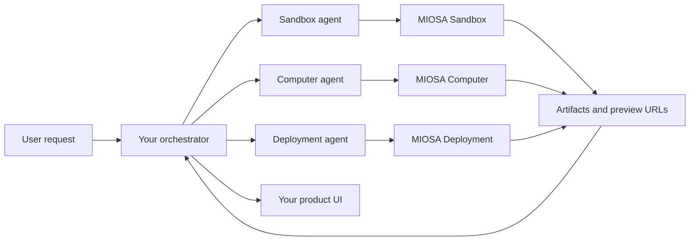
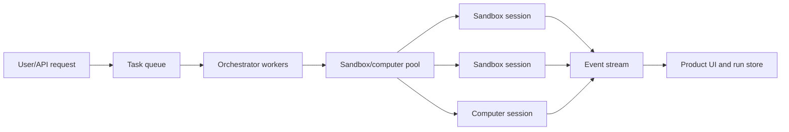

MIOSA lets you build agent systems where different agents use the right runtime
for each part of the job.

- A **sandbox agent** writes code, edits files, runs commands, builds packages,
  generates artifacts, and exposes preview ports.
- A **computer agent** uses a real browser or desktop for visual checks, clicks,
  form fills, screenshots, uploads, and human handoff.
- A **deployment agent** promotes a verified sandbox workspace into a production
  deployment or Docker Host app.
- Your **orchestrator** owns the task graph, model calls, permissions, retries,
  and user-facing progress stream.

The agents communicate through MIOSA-managed state: files, artifacts, events,
preview URLs, screenshots, snapshots, and deployment records.

If you are building an agent-company product, treat this as the platform layer:
agents are configured workers, devices are the execution substrate, connectors
grant tools, and events/artifacts make the work visible to users. See
[What MIOSA agents can do](/docs/guides/agent-capabilities),
[Configure an agent](/docs/guides/configure-agent), and
[Agent devices](/docs/guides/agent-devices) for the product model before
scaling the orchestration layer.

For the end-to-end product blueprint, including Polsia-style company operators,
Cofounder (cofounder.co)-style department agents, Nebula-style virtual devices,
Heuresis-style encoded workspaces, and prompt dispatch into devices, see
[Build an agent-company platform](/docs/guides/build-agent-company).

---

## Scale model: from one agent to thousands

The same primitives work for one agent, one hundred agents, or thousands of
agents, but the orchestration shape changes.

| Scale | Recommended shape |
|---|---|
| 1-10 agents | Direct agent loop creates/resumes sandboxes as needed |
| 10-100 agents | Queue-backed orchestrator with sandbox pools and per-workspace limits |
| 100-1,000 agents | Sharded job queues, regional sandbox pools, scoped tokens, explicit concurrency controls |
| 1,000+ agents | Dedicated tenant capacity, rate-limit contracts, batch APIs, event aggregation, and backpressure |

Do not start 10,000 independent sandboxes just because there are 10,000 logical
agents. Most products should distinguish:

- **Logical agent**: a model/tool loop or task worker in your application.
- **Runtime session**: a sandbox or computer doing actual work.
- **Workspace**: the persistent filesystem, secrets, snapshots, usage, and
  attribution boundary.

Many logical agents can share a queue and borrow runtime sessions from a pool.
Only the agents doing active code/browser work need a running sandbox or
computer at that moment.

---

---

## Mental model

The orchestrator should not make every agent share one messy machine. Instead,
each runtime does the work it is good at and emits durable outputs that the next
agent can consume.

---

---

## Runtime selection

| Job | Runtime | Why |
|---|---|---|
| Write app code | Sandbox | Fast headless Linux workspace with files and exec |
| Install dependencies | Sandbox | Dependency state stays in `/workspace` and snapshots |
| Run tests/builds | Sandbox | Deterministic command execution and streamed output |
| Serve a preview | Sandbox | Expose app ports as preview URLs |
| Inspect a browser UI | Computer | Real browser, screenshots, mouse, keyboard |
| Test signup/login flows | Computer | Cookies, popups, OAuth, uploads, and visual state |
| Generate PDFs/DOCX/images | Sandbox | Python/Node generators produce artifacts |
| Use private local systems | BYOC/OpenComputer | Data, network, apps, or local GPU capacity stays on the customer host |
| Publish production app | Deployment or Docker Host | Stable URL, versions, rollback, routing |

> **Note: Sandbox and Computer are different products**
>
> Do not collapse sandboxes and computers into one concept. Sandboxes are for
> headless code and artifacts. Computers are for GUI/browser work. Orchestration is
> the layer that lets them cooperate.

---

---

## Communication primitives

Use explicit handoffs instead of hidden shared memory.

| Primitive | Producer | Consumer | Example |
|---|---|---|---|
| File | Sandbox agent | Sandbox agent, deployment agent | `/workspace/app/page.tsx` |
| Artifact | Sandbox agent | User, another agent | `proposal.pdf`, `chart.png` |
| Preview URL | Sandbox agent | Computer agent, user | `https://3000-...sandbox.miosa.ai` |
| Screenshot | Computer agent | Orchestrator, LLM | Browser QA finding |
| Event | Any runtime | UI, orchestrator | stdout, stderr, file changed, preview ready |
| Snapshot | Sandbox | Sandbox agent | checkpoint before risky refactor |
| Deployment | Deployment agent | User, support | durable production URL |

The orchestrator should store these as run state so the frontend can replay what
happened and the next agent has a clean input.

---

---

## Queue and pool architecture

For high-scale orchestration, put a queue in front of MIOSA runtimes.

The queue owns backpressure. The runtime pool owns capacity. The orchestrator
owns task assignment. MIOSA owns isolated execution.

Use this pattern when:

- thousands of user tasks may arrive at once
- agents do bursty work
- you need to cap spend
- you need per-customer fairness
- you need reliable retries and dead-letter queues
- users need live progress without polling every runtime directly

---

---

## When to use ADK vs your own orchestrator

Use the [ADK](/docs/adk) when you want MIOSA's built-in tool catalog and a
simple agent loop.

Build your own orchestrator when you need:

- multiple agents with different responsibilities
- product-specific UI events
- custom approval steps
- background jobs and retries
- per-user quotas and billing
- white-label attribution
- durable run history in your product layer

The orchestrator is your product layer. MIOSA is the runtime layer.

---

---

## See also

- [Orchestration patterns](/docs/guides/agent-orchestration/patterns): Prompt dispatch, durable run groups, subagents, sandbox-hosted orchestrators, and permissions.
- [Orchestration examples](/docs/guides/agent-orchestration/examples): Worked flows: app builder with browser QA, sandbox-first code agent, minimal orchestrator shape.
