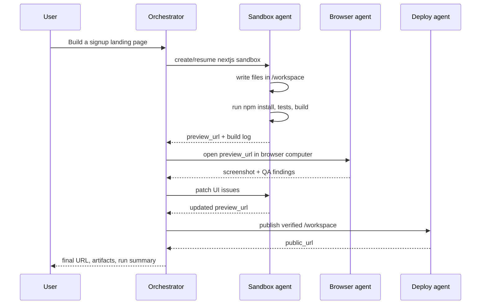

Concrete flows that show the coordination patterns in action, from a full app builder with browser QA down to the minimal orchestrator shape and the UI it feeds.

---

## Example: app builder with browser QA



This is the pattern behind AI app-builder products. The user sees one task, but
the orchestrator splits it across code, browser, and deployment agents.

---

---

## Sandbox-first code agent

The code agent should build inside the sandbox rather than building locally and
uploading only at the end.

```text
get_or_create persistent sandbox
write files under /workspace
run install/build/test inside sandbox
start preview server
stream stdout/stderr to product UI
snapshot after meaningful progress
publish when verified
```

This is the loop that makes MIOSA useful for coding agents.

---

---

## Computer QA agent

Use a computer agent when the output needs visual/browser inspection.

```text
open preview URL
capture screenshot
click through navigation
fill a form
test login or signup
capture errors
return screenshot and findings to orchestrator
```

The browser agent should not edit code directly. It reports findings. The
sandbox agent patches the code.

---

---

## Minimal orchestrator shape

**TypeScript**

```typescript
type RuntimeHandoff =
  | { type: "file"; path: string }
  | { type: "preview"; url: string; port: number }
  | { type: "artifact"; path: string; mimeType?: string }
  | { type: "screenshot"; computerId: string; url: string }
  | { type: "deployment"; url: string; deploymentId: string };

type AgentStep = {
  id: string;
  agent: "sandbox" | "computer" | "deploy";
  status: "queued" | "running" | "succeeded" | "failed";
  input: Record<string, unknown>;
  output?: RuntimeHandoff[];
};
```

**Python**

```python
from typing import Literal, TypedDict

class RuntimeHandoff(TypedDict, total=False):
    type: Literal["file", "preview", "artifact", "screenshot", "deployment"]
    path: str
    url: str
    port: int
    deployment_id: str

class AgentStep(TypedDict, total=False):
    id: str
    agent: Literal["sandbox", "computer", "deploy"]
    status: Literal["queued", "running", "succeeded", "failed"]
    input: dict
    output: list[RuntimeHandoff]
```

---

---

## Product UI pattern

An orchestrated MIOSA product usually has three panels:

| Panel | Shows |
|---|---|
| Chat / task stream | Reasoning summary, tool calls, command output, status updates |
| Workspace / preview | Live sandbox preview, computer desktop, screenshots, logs |
| Artifacts | Generated files, screenshots, PDFs, DOCX, ZIPs, deployment URLs |

Good progress events include:

- plan created
- sandbox created or resumed
- file written
- command started
- stdout/stderr chunk
- command completed
- preview ready
- screenshot captured
- artifact created
- deployment started
- deployment ready

---

---

## See also

- [Agent orchestration](/docs/guides/agent-orchestration): The concepts: scale model, runtime selection, communication primitives, and the queue and pool architecture.
- [Orchestration patterns](/docs/guides/agent-orchestration/patterns): Prompt dispatch, durable run groups, subagents, and permissions.
