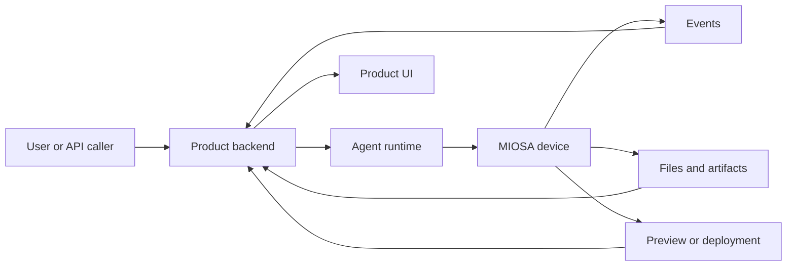

MIOSA lets builders create products where agents do real work in cloud devices.
The product model is deliberately small:

```text
Agent + Device + Tools + Run stream + Artifacts + Credits
```

That model supports simple one-shot commands, generated app builders, browser
automation, artifact workspaces, 24/7 company operators, white-label SaaS
backends, and multi-agent fleets.

Use this page as the canonical vocabulary for products built on MIOSA.

---

## Core primitives

| Primitive | Meaning | Owned by |
|---|---|---|
| Agent | The worker identity: instructions, runtime, model, tools, memory, policy | Your product or MIOSA |
| Runtime | The implementation that reasons and acts: OSA, Codex, Claude Code, Hermes, Pi, custom | Agent configuration |
| Device | The machine where work happens: sandbox, computer, or local device | MIOSA |
| Run | A prompt dispatched to an agent on a device | Your product and MIOSA |
| Session | A long-lived run that can receive more tasks | Agent runtime |
| Tool | A capability: files, exec, browser, connector, deploy, artifact, MCP | Runtime and policy |
| Event | A streamed record of work: tool call, command output, file change, screenshot | MIOSA stream |
| Artifact | A durable output: file, image, PDF, DOCX, report, preview, app URL | MIOSA storage |
| Snapshot | Saved filesystem/device state for resume, fork, or rollback | MIOSA |
| Credits | The metering unit for model usage, device runtime, tools, storage, and hosting | Billing ledger |

> **Note: Do not confuse the runtime with the device**
>
> The MIOSA agent is the reasoning/runtime layer. The device is where work
> executes. A sandbox has an executor, but that executor is not the product agent.

---

## Boundary



Your product backend decides:

- who the user is
- what workspace, project, and budget apply
- which agent should run
- which runtime should power the agent
- which device the agent can use
- which tools and connectors are allowed
- which actions require approval
- how events appear in your UI

MIOSA provides:

- sandbox lifecycle
- computer lifecycle
- local-device pairing
- filesystem and exec APIs
- browser/desktop execution
- previews and routing
- snapshots and persistence
- artifacts and downloads
- deploy and Docker Host
- event streaming
- credit metering hooks

---

## Product categories

- **App builder**: The agent writes code inside a persistent sandbox, starts a preview, fixes
  errors, creates artifacts, and publishes the finished app.
- **Artifact workspace**: The agent creates PDFs, DOCX files, diagrams, images, reports, ZIPs, and
  HTML previews, then stores each output with version history.
- **Browser operator**: The agent uses a computer to click, type, log in, fill forms, inspect pages,
  capture screenshots, and verify workflows.
- **Virtual device product**: Users and agents share persistent devices with files, browser state, jobs,
  previews, connected apps, and recoverable sessions.
- **Agent-company platform**: An orchestrator delegates work to department agents across sandboxes,
  computers, connectors, and scheduled jobs.
- **White-label SaaS backend**: Your platform routes prompts from your users into MIOSA resources while
  preserving your own workspace, project, and billing model.

---

## Product stack

Most MIOSA-powered products have the same layers:

| Layer | Responsibility |
|---|---|
| Product UI | Chat, tasks, files, artifacts, preview, approvals, usage |
| Product API | Auth, tenancy, workspace/project mapping, budgets, policies |
| Orchestrator | Agent selection, runtime routing, device assignment, queues |
| MIOSA devices | Sandboxes, computers, local devices, previews, snapshots |
| Tool layer | Files, exec, browser, connectors, egress, deploy, MCP |
| Event stream | Live progress, stdout, screenshots, artifacts, errors |
| Billing ledger | Credits by model, device, connector, storage, deployment |

The product UI should make the run visible. Users should see what the agent is
doing, not only a final chat answer.

Recommended panes:

- chat or task input
- current plan
- live tool calls
- command output
- file tree or artifact list
- preview/browser panel
- approvals
- credits used
- final outputs

---

## Canonical run shape

```typescript
type AgentRun = {
  id: string;
  tenantId: string;
  workspaceId: string;
  projectId?: string;
  userId: string;
  agentId: string;
  runtime: "osa" | "codex" | "claude-code" | "pi" | "hermes" | "custom";
  device: {
    type: "sandbox" | "computer" | "local";
    id: string;
  };
  prompt: string;
  status: "queued" | "running" | "waiting_for_approval" | "failed" | "completed";
  approvalPolicy: "auto" | "confirm-risky" | "manual";
  idempotencyKey: string;
};
```

Every run should have:

- one owner workspace
- one initiating user or service account
- one selected agent
- one primary device
- one idempotency key
- a typed event stream
- a credit ledger record
- a recovery path if it fails after creating resources

---

## Event stream

The event stream is what makes the product feel alive.

| Event | Purpose |
|---|---|
| `run.queued` | Request accepted and waiting for execution |
| `run.started` | Runtime and device assigned |
| `agent.message.delta` | Assistant text streaming to the UI |
| `plan.updated` | Agent created or changed the task plan |
| `tool.started` | Tool, MCP, connector, or device action started |
| `tool.completed` | Tool completed with result metadata |
| `command.output` | stdout/stderr chunks from exec |
| `file.changed` | File create/update/delete/rename |
| `preview.ready` | Live server URL passed readiness |
| `browser.screenshot` | Computer/browser image captured |
| `artifact.created` | Durable output available |
| `approval.required` | Human approval needed |
| `credits.estimated` | Expected cost for a risky action |
| `credits.charged` | Metering entry committed |
| `deployment.ready` | Public URL live |
| `run.failed` | Typed failure with recovery instruction |
| `run.completed` | Final answer and outputs are ready |

Do not build a product that hides all of this until the end. The visible stream
is how users trust that the agent is working.

---

## What gets billed

Credits should be metered by resource category:

| Category | Examples |
|---|---|
| Model | OSA/model tokens, external model calls, hosted agent runtime |
| Device runtime | Sandbox CPU/RAM time, computer time, local-device relay |
| Tooling | Browser actions, connector token requests, Refero design research, web search |
| Storage | Artifacts, snapshots, persistent workspace storage, logs |
| Deployment | MIOSA Deploy, Docker Host, domains, always-on apps |

This means the user does not need to understand every infrastructure detail.
They buy credits; credits power agents doing real work on devices.

---

## See also

- [Workflow patterns](/docs/guides/agent-workflow-patterns): Simple to complex examples: one-shot runs, sandbox builds, browser work, teams, and fleets.
- [Runtime routing](/docs/guides/agent-runtime-routing): How OSA, Codex, Claude Code, Hermes, Pi, and custom runtimes attach to devices.
- [Credit metering](/docs/platform/agent-credit-metering): Meter model usage, device runtime, tools, storage, and deployments.
- [Build an agent-company platform](/docs/guides/build-agent-company): Map Polsia, Cofounder (cofounder.co), Nebula, Heuresis, and Agentfounder-style products to MIOSA.
