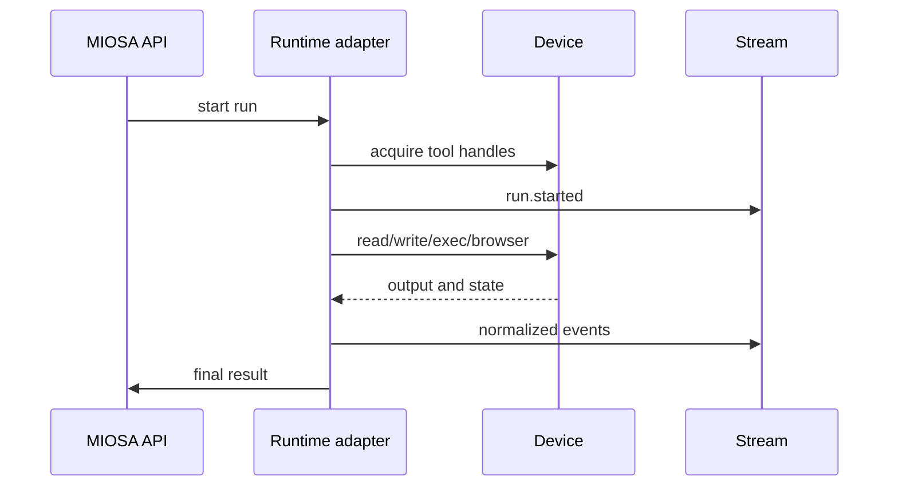

An agent run has two separate choices:

1. **Which runtime thinks and acts?**
2. **Which device executes the work?**

The runtime can be OSA, Codex, Claude Code, Pi, Hermes, Gemini CLI, OpenCode,
or a custom agent harness. The device can be a sandbox, computer, or local
device.

```text
MIOSA Agent = runtime, model, instructions, tools, policy
MIOSA Device = sandbox, computer, or local machine where actions happen
```

---

## Routing contract

```typescript
type RuntimeRoute = {
  runtime: "osa" | "codex" | "claude-code" | "pi" | "hermes" | "gemini-cli" | "opencode" | "custom";
  model?: string;
  deviceType: "sandbox" | "computer" | "local";
  deviceId: string;
  cwd?: string;
  prompt: string;
  tools: string[];
  connectors: string[];
  approvalPolicy: "auto" | "confirm-risky" | "manual";
};
```

The runtime receives:

- prompt
- system instructions
- device tool handles
- connector handles
- allowed environment variables
- approval policy
- budget envelope

The device executes:

- file operations
- commands
- browser actions
- screenshots
- preview servers
- artifact generation
- deployment prep

---

## Runtime choices

| Runtime | Use it for | Notes |
|---|---|---|
| OSA | MIOSA-native general agent, white-label flows, managed products | Default platform runtime |
| Codex | Code-heavy sandbox work, repo edits, tests, CLI-native dev workflows | Best for software engineering loops |
| Claude Code | Code and artifact workflows where Claude Code is the customer's preferred harness | Needs non-interactive session support |
| Pi | Agent harness experiments and AI SDK-compatible streams | Useful when customer ecosystem expects Pi |
| Hermes | Specialized customer agent runtime | Treat as runtime adapter |
| Gemini CLI / OpenCode / custom | Customer-provided runtimes | Must satisfy MIOSA event/tool protocol |

> **Note: Runtime adapter rule**
>
> Every runtime should adapt to the same MIOSA event stream. The frontend should
> not need custom rendering logic for each agent runtime.

---

## Device choices

| Device | Runtime fit |
|---|---|
| Sandbox | OSA, Codex, Claude Code, Hermes, custom code agents |
| Computer | OSA, Claude Code, browser/desktop operators, QA agents |
| Local device | Customer-controlled runtimes, private network work, local-file workflows |

Recommended defaults:

- app builders: sandbox
- artifact generation: sandbox
- web QA: computer
- dashboard automation: computer
- private enterprise task: local device
- broad agent-company product: primary sandbox plus optional computer

---

## Non-interactive first

Interactive TUIs are useful for humans. They should not be the only reliable
execution path for a platform.

Production-grade runtime sessions should support:

- `--prompt` or prompt file input
- `--detach`
- JSON output
- reconnectable event stream
- explicit model selection
- clean cancel/stop
- typed errors
- no dependency on tmux for correctness

This is the difference between a CLI tool and a product substrate.

---

## Runtime adapter lifecycle



The adapter is responsible for translating runtime-specific behavior into
MIOSA's common protocol.

Examples:

| Runtime event | MIOSA event |
|---|---|
| Tool call started | `tool.started` |
| Shell output | `command.output` |
| File edit | `file.changed` |
| Browser screenshot | `browser.screenshot` |
| Artifact saved | `artifact.created` |
| Human confirmation needed | `approval.required` |
| Model/tool failure | `run.failed` |

---

## Model availability

The runtime should never silently default to an unavailable model. The product
must validate model availability before starting a session.

Recommended behavior:

1. List available models for the runtime.
2. Pick workspace default if valid.
3. Fall back to runtime default if configured.
4. Return a typed error with valid model options if unavailable.

Bad:

```text
Unknown model "x"
```

Good:

```json
{
  "code": "MODEL_UNAVAILABLE",
  "message": "claude-opus-4-7 is not available for this workspace.",
  "available_models": ["claude-sonnet-4.6", "claude-opus-4.6"],
  "recovery": "Retry with --model claude-sonnet-4.6."
}
```

---

## Credential injection

Runtimes often need provider credentials. The safe model is:

- users or admins store credentials in MIOSA
- runtime receives scoped handles, not raw platform admin keys
- sandboxes receive only the environment variables approved for that workspace
- egress swaps managed placeholders only for the intended provider endpoint
- all credential use emits audit events

Example:

```text
workspace stores ANTHROPIC_API_KEY
  -> agent policy allows Claude Code runtime
  -> sandbox session receives scoped runtime secret
  -> runtime can call provider
  -> UI never shows raw key
```

For managed connectors such as Refero, GitHub, Slack, Google, or tenant APIs,
prefer connector token exchange over plain environment variables.

---

## See also

- [Agent product model](/docs/guides/agent-product-model): The core vocabulary for agents, devices, runs, events, and billing.
- [Agent workflow patterns](/docs/guides/agent-workflow-patterns): Simple-to-complex examples of prompt dispatch and sessions.
- [Managed connectors](/docs/guides/managed-connectors): Provide tools and credentials without leaking provider tokens to browsers.
- [Agent devices](/docs/guides/agent-devices): Decide when to use sandboxes, computers, local devices, or deploy targets.
