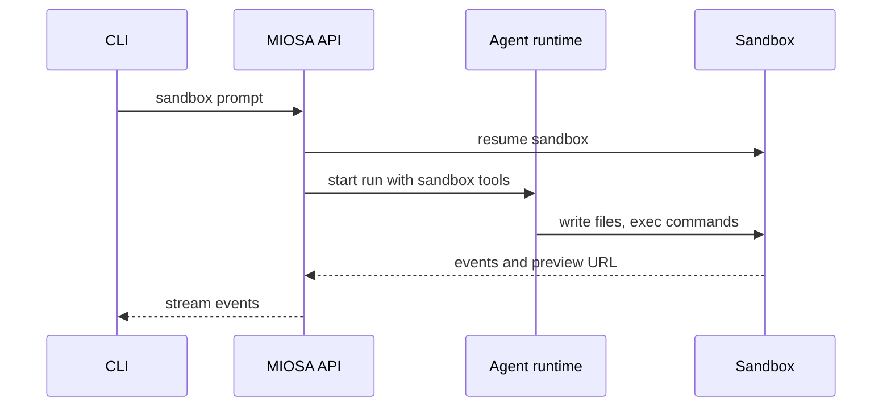
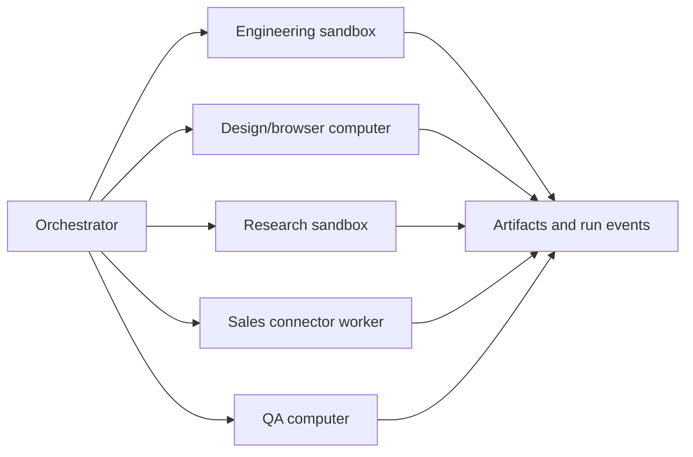

MIOSA workflows scale from a single prompt to a fleet of long-running agents.
The same primitives apply at every level:

```text
prompt -> agent runtime -> assigned device -> event stream -> durable output
```

Use this page to choose the right workflow for your product.

---

## Pattern 1: one-shot run

Use this for quick checks, small scripts, inspections, summaries, and health
tests.

```bash
miosa prompt --sandbox <sandbox-id> "check if the preview server is healthy"
```

Expected behavior:

1. CLI sends the prompt to MIOSA.
2. MIOSA validates the target sandbox.
3. Runtime executes a short task.
4. CLI prints the answer and any structured output.
5. Credits are charged for model usage and device time.

Use this when the user does not need a long-lived session.

---

## Pattern 2: prompt into a sandbox

Use this when the agent should code, generate artifacts, run tests, or start a
preview.

```bash
miosa prompt --sandbox <sandbox-id> \
  --harness codex \
  "Build a Next.js landing page, run it on port 3000, and fix any errors."
```

The agent should work inside `/workspace`:

- write files
- install dependencies
- run tests
- start dev server
- inspect errors
- save artifacts
- snapshot checkpoints
- publish when approved



> **Tip: Do not upload as the default**
>
> Uploading a local repo is useful for import and sync. It should not be the only
> agent workflow. The normal agent-builder path is to let the agent create and
> modify files inside the sandbox.

---

## Pattern 3: prompt into a computer

Use this when the task requires a real browser, GUI, login flow, or visual QA.

```bash
miosa prompt \
  --computer <computer-id> \
  --harness claude-code \
  "Open the app preview, test signup, capture screenshots, and report issues."
```

The computer device can:

- open URLs
- click buttons
- type into forms
- scroll
- log in to dashboards
- inspect UI states
- take screenshots
- use terminal or desktop apps

Use a computer after a sandbox creates a preview, or as the primary runtime for
browser-heavy automation products.

---

## Pattern 4: detached agent session

Use this for tasks that continue after the first command returns.

```bash
miosa agent run builder \
  --sandbox <sandbox-id> \
  --no-follow \
  --json
```

Then inspect and continue the session:

```bash
miosa run events <run-id>
miosa run steer "Now add authentication and update the README." --sandbox <sandbox-id>
miosa run files <run-id>
miosa run stop <run-id>
```

Detached sessions should not require a terminal UI to keep running. A TUI is a
view, not the execution model.

Detached run requirements:

- run id returned immediately (`--no-follow`)
- events available over API and CLI
- reconnectable stream
- durable transcript (`miosa run messages`)
- artifacts linked to the run (`miosa run files`)
- clean stop/cancel (`miosa run stop`)
- typed failure state
- clear credit usage

---

## Pattern 5: app-builder loop

Use this for Lovable, Replit, v0, or Lumen-style app generation.

```text
User prompt
  -> create/resume sandbox
  -> agent edits files in /workspace
  -> run install/build/test
  -> start preview
  -> stream files and preview URL to UI
  -> user asks for edits
  -> agent patches same sandbox
  -> snapshot stable state
  -> publish to deployment
```

Recommended UI:

- chat
- file tree
- command log
- preview frame
- artifacts panel
- deployment status
- version history
- credit usage

Recommended backend records:

```sql
projects
  current_sandbox_id
  current_deployment_id
  latest_snapshot_id

agent_runs
  project_id
  sandbox_id
  prompt
  status
  idempotency_key
```

---

## Pattern 6: artifact workspace

Use this for Claude Desktop-style work where the agent creates documents,
images, diagrams, or data files.

Examples:

- proposals
- DOCX files
- PDFs
- pitch decks
- diagrams
- brand assets
- CSV reports
- HTML previews
- ZIP bundles

Flow:

```text
prompt -> sandbox -> generate file -> render/validate -> artifact -> version
```

The UI should show:

- live text/code generation
- generated file cards
- preview pane
- download button
- revision history
- "make changes" prompt attached to the artifact

---

## Pattern 7: browser operator

Use this for Nebula-style browser work or RPA-like workflows.

```text
prompt -> computer -> browser session -> screenshots/events -> report/action
```

Examples:

- fill onboarding forms
- verify checkout
- inspect admin dashboards
- scrape authenticated data
- test browser UI
- run visual QA on previews

Human approval should be required before:

- submitting external forms
- sending messages
- spending money
- deleting data
- changing account settings
- using admin credentials

---

## Pattern 8: orchestrated agent team

Use this for Cofounder (cofounder.co), Polsia, Agentfounder, or internal
operator products.



The orchestrator should:

- break the prompt into tasks
- assign devices and runtimes
- enforce budget and approvals
- stream each child run
- merge artifacts
- ask for human approval on risky actions
- produce one final status

Use child devices only when they create real leverage. Not every task needs a
new sandbox.

---

## Pattern 9: agent fleet

Use this when the product launches tens, hundreds, or thousands of workers.

Examples:

- large test matrices
- lead enrichment
- website audits
- browser QA sweeps
- benchmark runs
- research crawls
- parallel code migrations

Fleet requirements:

| Requirement | Why it matters |
|---|---|
| Queue | Avoid unbounded device creation |
| Idempotency | Retry without duplicate resources |
| Budget cap | Stop runaway spend |
| Concurrency limit | Protect user plan and platform capacity |
| Child-run events | Show progress without opening every worker |
| Aggregation | Merge output into one report |
| Cancellation | Stop the fleet fast |
| Partial results | Preserve useful work after failures |

---

## Choosing the pattern

| User asks for | Use |
|---|---|
| Quick check | One-shot run |
| Generate code | Sandbox prompt |
| Test browser flow | Computer prompt |
| Keep working after disconnect | Detached session |
| Build and preview app | App-builder loop |
| Make a document/image/report | Artifact workspace |
| Operate a website/dashboard | Browser operator |
| Run a company/project | Orchestrated agent team |
| Scale many workers | Agent fleet |

---

## See also

- [Agent product model](/docs/guides/agent-product-model): The canonical vocabulary for agents, devices, runs, events, artifacts, and credits.
- [Runtime routing](/docs/guides/agent-runtime-routing): Route prompts to OSA, Codex, Claude Code, Hermes, Pi, or custom runtimes.
- [Virtual device product](/docs/cookbook/build-virtual-device-product): Build a Nebula-style persistent workspace with files, browser, jobs, and artifacts.
- [Backend orchestration](/docs/integrations/backend-orchestration): Build the product backend that dispatches prompts into MIOSA devices.
