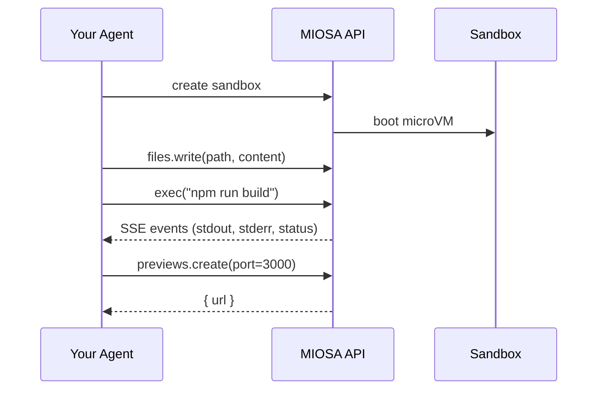

MIOSA provides the substrate: sandboxes, computers, file I/O, exec, previews,
and snapshots. You provide the agent loop: the LLM calls, screenshot decoding,
planning, and turn management. This guide shows how to wire the two together.

If you are designing the product surface around agents, start with
[What MIOSA agents can do](/docs/guides/agent-capabilities),
[Configure an agent](/docs/guides/configure-agent), and
[Agent devices](/docs/guides/agent-devices). This page focuses on the
integration loop once the agent and device policy are chosen.

---

## The pattern



Your agent code owns the loop: choosing the LLM, formatting tool calls,
interpreting results, and deciding when to stop. MIOSA executes the actions your
agent requests and streams back results.

---

## Sandbox integration

Sandboxes are the preferred substrate for code-generation agents. The agent
writes files, runs build commands, and opens preview URLs through MIOSA
primitives.

**Python**

```python
import miosa

client = miosa.Miosa(api_key="msk_u_...")

# Boot a sandbox with a Next.js environment
sbx = client.sandboxes.create("nextjs")

# Agent writes the code it generated
sbx.files.write("/workspace/app/page.tsx", agent_generated_code)

# Run the build
result = sbx.exec("npm run build")
if result.exit_code != 0:
    # Feed stderr back to the agent so it can debug
    agent.feedback(result.stderr)
else:
    # Open a live preview
    preview = sbx.previews.create(port=3000)
    print(f"Preview: {preview.url}")
```

**TypeScript**

```typescript
import { Miosa } from '@miosa/sdk';

const client = new Miosa({ apiKey: 'msk_u_...' });

// Boot a sandbox
const sbx = await client.sandboxes.create({ templateId: 'nextjs' });

// Agent writes the generated file
await sbx.files.write('/workspace/app/page.tsx', agentGeneratedCode);

// Run the build
const result = await sbx.exec('npm run build');
if (result.exitCode !== 0) {
  agent.feedback(result.stderr);
} else {
  const preview = await sbx.previews.create(3000);
  console.log('Preview:', preview.url);
}
```

The sandbox persists between turns. Files written in turn 1 are still there in
turn 5, so the agent does not need to re-send context on every call.

---

## Computer integration

Computers are full Linux desktop VMs with screenshot, click, type, and keyboard APIs. Use them when your agent needs to operate a graphical interface.

**Python**

```python
import miosa

client = miosa.Miosa(api_key="msk_u_...")

computer = client.computers.create(template_type="ubuntu-desktop")
computer.start()

# Screenshot → reason → act loop (your agent drives this)
while not done:
    png = computer.screenshot()
    action = agent.next_action(png)

    if action.type == "click":
        computer.left_click(action.x, action.y)
    elif action.type == "type":
        computer.type(action.text)
    elif action.type == "key":
        computer.key(action.combo)  # e.g. "ctrl+t", "enter"
    elif action.type == "scroll":
        computer.scroll(action.direction, x=action.x, y=action.y)
    elif action.type == "done":
        done = True

computer.stop()
```

**TypeScript**

```typescript
import { Miosa } from '@miosa/sdk';

const client = new Miosa({ apiKey: 'msk_u_...' });

const computer = await client.computers.create({ template_type: 'ubuntu-desktop' });
await computer.start();

let done = false;
while (!done) {
  const png = await computer.screenshot();
  const action = await agent.nextAction(png);

  switch (action.type) {
    case 'click':
      await computer.leftClick(action.x, action.y);
      break;
    case 'type':
      await computer.typeText(action.text);
      break;
    case 'key':
      await computer.key(action.combo);
      break;
    case 'done':
      done = true;
      break;
  }
}

await computer.stop();
```

---

## State tracking

Your agent code is responsible for keeping turn history, screenshots, and
decisions. MIOSA executes discrete actions; it does not maintain an agent loop
or conversation state on your behalf.

> **Note**
>
> A managed agent loop with built-in turn history and LLM orchestration is on the MIOSA roadmap. Today, state management lives in your application layer.

A minimal turn-log pattern:

```python
turns = []

while not done:
    png = computer.screenshot()
    action = agent.next_action(png, history=turns)
    turns.append({"screenshot": png, "action": action})

    # Execute action on the computer...
```

---

## Approval workflows

If your workflow requires human review before an action executes, your agent
pauses and asks the user. MIOSA does not gate actions; all approval logic lives
in your application.

```python
action = agent.next_action(png)

if action.requires_approval:
    approved = ask_user(f"Approve: {action.description}?")
    if not approved:
        agent.cancel(action)
        continue

computer.left_click(action.x, action.y)
```

---

## Streaming events

Subscribe to the sandbox or computer event stream to receive real-time progress without polling:

**Python**

```python
# Sandbox events
for event in sbx.events.stream():
    if event.type == "sandbox.exec.stdout":
        print(event.data["line"])
    elif event.type == "sandbox.exec.completed":
        print(f"Exit code: {event.data['exit_code']}")
        break

# Computer events
for event in computer.events.stream():
    if event.type == "computer.stopped":
        print("Computer stopped:", event.data["reason"])
        break
```

**TypeScript**

```typescript
// Sandbox events
for await (const event of sbx.events.stream()) {
  if (event.type === 'sandbox.exec.stdout') {
    process.stdout.write(event.data.line);
  } else if (event.type === 'sandbox.exec.completed') {
    console.log('Exit code:', event.data.exit_code);
    break;
  }
}
```

See [Events (SSE) reference →](/docs/api-reference/events) for the full event catalog.

---

## Best practices

- **Run the agent against a MIOSA device.** For code and artifact tasks, write
  files directly into `/workspace` and run commands inside the sandbox. Use the
  local machine for orchestration, not as the place where the final app is built.
- **Use `Idempotency-Key` on every action.** If your agent retries a failed request, the idempotency key prevents duplicate execution. Generate a key tied to your turn ID: `"turn-{turn_number}-{action_type}"`.
- **Cap `max_turns` in your agent loop.** A runaway agent loop can exhaust credits. Set a hard ceiling and surface the failure cleanly to the user.
- **Record screenshots and decisions.** Persist each turn's screenshot and the action taken. When an agent makes a bad decision, this record lets you replay and diagnose without re-running the whole task.
- **Fork at stable checkpoints.** Keep the original running sandbox as the known-good source and use `POST /sandboxes/{id}/fork` for risky work in an independent branch.
- **Prefer sandbox exec over computer desktop for code tasks.** File I/O and shell commands through the sandbox API are more reliable and faster than typing into a terminal window on a desktop.

---

## Examples

- **Code-gen agent**: An agent that generates and deploys a static site end-to-end.

  [View on GitHub →](https://github.com/Miosa-osa/miosa/tree/main/examples/agent-builds-static-app)
- **SDK reference**: Full Python and TypeScript SDK method signatures for sandboxes and computers.

  [SDK reference →](/docs/sdks/typescript)
