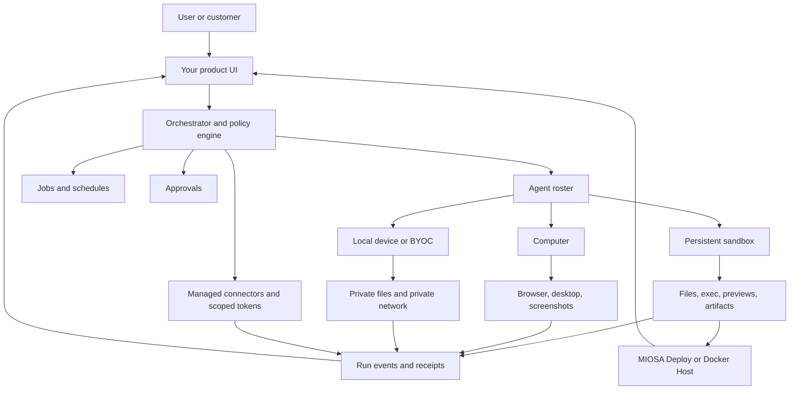
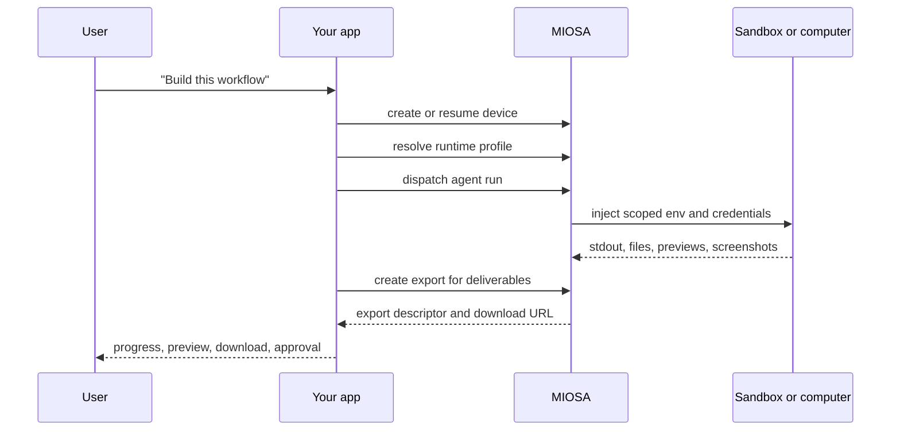

You can use MIOSA to build your own product in the same category as **Genspark**, **Emergent**, **Blackbox AI**, **Lovable**, **Replit Agent**, **Polsia**, **Cofounder**, or **Nebula**.

Your product owns the brand, customer experience, prompts, model routing, billing, and workflow.
MIOSA supplies the execution layer: sandboxes, computers, files, commands, previews, artifacts, snapshots, connectors, events, data services, and immutable deployments.

> **Note: Yes, you can build your own version**
>
> This guide maps the product category to concrete MIOSA resources.
> It covers prompt-to-app builders, autonomous company operators, agent workspaces, and persistent virtual-device products.
> See the [Agent product reference map](/docs/guides/agent-company-reference-map) for the reference products to study, then build your own implementation and brand here.

---

## Reference architecture



The orchestrator is your product layer. It decides which agent runs, what model
or harness powers it, which device it can use, which credentials are available,
when to ask for approval, and how progress appears to the user.

MIOSA is the runtime layer. It executes the work and records the outputs.

---

## Implementation checklist

Start with one workspace and one agent before scaling to teams or thousands of
workers.

| Step | MIOSA primitive | What to build in your product |
|---|---|---|
| 1. Create workspace | Workspace or white-label workspace | Customer/company boundary |
| 2. Configure credentials | Managed secrets and connectors | Provider keys, OAuth installs, MCP/tool access |
| 3. Create runtime profile | Agent runtime profile | Default harness, tools, non-secret env, policy |
| 4. Create primary device | Persistent sandbox or computer | Shared execution workspace |
| 5. Dispatch prompt | Agent run | One task sent into the chosen device |
| 6. Stream progress | Events, stdout, screenshots, previews | User-visible activity feed |
| 7. Export output | Sandbox file export | Downloadable PDFs, HTML, zips, screenshots, app folders |
| 8. Snapshot state | Sandbox snapshot or computer persistence | Resume without losing files/dependencies |
| 9. Publish | MIOSA Deploy or Docker Host | Stable customer-facing URL |
| 10. Scale | Queues, pools, groups, quotas | Many logical agents sharing controlled runtime capacity |

The important rule is that agent identity, runtime profile, device, credentials,
and artifacts are separate records. That separation is what lets you swap OSA
for Claude Code, move a task from sandbox to computer, or give one workspace a
different provider key without rewriting the product.



This is the smallest working version of a Polsia-style operator, a
Cofounder-style department agent, or a Nebula-style virtual device.

---

## Backend module shape

Keep these modules separate in your product backend. Combining them too early is
what makes agent products hard to debug.

```typescript
type AgentRuntime =
  | "osa"
  | "codex"
  | "claude-code"
  | "pi"
  | "hermes"
  | "gemini-cli"
  | "opencode"
  | "custom";

type AgentDevice =
  | { type: "sandbox"; id: string; cwd: "/workspace" | string }
  | { type: "computer"; id: string }
  | { type: "local"; id: string };

type AgentRunRequest = {
  workspaceId: string;
  agentId: string;
  runtime: AgentRuntime;
  device: AgentDevice;
  prompt: string;
  connectors: string[];
  approvalPolicy: "auto" | "confirm-risky" | "manual";
};
```

| Module | Interface | Implementation hidden behind it |
|---|---|---|
| Orchestrator | `dispatch(runRequest)` | Selects runtime, device, queue, retry policy, approvals |
| Runtime adapter | `start(prompt)`, `send(task)`, `stop()` | OSA, Codex, Claude Code, Pi, Hermes, or custom harness |
| Device adapter | `exec`, `writeFile`, `readFile`, `preview`, `snapshot` | MIOSA sandbox, computer, local device |
| Connector broker | `getToken(connector, subject, scopes)` | Provider auth, refresh, egress restrictions, audit |
| Event stream | `subscribe(runId)` | Tool calls, stdout, file writes, screenshots, artifacts, approvals |
| Artifact store | `putArtifact`, `versionArtifact` | PDFs, DOCX, images, zips, screenshots, generated apps |
| Deployment bridge | `publish(version)` | MIOSA Deploy, Docker Host, domains, rollback |

The frontend should never special-case every runtime. It should render the same
event contract regardless of whether the backend used OSA, Codex, Claude Code,
Pi, Hermes, or a customer-owned harness.

## Product mapping

### Build your own Polsia-style operator

Use this when the product promise is: "Describe the business. Agents keep
building, researching, selling, and improving it."

Use this MIOSA shape:

| Layer | MIOSA choice |
|---|---|
| Default device | Persistent sandbox |
| Browser work | Computer when a real browser or dashboard login is needed |
| Long-running work | Scheduled jobs that resume the persistent sandbox |
| Deliverables | Artifacts, previews, deployment URLs, reports |
| Production apps | MIOSA Deploy or Docker Host |
| Credentials | Managed connectors and scoped runtime tokens |
| UI | Task stream, plan, files, artifacts, preview, approvals |

Example task flow:

```text
User: Build a landing page and start outbound research.
Orchestrator:
  1. Resume the company workspace sandbox.
  2. Agent writes Next.js files in /workspace.
  3. Agent starts preview on port 3000.
  4. Computer agent opens the preview and captures screenshots.
  5. Research agent writes lead notes and campaign copy.
  6. User approves publish.
  7. Deploy agent publishes the app and stores the URL.
```

### Build your own Cofounder / Co-Founder AI-style company OS

Use this when the product promise is: "Run company departments with specialized
agents and human approval."

Start with this agent roster:

| Department agent | Device and tools |
|---|---|
| Engineering | Sandbox files, exec, previews, deploy |
| Design | Refero managed connector, browser screenshots, artifacts |
| Marketing | Web research, files, connected email/CRM tools |
| Sales | Browser/computer, CRM connector, approval before outbound |
| Finance | Connected accounting or spreadsheet tools, strict approval |
| Support | Browser/computer, helpdesk connector, memory, approvals |
| Operations | Jobs, schedules, reports, audit log |

Human approval belongs at the orchestrator layer for:

- publish production app
- send external messages
- buy domains or spend credits
- create high-cost child devices
- delete data, snapshots, deployments, or customer files
- use admin-level credentials

### Build your own Nebula-style virtual device

Use this when the product promise is: "Agents and humans share a persistent
workspace with files, code, browser, jobs, and connected apps."

Use this MIOSA device model:

| Nebula-style concept | MIOSA implementation |
|---|---|
| Virtual device | Persistent sandbox or computer |
| Local device | Paired customer-owned device |
| Files between sessions | Sandbox `/workspace`, snapshots, computer storage |
| Code execution | Sandbox exec and streaming output |
| Browser | Computer browser automation and screenshots |
| Live server | Sandbox preview URL |
| Jobs | Scheduled orchestrator tasks that resume the device |
| Shared across members | Workspace-scoped device policy and audit log |
| Miniapps | Generated apps published from sandbox to MIOSA Deploy or Docker Host |

The key design decision is the **primary device policy**. Each workspace should
know which sandbox, computer, or local device agents reach for by default.

### Build Heuresis-style encoded workspaces

Use this when the product promise is: "Turn a company's operating knowledge into
a folder that any agent runtime can execute."

Use this workspace folder contract:

```text
/workspace
  SYSTEM.md
  company.yaml
  agents/
    founder.md
    engineering.md
    marketing.md
    sales.md
    support.md
  skills/
    write-proposal/
      SKILL.md
      references/
    qualify-lead/
      SKILL.md
    build-landing-page/
      SKILL.md
  runbooks/
  artifacts/
  receipts/
```

| Layer | Purpose |
|---|---|
| `SYSTEM.md` | Boot file read by the selected agent runtime |
| `company.yaml` | Business facts, offers, ICP, pricing, brand, constraints |
| `agents/` | One file per role: scope, authority, standards, escalation path |
| `skills/` | Reusable capabilities that produce named assets |
| `runbooks/` | Repeatable operating procedures |
| `artifacts/` | Generated files users can inspect and download |
| `receipts/` | Decisions, outputs, approvals, and audit trail |

MIOSA is where this workspace can actually run. The encoded company lives in a
persistent sandbox. The selected runtime, such as OSA, Codex, Claude Code,
Gemini CLI, OpenCode, Cursor, Aider, Windsurf, OpenClaw, Qwen Code, Kimi Code,
or a custom harness, reads the workspace and executes inside `/workspace`.

This gives customers a portable company operating system while MIOSA still owns
the secure execution, persistence, events, quotas, connectors, and deployment
path.

---

## Implementation path

### 1. Choose the runtime shape

Do not hard-code one agent runtime into the platform. Make runtime a setting on
the agent or workspace.

| Runtime option | Best use |
|---|---|
| OSA | MIOSA-native agents and platform operations |
| Codex | Repo work, codebase edits, terminal-driven engineering |
| Claude Code | Agentic coding with tool use and MCP |
| Gemini CLI | Alternate coding and research loop |
| OpenCode, Cursor, Aider, Windsurf | User-selected coding harnesses |
| OpenClaw | Multi-agent orchestration brain paired with coding tools |
| Qwen Code, Kimi Code | Model/vendor-specific code agents |
| Custom | Your own harness, prompt format, queue, or model router |

The runtime should receive the same workspace contract: scoped MIOSA token,
assigned device, allowed connectors, and `/workspace` files.

### 2. Dispatch prompts into the device

The product must be able to send a prompt into the assigned runtime and keep the
agent working there. This is the core workflow.

```text
prompt
  -> route to agent runtime
  -> run inside assigned sandbox/computer/local device
  -> stream events back to product UI
  -> persist files, artifacts, screenshots, previews, and deployment records
```

Use a sandbox prompt when the agent should code, generate artifacts, or run
commands inside `/workspace`:

```bash
miosa prompt --sandbox <sandbox-id> \
  --harness claude-code \
  --json \
  "Build the landing page, run tests, start the preview, and leave the files in /workspace"
```

Use a computer agent prompt when the task needs a desktop or browser:

```bash
miosa prompt --computer <computer-id> \
  --harness claude-code \
  "Open the preview, test signup, capture screenshots, and report visual issues"
```

Send follow-up work into the same running computer-agent session:

```bash
miosa run steer \
  "Re-check the mobile nav after the sandbox agent patches it" \
  --computer <computer-id>
```

In a product backend, model this as one dispatch contract:

```typescript
type DevicePromptDispatch = {
  deviceType: "sandbox" | "computer" | "local";
  deviceId: string;
  runtime: "osa" | "codex" | "claude-code" | "gemini-cli" | "opencode" | "custom";
  prompt: string;
  cwd?: string;
  connectors?: string[];
  approvalPolicy?: "auto" | "confirm-risky" | "manual";
};
```

The UI should not care whether the prompt ran through OSA, Codex, Claude Code,
Hermes, OpenCode, or a custom harness. It should display the same run stream:
tool calls, command output, file writes, screenshots, artifacts, approvals, and
final URLs.

> **Note: Current dispatch status**
>
> Prompt dispatch is available through `miosa prompt`, with `--sandbox` or
> `--computer` for MIOSA-managed devices. For customer-owned OpenComputers hosts,
> dispatch through `miosa api POST /opencomputers/hosts/<id>/agent/dispatch`.
> Computer session APIs remain the right fit for long-running browser or desktop
> conversations. Keep your product-level run model stable so every target can
> share one UI.

### 3. Create or resume the workspace runtime

Use a persistent sandbox for code and files. Use a computer only when the task
requires a real browser, desktop, or screenshot loop.

```bash
miosa create customer-workspace \
  --template nextjs \
  --ttl 1h \
  --wait \
  --json
```

Then run work inside the sandbox:

```bash
miosa exec <sandbox-id> -- sh -lc "cd /workspace && npm install"
miosa exec <sandbox-id> -- sh -lc "cd /workspace && npm run build"
```

### 4. Make the agent write inside the device

The agent should edit files in `/workspace`, not build everything locally and
upload a finished repo at the end.

```text
bad:
  local agent builds repo on laptop
  upload after the fact
  remote sandbox only previews the result

good:
  agent writes files into sandbox
  sandbox installs dependencies
  sandbox runs tests/builds
  sandbox serves preview
  user sees events and artifacts as work happens
```

### 5. Stream progress into the product UI

Show users the work surface:

- plan created
- device created or resumed
- file written
- command started
- stdout/stderr chunk
- preview ready
- screenshot captured
- artifact generated
- approval required
- deployment ready

This is the difference between "the agent disappeared" and "the agent is
working in a real machine."

### 6. Attach connectors and secrets safely

Use managed connectors, scoped tokens, and runtime variables. Do not paste
provider keys into chat.

```text
Tenant key
  -> stays server-side
  -> mints scoped runtime token
  -> sandbox receives only the scoped token
  -> managed provider token is brokered only to the allowed provider endpoint
```

This is how a platform can provide a managed design-research connector while
still preventing arbitrary token exfiltration.

### 7. Save checkpoints and publish

Use snapshots and versioned deployments:

```text
checkpoint after dependencies install
checkpoint after first working preview
checkpoint before risky refactor
publish after tests and browser QA
rollback through deployment versions
```

For many small customer apps in one workspace, publish to
[Docker Host](/docs/docker-host/docker-deploy). For normal production apps,
publish through MIOSA Deploy.

---

## What your frontend should show

| Surface | Purpose |
|---|---|
| Chat or task stream | User request, agent status, tool calls, command output |
| Device panel | Sandbox preview, computer desktop, logs, screenshots |
| Files panel | Workspace files, diffs, generated code, editable artifacts |
| Artifacts panel | PDFs, DOCX, images, ZIPs, screenshots, downloads |
| Approvals panel | Risky actions waiting for human confirmation |
| Jobs panel | Scheduled and background work |
| Deployment panel | Public URL, versions, rollback, domains |
| Usage panel | Credits, runtime minutes, sandbox/computer cost |

This is how to make MIOSA feel like an agent workspace, not just an API.

---

## Architecture rules

1. **Do not merge sandboxes and computers into one vague concept.** Sandboxes
   are for headless code, files, previews, and artifacts. Computers are for GUI
   and browser automation.
2. **Make persistence the default for agent work.** Idle compute can stop, but
   the workspace state should survive through snapshots or persistent storage.
3. **Use scoped runtime credentials.** Tenant admin keys stay server-side.
4. **Treat the orchestrator as your product.** MIOSA executes; your product
   decides roles, prompts, permissions, retries, approvals, and UI.
5. **Expose run events.** Users need to see code, commands, files, previews,
   artifacts, screenshots, and deploys as they happen.
6. **Dispatch prompts into assigned devices.** A user prompt should become a
   sandbox/computer/local-device run, not a detached local-only script.
7. **Separate development from hosting.** Agents build in sandboxes and
   computers. Finished apps run on deployments or Docker Host.
8. **Keep runtimes replaceable.** A workspace should be executable by OSA,
   Codex, Claude Code, OpenCode, Aider, OpenClaw, or a custom runtime without
   rewriting the customer's company knowledge.

---

## See also

- [What MIOSA agents can do](/docs/guides/agent-capabilities): Built-in toolkits, app actions, permissions, artifacts, and product surfaces.
- [Agent devices](/docs/guides/agent-devices): Sandboxes, computers, local devices, persistence, and primary device policy.
- [Agent orchestration](/docs/guides/agent-orchestration): Coordinate one agent, many agents, queues, subagents, and device pools.
- [Managed connectors](/docs/guides/managed-connectors): Provide hosted provider tools without exposing provider secrets.
