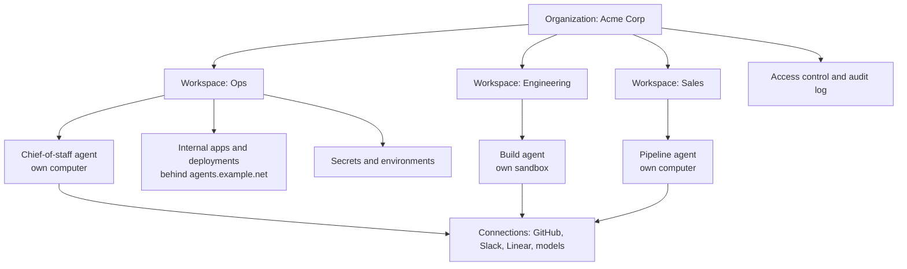

Some companies build an agent product to sell. Others build one platform for themselves, and run the company on it. This guide is the second one.

You are not launching this. It is not a product. It is the internal surface where your team's agents, apps, data, and workflows live together, and where every teammate and every agent gets a machine of their own.

If you are building a platform to sell to customers instead, read the [Platform builder guide](/docs/platform/overview).

## Who it's for

- **A company with teams.** Ops, engineering, sales, support, finance. Each team gets a workspace. Each teammate and each agent gets a machine.
- **An agency running client work.** Each client becomes a workspace, so one platform holds every client's agents, apps, and spend without mixing them.

Both cases are the same shape: one organization, many workspaces, one machine per worker.

## What it is

One internal platform where:

- Every **agent** gets its own MIOSA computer or sandbox, with its own filesystem, network, and process tree.
- Every **team member** can reach those agents, their apps, and the shared data from one dashboard.
- The company's **tools** (GitHub, Slack, Linear, your model providers) are reachable through Connections (OAuth) and MIOSA-managed connectors, not copy-pasted API keys.
- **Secrets and environments** are managed centrally, so a new machine starts with exactly what it should have.
- Internal apps and **deployments** run behind the company domain.
- **Access, spend, and the audit trail** are governed in one place.

## Architecture



### Organization and workspaces

The organization is the company. It pays for everything and owns the balance. Workspaces group machines, deployments, and data per team, per client, or per function.

```bash
miosa workspace create Ops
miosa workspace create Engineering
miosa workspace list
miosa workspace inventory ops
```

Every resource can be created inside a workspace, so `miosa create ops-box --workspace ops` never mixes teams. Workspace-scoped usage and inventory are one command away:

```bash
miosa workspace stats ops
miosa workspace usage ops
```

### A machine per agent

An agent needs somewhere to write files, install packages, run commands, and preview an app. That is a sandbox. An agent that needs a visible desktop, a browser, or a GUI app needs a computer.

```bash
# A code agent's workspace
miosa create ops-agent --template miosa-sandbox --workspace ops --env prod --wait

# A persistent desktop for a browsing agent
miosa computer create chief-of-staff-desktop --env prod
```

Each gets its own filesystem, network, and process tree. Use [Agent device selection](/docs/guides/agent-device-selection) to decide which one a given role needs.

### Connect the company's tools

Connections are what agents and machines use to reach the outside world: model providers, apps, and tool servers. MIOSA's own model keys never power your agents, so every run uses a connection of yours.

```bash
# Model provider with an API key (read from stdin, never from an argument)
miosa connections add models anthropic --key-stdin <<< "$ANTHROPIC_API_KEY"

# Or sign in with a subscription inside a named machine
miosa connections add models claude --sandbox ops-agent

# Company apps over OAuth
miosa connections add apps github
miosa connections add apps slack
miosa connections add apps linear

# A remote MCP tool server
miosa connections add tools --name docs --url https://mcp.internal.example.net/sse

miosa connections list --kind apps
```

For tools MIOSA already brokers, use [Managed connectors](/docs/guides/managed-connectors) so no teammate has to hand over a vendor token.

### Secrets and environments

An environment is the template a new machine inherits: which repositories are cloned, which variables and secret files are injected, and which connections the machine may use. Every save mints a new immutable version, and a machine keeps the version it started with until you upgrade it.

```bash
miosa env new prod
miosa env set --env prod --from-file .env
miosa env file put --env prod backend/.env ./backend.env
miosa env repo add --env prod acme/internal-tools --branch main
miosa env default prod
```

Values are never passed as arguments. Set them interactively, pipe them on standard input, or load a `.env` file.

### Access control, SSO, and the audit log

Membership is per organization with four roles: owner, admin, member, and viewer. Only owners and admins can change membership.

```bash
miosa member add dana@example.net --role admin
miosa member role user_123 --role viewer
miosa workspace members ops
```

- **RBAC.** Give each team the role it needs, and scope API keys to a workspace and a preset so a CI job can only touch what it should: `miosa api-key create ci-deploy --preset ci --workspace-id <workspace-id>`.
- **Service accounts.** Give each internal integration its own identity instead of a shared key: `miosa service-account new ci-bot`, then `miosa service-account key new ci-bot`.
- **SSO/SAML.** Organization single sign-on (SAML) is available, including enforce-SSO for members. Membership is per organization with roles, and members sign in with a MIOSA account or a scoped key.
- **Audit log.** Every API action is recorded, newest first: `miosa audit`, `miosa audit --workspace-id <workspace-id>`, or `miosa audit --type sandbox.created`.

### Internal deployments behind the company domain

An app an agent builds is previewed from a sandbox port, then deployed durably behind the company domain.

```bash
miosa process start ops-agent -- python -m http.server 8080
miosa preview create ops-agent 8080 --name ops-dashboard
miosa preview share ops-agent <preview-id> --ttl 1h

miosa deploy list
miosa deploy domain-add ops-dashboard agents.example.net
miosa deploy rollback ops-dashboard --to <version-id>
```

The preview is how teammates review work in progress. The deployment is what they bookmark.

## Starting point

Two open-source repos you can start from today.

- [BusinessOS](https://github.com/Miosa-osa/BusinessOS): The open-source business operating system: projects, CRM, docs, calendar, terminal, and AI agents in one app. Apache-2.0. This is the fastest way to get the platform shell your team will actually use.
- [OSA](https://github.com/Miosa-osa/OSA): The open-source agent that runs inside those machines. Point it at a MIOSA computer or sandbox and it writes files, runs commands, and builds apps.

You do not have to use OSA. Any harness that can run inside a machine works: **Claude Code**, **Codex**, or a custom runtime. MIOSA's `miosa agent` commands wrap a harness, instructions, model, and the machine it runs on into one versioned definition.

## Step-by-step walkthrough

This is Acme Corp building its internal platform. The ops team gets a chief-of-staff agent, and everything lives behind `agents.example.net`.

### Step 1: create the organization surfaces

```bash
miosa workspace create Ops
miosa workspace create Engineering
miosa env new prod
miosa env default prod
```

Create one server API key for the platform's backend, and one scoped key per integration:

```bash
miosa api-key create acme-platform --preset cli
miosa api-key create ci-deploy --preset ci --workspace-id <ops-workspace-id>
```

### Step 2: give the ops team a machine

```bash
miosa create ops-agent --template miosa-sandbox --workspace ops --env prod --wait --ttl 8h
miosa computer create ops-desktop --env prod
miosa computer urls ops-desktop
```

### Step 3: connect the tools the team already uses

```bash
miosa connections add models claude --sandbox ops-agent
miosa connections add apps github
miosa connections add apps slack
miosa connections add apps linear
miosa connections add tools --name docs --url https://mcp.internal.example.net/sse
```

### Step 4: define the chief-of-staff agent

An agent is a saved, versioned definition: harness, model, instructions, the machine it runs on, and what it may do.

```bash
miosa agent new chief-of-staff \
  --harness claude-code \
  --model sonnet \
  --instructions-file agents/chief-of-staff.md \
  --workspace-id <ops-workspace-id>

miosa agent run chief-of-staff "Draft this week's ops summary from Slack and Linear" --sandbox ops-agent
```

Every run uses one of your model connections. Publish a new immutable version whenever the instructions change, so a run can always prove which version it used:

```bash
miosa agent publish chief-of-staff --instructions-file agents/chief-of-staff.md
```

### Step 5: ship an internal app

The agent writes an app inside its machine, you preview it, then deploy it behind the company domain.

```bash
miosa preview create ops-agent 8080 --name ops-dashboard
miosa preview share ops-agent <preview-id> --ttl 1h
miosa deploy domain-add ops-dashboard agents.example.net
```

### Step 6: add the other teams

Engineering gets a build sandbox, Sales gets a pipeline computer. Same pattern, different workspace:

```bash
miosa create build-agent --template nextjs --workspace engineering --env prod --wait
miosa computer create pipeline-desktop --env prod
miosa agent new builder --harness claude-code --workspace-id <engineering-workspace-id>
miosa agent run builder "Set up the release checklist repo" --sandbox build-agent
```

### Step 7: wire the same commands into the SDK or the API

The CLI is a thin client over the API. Anything your internal portal does can go through the SDK.

**TypeScript**

```typescript
import { Miosa } from "@miosa/sdk"

const miosa = new Miosa({ apiKey: process.env.MIOSA_API_KEY! })

// One workspace per team
await miosa.workspaces.create({ name: "Ops", slug: "ops" })

// A machine for the agent, inside that workspace
const sandbox = await miosa.sandboxes.create({
  templateId: "miosa-sandbox",
  workspaceSlug: "ops",
})

// Dispatch a run onto that machine
const run = await miosa.agentRuns.run({
  prompt: "Draft this week's ops summary",
  targetKind: "sandbox",
  targetId: sandbox.id,
})

console.log(run.id)
```

**Python**

```python
import miosa, os

client = miosa.Miosa(api_key=os.environ["MIOSA_API_KEY"])

client.workspaces.create(name="Ops", slug="ops")

sandbox = client.sandboxes.create(
    template_id="miosa-sandbox",
    workspace_slug="ops",
)

run = client.agent_runs.run(
    prompt="Draft this week's ops summary",
    target_kind="sandbox",
    target_id=sandbox.id,
)

print(run["id"])
```

## Example scenarios

### Acme Corp: ops team with a chief-of-staff agent

Acme runs one organization. The `ops` workspace holds a persistent computer and a chief-of-staff agent. The agent reads Slack and Linear through Connections, drafts the weekly summary, and drops it in the shared docs app. When a teammate wants a new internal tool, the same agent builds it in its sandbox and deploys it to `agents.example.net`. Finance checks `miosa workspace usage ops` at the end of the period.

### Northwind Agency: per-client workspaces

Northwind is an agency running client work. Each client is a workspace: `northwind-agency` for the agency itself, plus one per client. Each client's agents and apps live inside their own workspace, so nothing crosses between clients, and the agency's dashboard reports usage per client. Branded previews and deployment domains come from the agency's own domain, `northwind.studio`.

## Security and governance checklist

**Identity and access**

- One organization, roles per member (`owner`, `admin`, `member`, `viewer`).
- A workspace per team or client, and the right role on each.
- One scoped API key per integration, bound to a workspace and a preset.
- A service account per automated integration, not a shared personal key.
- Organization SSO (SAML) is available, including enforce-SSO; treat MIOSA accounts like any other corporate identity until it is configured.

**Secrets**

- Keep secrets in environments, versioned and immutable, never in a repo.
- Put secret files in the environment so a machine receives them at start.
- Rotate keys on a schedule; rotate the platform key periodically.

**Runtime**

- One machine per agent, never shared across teams.
- Set TTLs and idle timeouts so idle machines pause instead of billing.
- Restrict outbound traffic with [Network policy](/docs/security/network) and review the [egress audit](/docs/security/audit-log).

**Governance**

- Review `miosa audit` regularly, and filter by workspace or event type.
- Cap per-member spend and concurrency with `miosa org caps`.
- Store `workspace_id` and `project_id` next to your own IDs so usage, audit, and billing reconcile.

## Next steps

- [Device selection](/docs/guides/agent-device-selection): Which runtime each role needs: sandbox, computer, or local device.
- [Configure an agent](/docs/guides/configure-agent): Harness, model, instructions, connections, and what an agent may do.
- [Connections and managed connectors](/docs/guides/managed-connectors): Brokered provider access without client-supplied vendor tokens.
- [Environments](/docs/cli/environments): Repositories, variables, and secret files a new machine inherits.
- [Audit log](/docs/security/audit-log): Every outbound call and API action, per user and per workspace.
- [Ownership and attribution](/docs/platform/attribution): Workspaces, projects, and your own external IDs.

## Reference

- [BusinessOS](https://github.com/Miosa-osa/BusinessOS) (Apache-2.0)
- [OSA](https://github.com/Miosa-osa/OSA)
- [Workspaces API](/docs/api-reference/workspaces)
- [Agents CLI](/docs/cli/agents)
- [Connections and secrets](/docs/security/secrets)
