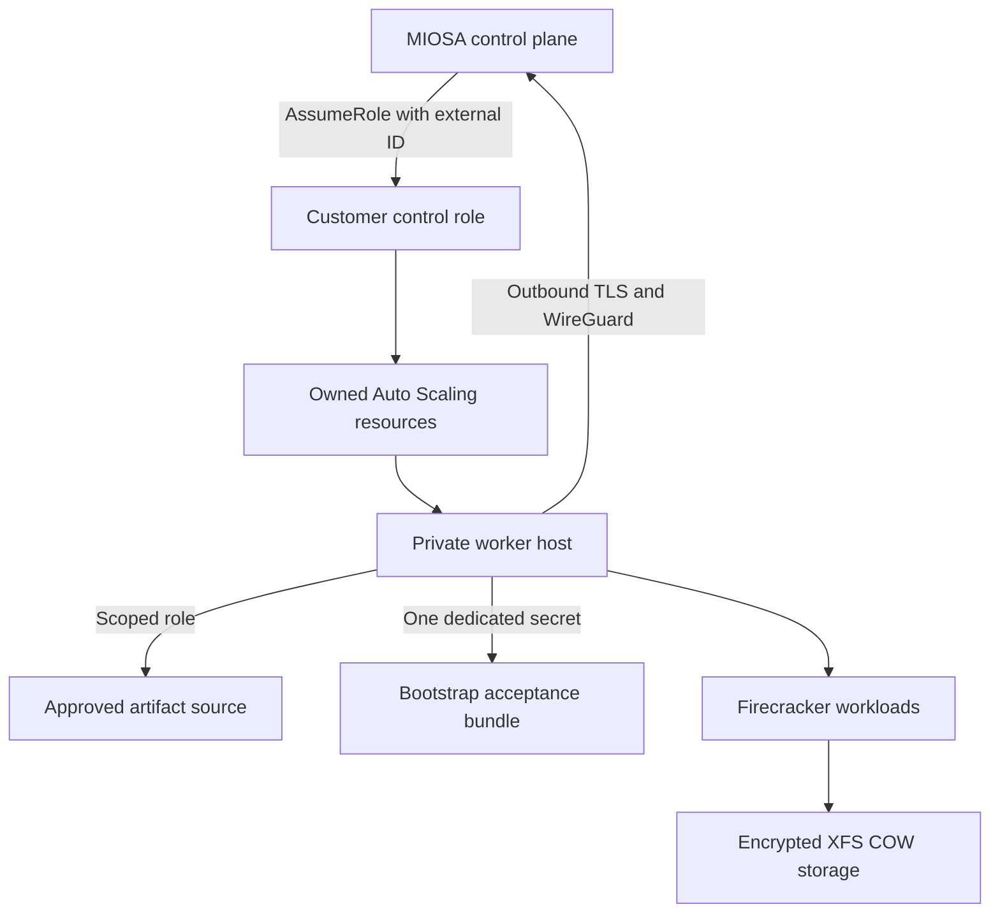

The AWS path uses customer-reviewed Terraform or CloudFormation to create a private, scoped worker foundation.

`Activation gated`
`Terraform and CloudFormation validated`

## Packaged foundation

The current AWS packages define:

- A customer-specific external-ID trust boundary.
- A least-privilege worker instance profile.
- Private subnets across at least two Availability Zones.
- An egress-only security group with no inbound rules.
- Immutable launch-template versions.
- Encrypted root and XFS copy-on-write volumes.
- A fail-closed Auto Scaling lifecycle hook.
- A dedicated, versioned bootstrap secret per host attempt.
- Immutable runtime manifests with exact SHA-256 verification.

## Security architecture

Revoking the cross-account role is the customer control-plane kill switch.

The worker role cannot administer EC2, Auto Scaling, IAM, or unrelated storage.

Hosts receive no public IP and accept no inbound security-group traffic.

## Readiness is fail-closed

Terraform and CloudFormation completion do not make a worker schedulable.

The packaged fleet begins at zero capacity.

When activation is enabled, each launched host must remain behind an Auto Scaling lifecycle hook until MIOSA verifies:

1. The expected immutable image and runtime generation.
2. Encrypted root and copy-on-write device mappings.
3. Nested virtualization and `/dev/kvm`.
4. Snapshot restore support.
5. Outbound control-plane and WireGuard reachability.
6. A fresh authenticated host session.
7. One real guest boot smoke.
8. Scheduler capability advertisement.

Timeouts abandon the launch instead of admitting an ambiguous host.

## Current maturity

The Terraform, CloudFormation, bootstrap, runtime-artifact, and control-plane contracts are implemented and validated in repository CI.

General production activation remains gated because the capacity packages intentionally create zero active hosts and live provider mutation requires a certified AWS/KVM canary.

> **Caution: Do not describe AWS BYOC as generally available**
>
> The current public contract is architecture and controlled onboarding preparation.
> Production placement must remain disabled until the acceptance gate is certified and enabled for the organization.

## What customers will control

- AWS account and selected region.
- VPC, private subnets, routing, and endpoints.
- Customer IAM review and revocation.
- KMS and cloud storage choices.
- Provider quotas and provider billing.
- Terraform state or CloudFormation stack.
- Final placement enablement.

- [Bring Your Own Cloud architecture](/docs/infrastructure/byoc/overview): Return to the complete control-plane and customer-cloud model.

## Sandbox runtime boundary on customer hosts

MIOSA-managed sandboxes run on capacity operated by MIOSA.
AWS BYOC places eligible sandboxes on accepted hosts in a customer's AWS environment while retaining the public sandbox API and resource contract.

> **Note: Private preview**
>
> AWS BYOC sandbox capacity is a gated private preview.
> Catalog entries and API access do not prove that a customer host has passed acceptance or that placement is enabled.

Each customer host runs the standalone `miosa_host` runtime.
Customer hosts do not run the control-plane compute service.
That service remains inside the MIOSA control plane, where it performs admission, policy evaluation, catalog resolution, scheduling, lifecycle coordination, and usage accounting.

The host initiates an outbound session to the MIOSA control plane.
The control plane can revoke that session and fence the host so a disconnected, replaced, or stale host process cannot continue receiving placement.
No inbound control-plane listener is required on the customer host.

The public sandbox API does not expose customer host IDs, provider instance fields, placement records, network addresses, credentials, or session fencing details.

### Certified artifacts

BYOC sandboxes boot only from immutable artifact generations certified for the selected public template.
Templates and sizes in `GET /api/v1/templates` identify customer-visible configuration, not mutable host paths or provider images.

A host must have the required certified generation and pass artifact integrity and runtime compatibility checks before it can be accepted for placement.
MIOSA does not silently substitute an uncertified local image when that generation is missing.

### Host acceptance before placement

Registering a host does not make it schedulable.
MIOSA must accept the host before any sandbox can be placed on it.

Acceptance verifies the conditions required by the preview environment, including:

- Compatible `miosa_host` and control-plane protocol versions.
- Required hardware virtualization and host capacity.
- Storage and network prerequisites.
- Availability and integrity of the certified artifact generation.
- A healthy outbound session with a current fencing generation.
- Runtime readiness checks required for sandbox execution.

Acceptance can be withdrawn when one of these conditions stops holding.
A withdrawn or fenced host receives no new placement until it passes acceptance again.

### Configuration vs request parameters

Environment configuration determines which accepted hosts, templates, resource contracts, policies, and limits are available to a tenant.
That configuration is established outside ordinary sandbox create requests.

Per-sandbox requests select only public workload behavior: `template_id`, `size`, `timeout_sec`, `idle_timeout_sec`, `always_on`, and `persistent`.

Use `GET /api/v1/templates` as the catalog source.
Select only a size listed for the chosen template as `fast_ready` or `cold_boot_only`, and use that template's `default_size` when no other supported size is requested.
`cold_boot_only` is valid but slower; `missing` is unavailable.
The default `small` resource contract is 2 vCPU, 4096 MiB RAM, and 10240 MiB disk when the selected template advertises it as ready.

### Responsibility boundary

| Area | Customer responsibility | MIOSA responsibility |
|---|---|---|
| AWS environment | Account ownership, host capacity, network egress, customer IAM, and customer-controlled infrastructure policy | Document required connectivity and reject environments that do not satisfy acceptance |
| Host operation | Keep the accepted host and its operating environment available and within the agreed configuration | Provide and coordinate `miosa_host`, session fencing, runtime compatibility checks, and acceptance state |
| Artifacts | Preserve the storage and access prerequisites needed by the accepted host | Publish immutable certified generations and prevent placement when the required generation is absent or invalid |
| Sandbox control | Choose public template, size, lifecycle, and persistence parameters | Resolve versioned resource contracts, enforce policy, schedule only onto accepted hosts, and coordinate lifecycle operations |
| Isolation and access | Control the customer AWS boundary and access to customer infrastructure | Enforce sandbox isolation and avoid exposing internal host or provider details through the public API |
| Usage records | Reconcile usage with customer infrastructure records when required | Report public usage measurements and preserve unavailable or stale measurement semantics |

### Availability and limits

BYOC does not imply a guaranteed sandbox count, launch rate, or geographic scale.
Actual availability is bounded by accepted customer capacity, certified artifact readiness, tenant policy, and current catalog state.
MIOSA will publish measured limits only after they have been validated for the applicable environment.

Managed and accepted BYOC sandboxes use the same customer-visible lifecycle operations, including extend, pause, resume, fork, usage, and destroy.
See [Sandboxes](/docs/develop/sandboxes) for request examples and [Snapshots and persistence](/docs/develop/snapshots) for lifecycle behavior.
