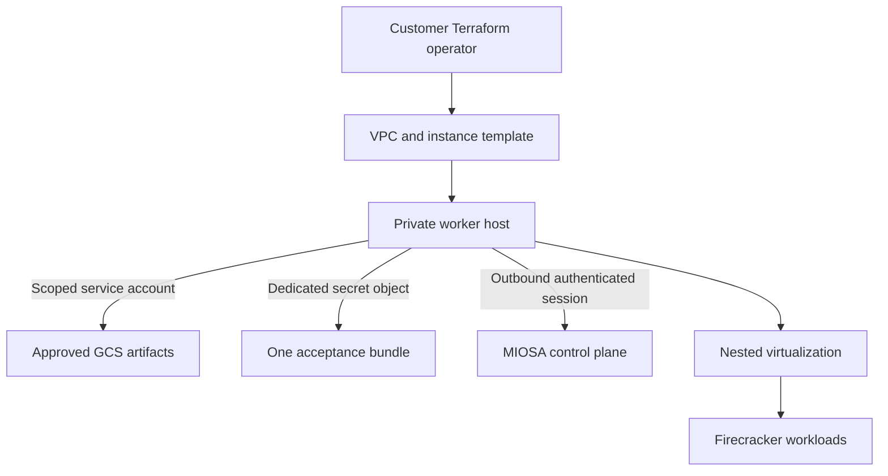

The Google Cloud path uses customer-owned Terraform to create a private worker foundation and reusable instance template.

`Activation gated`
`Terraform foundation validated`

## Packaged foundation

The current GCP package defines:

- A scoped worker service account.
- IAM bindings for approved artifacts, telemetry, and one bootstrap secret.
- A VPC, subnetwork, and firewall rules.
- A reusable Compute Engine instance template.
- Optional GCS artifact access.
- Immutable manifest and checksum inputs.
- A dedicated Secret Manager object for each provisioning attempt.
- Labels binding every resource to its MIOSA region and tenant.

The module does not create running instances by itself.

## Security architecture

The customer's Terraform principal creates the declared infrastructure.

The runtime worker receives no broad Compute Engine administration permission.

Each worker must use a dedicated bootstrap secret object in the same project.

## GCP-specific acceptance

The instance template must enable nested virtualization.

MIOSA must prove `/dev/kvm` inside the worker before it becomes schedulable.

GCP performance and density must be measured independently instead of copying AWS assumptions.

Provider running state is only a cloud observation.

It is not evidence that the MIOSA runtime, storage, guest boot, and outbound session are ready.

## Current maturity

The GCP Terraform, bootstrap, and host-acceptance contracts are implemented and validated in repository CI.

The module creates a reusable instance template, not an active worker fleet.

GCP remains a parity path until it completes the same real nested-virtualization and acceptance proof required for AWS.

> **Caution: Do not describe GCP BYOC as generally available**
>
> The current public contract is architecture and controlled onboarding preparation.
> Production placement must remain disabled until a real provider canary passes and the organization is explicitly enabled.

## What customers will control

- GCP project, region, and zone.
- VPC, subnetwork, routes, and egress.
- Terraform execution identity and state.
- Worker service-account review.
- Cloud KMS, GCS, and Secret Manager policy.
- Provider quota and provider billing.
- Final placement enablement.

- [Bring Your Own Cloud architecture](/docs/infrastructure/byoc/overview): Return to the complete control-plane and customer-cloud model.
