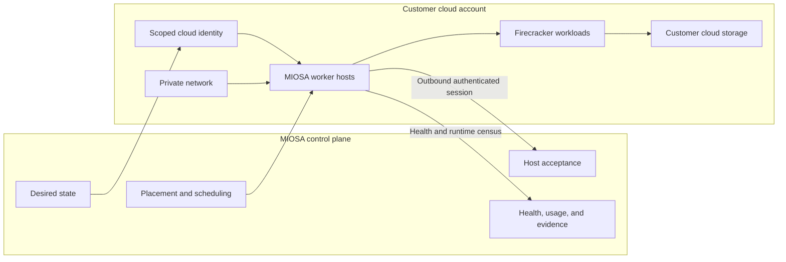
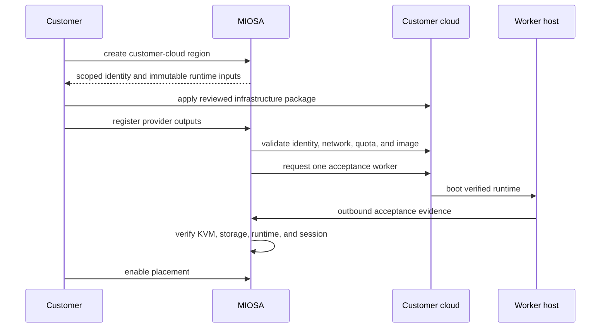

Bring Your Own Cloud lets an organization power its product with infrastructure inside its own AWS account or GCP project.

MIOSA remains the orchestration and product control plane.

For servers in your own office, lab, or data center, use [on-premises servers through OpenComputers](/docs/opencomputers).
Connecting an existing server or cloud VM through OpenComputers does not provision a governed BYOC worker region.
Here, **BYOC** consistently means **Bring Your Own Cloud**.

`Activation gated`
`Infrastructure packages built`

## Choose an infrastructure model

- **MIOSA-managed**: MIOSA operates compute, networking, host lifecycle, capacity, and placement.
- [OpenComputers](/docs/opencomputers): Connect an individual workstation or owned server through an outbound agent session.
- **Bring Your Own Cloud**: Install a governed MIOSA worker region inside a customer AWS account or Google Cloud project.
- **Hybrid placement**: Keep governed workloads in customer infrastructure and use other capacity only where policy permits.

OpenComputers and Bring Your Own Cloud are different products.

OpenComputers connects individual machines.

Bring Your Own Cloud creates a governed cloud capacity region that remains orchestrated by the MIOSA control plane.

## Control plane and customer cloud

The customer controls the cloud account, network, identity policies, provider resources, and provider bill.

MIOSA controls desired capacity, workload placement, immutable runtime generations, acceptance, scheduling, drain, and reconciliation.

## What runs where

| Layer | MIOSA control plane | Customer cloud |
|---|---|---|
| Organization and workspace policy | Yes | No |
| Desired capacity and placement | Yes | Reflected by worker capacity |
| Provider IAM and networking | Validated and orchestrated | Created and owned |
| Worker hosts | Observed and scheduled | Executed and billed |
| Firecracker workloads | Requested and tracked | Executed |
| Host runtime artifacts | Identified and verified | Downloaded and installed |
| Customer data stores | Bound by the application | Customer-selected |
| Acceptance evidence | Recorded | Produced by the host |

## Provider support

- **Amazon Web Services**: Terraform and CloudFormation packages define private multi-AZ worker foundations, scoped IAM, immutable templates, and fail-closed acceptance.

  [AWS architecture →](/docs/infrastructure/byoc/aws)
- **Google Cloud**: Terraform defines the service account, network, firewall, instance template, artifact access, and acceptance handoff.

  [Google Cloud architecture →](/docs/infrastructure/byoc/gcp)

## Customer onboarding path

Infrastructure creation does not make a region live.

Placement begins only after provider preflight, one real host acceptance, recorded evidence, and explicit enablement.

> **Note: Why activation is gated**
>
> The packages intentionally fail closed until the per-instance acceptance sequence is certified through a real provider canary.
> Cloud-provider state such as EC2 running is never enough to declare a MIOSA host ready.

## BYOC compared with OpenComputers

| | Bring Your Own Cloud | OpenComputers |
|---|---|---|
| Unit | Governed cloud region or host pool | Individual owned machine |
| Provisioning | Terraform or CloudFormation | Agent installation |
| Network | Customer VPC or subnetwork | Existing host network |
| Identity | Cloud IAM and instance identity | MIOSA host registration |
| Capacity | Provider fleet | Connected machines |
| Best for | Enterprise cloud boundaries | Local and owned hardware |

- [Review responsibility boundaries](/docs/infrastructure/shared-responsibility): Understand identity, networking, data, runtime, upgrades, and incident ownership.

## Provider foundations

| Provider | Current package | Current boundary |
|---|---|---|
| AWS | Terraform and CloudFormation | Private networking, scoped identity, immutable host templates, artifact inputs, and fail-closed acceptance |
| Google Cloud | Terraform | Separate keyless actuator and worker identities, network, firewall, immutable host image, artifact access, and acceptance handoff |

> **Caution: Activation gated**
>
> The AWS and Google Cloud packages exist, but general production activation remains gated on a real provider canary and per-host acceptance evidence.
> Cloud-provider status alone does not make a MIOSA host schedulable.

## Activation sequence

1. Create the customer-cloud region in MIOSA.
2. Apply the reviewed provider package in the customer account or project.
3. Register the provider outputs with MIOSA.
4. Run identity, network, quota, image, and artifact preflight.
5. Boot one acceptance worker.
6. Verify KVM, storage, runtime generation, authenticated session, and workload execution.
7. Record the evidence.
8. Record separate Sandbox, Computer, and Deployment verification receipts for every workload type that will use the pool.
9. Explicitly enable placement.

Infrastructure creation does not make a region live.

Placement begins only after the full acceptance contract passes.

## Shared responsibility

| Responsibility | Customer | MIOSA | Cloud provider |
|---|---|---|---|
| Account or project ownership | Owns | Validates access | Hosts account services |
| IAM and network policy | Approves and owns | Requests scoped capabilities | Enforces |
| Worker runtime | Supplies capacity | Versions, verifies, and reconciles | Runs infrastructure |
| Workload placement | Sets policy | Schedules and records | Provides compute |
| Provider billing | Pays | Reports MIOSA usage separately | Bills resources |
| Host health | Receives incidents | Verifies runtime census and acceptance | Reports infrastructure state |

## Product contract

Your product should not need a different workflow for every provider.

MIOSA resolves the target, checks policy and capacity, dispatches work, and reports one status and evidence shape.

Use OpenComputers for individual owned machines.

Use customer-cloud regions for governed pools of AWS or Google Cloud capacity.

Use MIOSA-managed compute when the customer does not require a cloud-account boundary.
