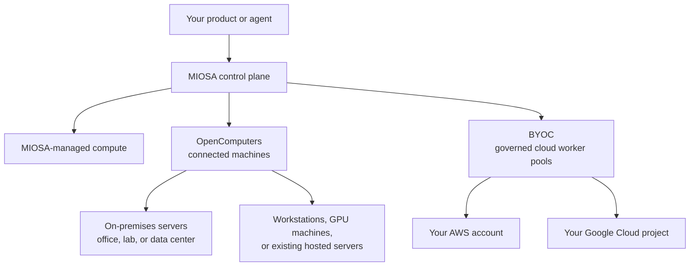

Run work on MIOSA-managed compute, connect machines you already own, or use governed worker capacity in your own cloud account.

MIOSA provides the organization, workspace, API, and orchestration layer.
The selected infrastructure determines where execution happens and who operates the hardware.

## Choose where work runs

| Your requirement | Infrastructure path | Who operates the machines? |
|---|---|---|
| Start without owning servers | MIOSA-managed compute | MIOSA |
| Use servers in your office, lab, or data center | On-premises servers connected through OpenComputers | Your organization |
| Use a workstation, a GPU machine, or an existing hosted server | OpenComputers | You or your hosting provider |
| Provision a governed worker pool in your AWS account or Google Cloud project | Bring Your Own Cloud (BYOC) | Shared between your organization, MIOSA, and the cloud provider |
| Use more than one of these locations | Hybrid infrastructure with explicit workload placement | Depends on each selected target |

- **MIOSA-managed compute**: MIOSA operates the compute capacity, host lifecycle, and platform networking.
  Use it when you want to create resources without maintaining your own servers.
- **On-premises servers**: Connect a supported server in your office, lab, or data center through OpenComputers.
  Your organization retains responsibility for the hardware, operating system, power, storage, and local network.

  [OpenComputers overview →](/docs/opencomputers)
- **OpenComputers**: Connect a customer-controlled machine through an authenticated outbound agent session.
  That machine can be an on-premises server, workstation, GPU host, or an existing server at a hosting provider.

  [Connect a machine →](/docs/opencomputers/connect)
- **Bring Your Own Cloud**: Provision a governed MIOSA worker region inside a customer AWS account or Google Cloud project.
  This is a pool of worker capacity with provider-specific onboarding and acceptance checks.

  [BYOC architecture →](/docs/infrastructure/byoc/overview)

## Compare capabilities

The resource type determines the execution model; the location alone does not.
Check the selected host or region before dispatching work.

| Resource | Execution and desktop | Persistence and operation |
|---|---|---|
| Managed Sandbox | Isolated Linux execution for code and agents; use a Computer for a full desktop. | Follow the [snapshot and persistence lifecycle](/docs/develop/snapshots); MIOSA operates the host. |
| Managed Computer | Linux desktop, browser automation, and command execution; wait for desktop readiness. | Follow [Computer readiness](/docs/computers/fast-start) and recovery guidance; MIOSA operates the host. |
| OpenComputer | Runs on your existing machine with its advertised capabilities; direct execution uses the agent's OS permissions. | You maintain the OS, disks, backups, network, and agent service; desktop and GPU use depend on the host. |
| BYOC worker capacity | Accepted worker pools in your cloud account; available resource types depend on the provider rollout. | Your cloud account owns the infrastructure; follow provider acceptance and [shared responsibility](/docs/infrastructure/shared-responsibility). |

A GPU in an OpenComputer is usable only when its driver, model runtime, and selected workflow support it.
It does not imply availability of a managed GPU Sandbox.
A published application needs a deployment target; connecting a host does not automatically configure Docker Host on it.

## Availability before you choose

- **Managed Sandboxes:** generally available according to the [availability page](/docs/availability).
- **Managed Computers:** partner preview; desktop provisioning and readiness remain in hardening.
- **OpenComputers:** verify account access and the installed agent's capabilities before choosing a host; registration alone proves neither readiness nor feature parity.
- **BYOC:** activation gated on provider canary and host acceptance; infrastructure packages alone are not production capacity.

[Connect your first Linux server](/docs/opencomputers/connect) walks through installation, registration, a completed command, service startup, and disconnection.
If an existing host fails, use [OpenComputers troubleshooting](/docs/opencomputers/troubleshooting).

## How the options relate

**On-premises** describes the location and operating responsibility of the hardware.
**OpenComputers** is the connection and remote-operation path for a supported machine.
An on-premises server connected through OpenComputers is an **OpenComputer**.
OpenComputers also works with supported machines outside your premises.

**BYOC** means **Bring Your Own Cloud** in these docs.
Connecting an existing cloud VM as an OpenComputer does not make it a governed BYOC worker pool.

## Hybrid infrastructure and placement

Hybrid infrastructure combines two or more infrastructure locations in one product.
For example, an agent can run a command on an explicitly selected on-premises host while another task uses a MIOSA-managed Sandbox.
Choose each target according to its capabilities, data access, and permitted execution location.

Do not assume that an offline or full on-premises host causes automatic cloud overflow.
A fallback target needs explicit authorization, compatible capabilities, access to the required files and secrets, and a recovery plan for any unfinished work.
A common API does not make hardware, desktop support, or isolation identical across targets.

## Availability and responsibility

Connecting a host uses the MIOSA control plane; it does not install the complete MIOSA platform on your premises.
Work can execute on your machine while commands, status, output, and any requested artifacts pass through the configured MIOSA services.
Use the [OpenComputers security model](/docs/opencomputers/security) to understand connectivity and data boundaries.

> **Caution: Customer-cloud activation is gated**
>
> AWS and Google Cloud infrastructure packages exist, but production activation remains subject to provider acceptance and live canary evidence.
> Check the provider guide for the applicable maturity boundary before planning a rollout.

- [OpenComputers](/docs/opencomputers): Connect owned servers and machines, and understand execution, connectivity, and operating responsibilities.

- [Shared responsibility](/docs/infrastructure/shared-responsibility): See who operates the hardware, operating system, network, and control plane.

- [Infrastructure glossary](/docs/glossary#customer-infrastructure): Definitions for on-premises, OpenComputers, BYOC, hosts, and hybrid infrastructure.
