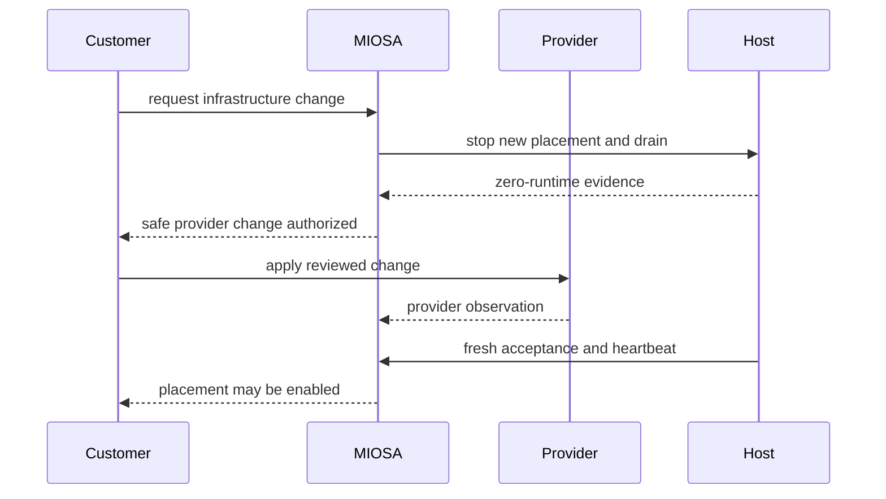

Infrastructure ownership changes who operates each layer.

The product should make those boundaries visible before a workload is placed.

OpenComputers includes on-premises servers as well as workstations and other existing customer-controlled machines.
The customer operates the connected machine and its local environment; MIOSA operates the connected control-plane service.

## Responsibility matrix

| Responsibility | MIOSA-managed | OpenComputers, including on-premises | Bring Your Own Cloud |
|---|---|---|---|
| Control-plane service | MIOSA | MIOSA | MIOSA |
| Physical hardware or cloud account | MIOSA | Customer | Customer |
| Site power, cooling, and physical access | MIOSA or its provider | Customer or its hosting provider | Cloud provider |
| Host operating system | MIOSA | Customer | Shared through certified image and customer account |
| Host capacity | MIOSA | Customer | Customer provider resources, MIOSA desired state |
| Network perimeter | MIOSA | Customer host network | Customer VPC or subnetwork |
| Runtime generation | MIOSA | Customer-approved agent update | MIOSA-signed generation, customer-reviewed installation |
| Workload placement | MIOSA policy | MIOSA policy within connected hosts | MIOSA policy within enabled customer pools |
| Provider billing | MIOSA | Customer hardware and network | Customer cloud bill |
| Application data and backup policy | Application owner | Application owner, including local disks and services | Application owner |
| Drain and workload proof | MIOSA | MIOSA plus host availability | MIOSA plus provider observation |

## MIOSA responsibilities

- Maintain desired state and placement policy.
- Issue scoped, retry-safe operations.
- Verify immutable runtime generations.
- Record host acceptance evidence.
- Require fresh host sessions before placement.
- Reconcile provider and runtime drift.
- Drain workloads before an authorized teardown.
- Report health, capacity, usage, and next actions.

## Customer responsibilities

- Choose the infrastructure ownership model.
- For on-premises hosts, maintain physical security, power, cooling, hardware, operating-system updates, disks, and network availability.
- Set the connected agent's permissions and monitor its service and outbound connectivity.
- Review which command output, artifacts, desktop streams, and model requests may leave your premises.
- Review cloud IAM, network, and infrastructure packages.
- Maintain cloud quotas, billing, and organization policy.
- Protect Terraform state and provisioning identities.
- Select data stores, retention, backup, and recovery policy.
- Approve placement into a customer-cloud region.
- Revoke access when the trust relationship should end.
- Coordinate destructive cloud changes with MIOSA drain state.

## Cloud-provider responsibilities

- Operate the underlying cloud services.
- Enforce the configured provider identity and network policy.
- Report provider state and billing.
- Provide the compute, storage, and network primitives requested by the customer.

## On-premises maintenance

Before restarting or disconnecting an on-premises server, stop new work and inspect the jobs and local services still running on it.
Confirm the outcome of interrupted operations before retrying them.
After maintenance, verify connectivity and required capabilities with a small command on that exact host.
An offline status does not prove that local processes stopped or that work moved to another machine.

See [OpenComputers](/docs/opencomputers) for the execution and data boundaries.

## Governed worker-pool change order

Do not terminate a host because its time-to-live expired or its provider record looks stale.

Termination requires exact ownership plus fresh drain, zero-runtime, and session-revocation evidence.

> **Caution: Provider healthy is not MIOSA ready**
>
> A running VM is not sufficient.
> The runtime, storage, authenticated session, guest boot, capability advertisement, and placement scope must also agree.

- [Customer infrastructure overview](/docs/infrastructure/overview): Compare MIOSA-managed compute, on-premises servers, OpenComputers, and customer-cloud regions.
