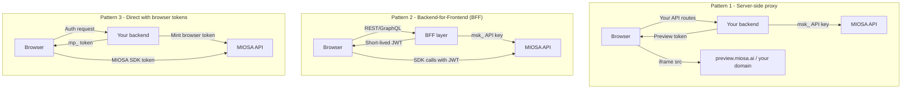

MIOSA gives you the full compute and preview infrastructure. You own the product, the brand, and the user relationship. Your customers never see "MIOSA".

This section covers everything you need to ship a white-label SaaS on top of MIOSA: per-user provisioning, custom domains, secure iframe embeds, webhooks, usage metering, and abuse controls.

---

## Core building blocks

- [Backend orchestration](/docs/integrations/backend-orchestration): Build the server-side control plane for prompt dispatch, device assignment, event streaming, artifact storage, and quota enforcement.
- [Fractal enterprise data](/docs/data/fractal): Run dedicated Fractal instances for massive-scale structured data and computation, secure and isolated for enterprise and government.
- [White-label SaaS walkthrough](/docs/platform/white-label): Provision customer-owned sandboxes, embed previews, use branded domains, and roll usage up to your users.
- [Preview tokens](/docs/develop/previews): Keep API keys server-side while safely embedding sandbox previews and customer-facing runtime surfaces.
- [Example apps](/docs/integrations/examples): Clone reference product patterns and adapt them to your own backend and frontend.

---

## What white-label tenants get

| Capability | What it means for your product |
|---|---|
| **Isolated sandboxes per user** | Each customer project runs in its own microVM with its own filesystem, network, and process tree. |
| **Custom preview domains** | Sandbox previews serve from `*.example.com` instead of `*.sandbox.miosa.ai`. |
| **Short-lived preview tokens** | Mint a server-side token, pass it to the browser  -  never expose your API key client-side. |
| **Webhook lifecycle events** | Receive `sandbox.running`, `sandbox.destroyed`, and more at your own HTTPS endpoint. |
| **Usage rollup by user** | Query compute usage keyed to your own `external_user_id` for per-seat billing. |
| **Per-user quotas** | Set max sandboxes, max CPU, or max runtime per user to prevent runaway spend. |
| **Branded failure pages** | 502 and 404 errors in previews show your logo, not MIOSA's. |
| **Full filesystem and terminal access** | Expose a file tree, terminal, or run-button in your UI using the SDK  -  no shell into MIOSA required. |

---

## Architecture patterns

Three deployment patterns cover the vast majority of integrations. All three keep your `msk_*` API key server-side.

### Pattern 1  -  Server-side proxy (recommended for most teams)

Your backend owns all MIOSA calls. The browser only receives a short-lived preview URL from your API. This is the simplest pattern and the one used in the `whitelabel-saas` example.

**When to use:** You already have a backend. You want the tightest control over what each user can do. No SDK needed in the browser.

### Pattern 2  -  Backend-for-Frontend (BFF)

A thin BFF layer authenticates the user, resolves their MIOSA workspace/project IDs, and returns a short-lived JWT. The browser then calls MIOSA directly using that token.

**When to use:** High-volume preview-heavy products where round-tripping every terminal keystroke through your backend adds latency.

### Pattern 3  -  Direct with browser tokens

Your backend mints a scoped browser token (`mp_...`) once. The browser uses `@miosa/sdk` directly with that token for file reads, exec calls, and preview embeds.

**When to use:** Interactive coding tools or IDEs where the browser needs low-latency direct access to the sandbox.

---

## Five-minute path for new integrators

1. [One-time setup](/docs/platform/white-label)  -  register your domain, set branding, configure a webhook
2. [Provision a sandbox per user](/docs/platform/white-label)  -  `client.sandboxes.create(external_user_id=...)`
3. [Embed the preview](/docs/platform/white-label)  -  mint a token server-side, drop an `<iframe>` in your UI
4. [Handle lifecycle events](/docs/platform/white-label)  -  react to `sandbox.running`, `sandbox.destroyed`
5. [Bill by user](/docs/platform/white-label)  -  query usage keyed to your `external_user_id`

---

## Example apps

Four full-stack examples you can clone and run locally:

- **whitelabel-saas (Python + Flask)**: The canonical white-label walkthrough. Lumen  -  a white-label SaaS  -  provisions sandboxes per customer project, embeds previews in iframes, and verifies lifecycle webhooks.

  [Walkthrough →](/docs/platform/white-label)
- **whitelabel-react-saas (React + Express)**: A React frontend with an Express BFF. Shows how to mint browser tokens server-side and use the TypeScript SDK directly from the browser for live terminal access.

  [Examples gallery →](/docs/integrations/examples)
- **whitelabel-nextjs-marketplace (Next.js)**: A Next.js App Router marketplace where each seller gets an isolated sandbox for their storefront. Uses Route Handlers for token minting and Server Components for usage display.

  [Examples gallery →](/docs/integrations/examples)
- **whitelabel-vue-tutor (Vue 3 + Express)**: An interactive coding tutor. Each lesson runs in a fresh sandbox. Demonstrates quota enforcement, public share links, and the file-tree SDK primitives.

  [Examples gallery →](/docs/integrations/examples)

---

## See also

- [Where compute runs](/docs/integrations/external-computers): MIOSA-managed, OpenComputers, and BYOC
- [Preview Tokens  -  auth deep dive](/docs/develop/previews)
- [Webhooks reference](/docs/integrations/webhooks)
- [White-Label Setup (domains, branding)](/docs/platform/white-label)
- [External Attribution](/docs/platform/attribution)
- [Usage & Billing](/docs/platform/usage-and-billing)
