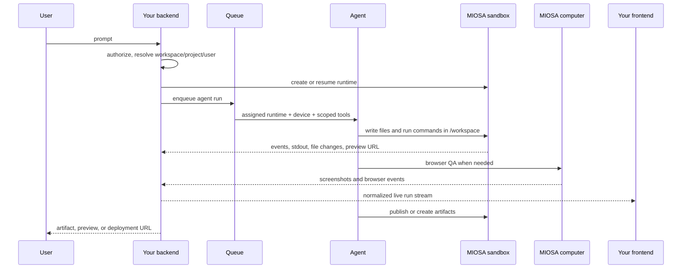

Your backend is the control plane for products built on MIOSA. It owns the user
session, product permissions, billing policy, model routing, agent roster,
connector grants, and approval rules. MIOSA owns the execution substrate:
sandboxes, computers, files, exec, previews, artifacts, events, snapshots, and
deployments.

Use this guide when you are building products like app builders, artifact
workspaces, Polsia-style operators, Cofounder / Co-Founder AI-style company
agents, Nebula-style virtual devices, or Heuresis-style encoded workspaces.

> **Note: Keep keys server-side**
>
> Use tenant or workspace API keys from your backend. Browsers should receive
> short-lived browser tokens, preview tokens, or your own session-bound proxy
> responses. Do not put `msk_*` keys in client code.

---

## Backend responsibilities

- **Resolve ownership**: Map your account, workspace, user, project, document, or app record to MIOSA
  ownership fields before creating resources.
- **Choose the runtime**: Route work to a sandbox for code/files, a computer for browser/desktop, or a
  local device when customer-owned hardware is required.
- **Dispatch the prompt**: Send the user's task into the selected agent runtime and assigned device.
  The agent should work inside that device, not build locally and upload later.
- **Stream progress**: Normalize tool calls, command output, file writes, screenshots, preview
  readiness, artifacts, approvals, and final URLs into one product event stream.
- **Persist outputs**: Store MIOSA resource ids, artifact ids, snapshot ids, deployment ids,
  connector grant ids, and request ids next to your own product records.
- **Enforce policy**: Apply quota, budget, approval, network, and connector rules before the agent
  can spend credits, send messages, publish apps, or use sensitive credentials.

---

## Reference flow



The important boundary is simple: your backend orchestrates; the agent executes
inside a MIOSA device.

---

## Prompt dispatch contract

Model every agent run as a prompt dispatched into an assigned device.

```typescript
type DevicePromptDispatch = {
  tenantId: string;
  workspaceId: string;
  projectId?: string;
  userId: string;
  deviceType: "sandbox" | "computer" | "local";
  deviceId: string;
  runtime: "osa" | "codex" | "claude-code" | "hermes" | "gemini-cli" | "opencode" | "custom";
  prompt: string;
  cwd?: string;
  connectors?: string[];
  approvalPolicy: "auto" | "confirm-risky" | "manual";
  idempotencyKey: string;
};
```

The output stream should use one shape even when runtimes differ:

| Event | Use it for |
|---|---|
| `run.started` | The backend accepted the prompt and assigned a device |
| `tool.started` / `tool.completed` | Agent tool calls, MCP calls, connector calls |
| `command.output` | stdout/stderr from sandbox or computer commands |
| `file.changed` | Files created, edited, renamed, or deleted |
| `preview.ready` | Live server URL is ready |
| `artifact.created` | PDF, DOCX, image, HTML, ZIP, report, screenshot, or generated code output |
| `approval.required` | The agent wants to do something sensitive |
| `deployment.ready` | Stable public app URL is available |
| `run.failed` | Typed failure with request id and recovery path |

---

## Backend resource model

Store both your product ids and MIOSA ids. Do not force users or agents to
discover partial state after a retry.

```sql
agent_runs
  id
  tenant_id
  workspace_id
  project_id
  user_id
  prompt
  runtime
  device_type
  device_id
  sandbox_id
  computer_id
  deployment_id
  status
  idempotency_key
  created_at
  updated_at

agent_run_events
  id
  run_id
  type
  payload_json
  request_id
  created_at

agent_artifacts
  id
  run_id
  miosa_artifact_id
  path
  content_type
  size_bytes
  preview_url
  download_url
  created_at
```

For generated app products, also store the current persistent sandbox and latest
deployment per project:

```sql
projects
  id
  current_sandbox_id
  current_computer_id
  current_deployment_id
  primary_device_type
  primary_device_id
```

---

## SDK shape

Use the SDK language that matches your backend. The product logic is the same in
every language.

- [TypeScript backend](/docs/sdks/typescript): Node, Next.js route handlers, queues, AI SDK harnesses, and product backends.
- [Python backend](/docs/sdks/python): FastAPI, Django, Flask, data jobs, artifact generation, and Python agent loops.
- [Go backend](/docs/sdks/go): High-concurrency orchestration services, workers, queues, and control planes.
- [Elixir backend](/docs/sdks/elixir): Phoenix control planes, LiveView progress streams, queues, and long-running orchestration.

The minimum backend loop:

```text
1. Authenticate your user.
2. Resolve their workspace/project/user attribution.
3. Create or resume a sandbox/computer.
4. Dispatch the prompt into that device.
5. Stream events back to your UI.
6. Store artifacts, snapshots, previews, and deployments.
7. Enforce budget, quota, connector, and approval policy.
```

---

## Recovery rules

Production backends need to recover from partial progress.

| Failure | Backend behavior |
|---|---|
| Create succeeded, upload failed | Return the sandbox id and retry command; do not hide the partial resource |
| Agent runtime crashed | Keep the device and events; let user retry into the same workspace |
| Preview failed | Surface logs and process state; do not delete files automatically |
| Sandbox stopped | Resume or fork from snapshot when persistence is available |
| Budget exceeded | Stop new work and show the usage source |
| Connector authorization missing | Return a connect-account action, not a generic 500 |
| Publish failed | Keep the sandbox preview and release artifact for retry |

Use idempotency keys on mutations so retries do not create duplicate sandboxes,
deployments, or app records.

---

## See also

- [Build an agent-company platform](/docs/guides/build-agent-company): Product architecture for Polsia, Cofounder, Nebula, and Heuresis-style systems.
- [Agent orchestration](/docs/guides/agent-orchestration): Scale from one agent to thousands with queues, devices, subagents, and events.
- [API reference](/docs/api-reference): Low-level REST endpoints for sandboxes, computers, files, exec, events, and deploys.
- [White-label SaaS walkthrough](/docs/platform/white-label): Customer attribution, preview tokens, custom domains, and branded product flows.
