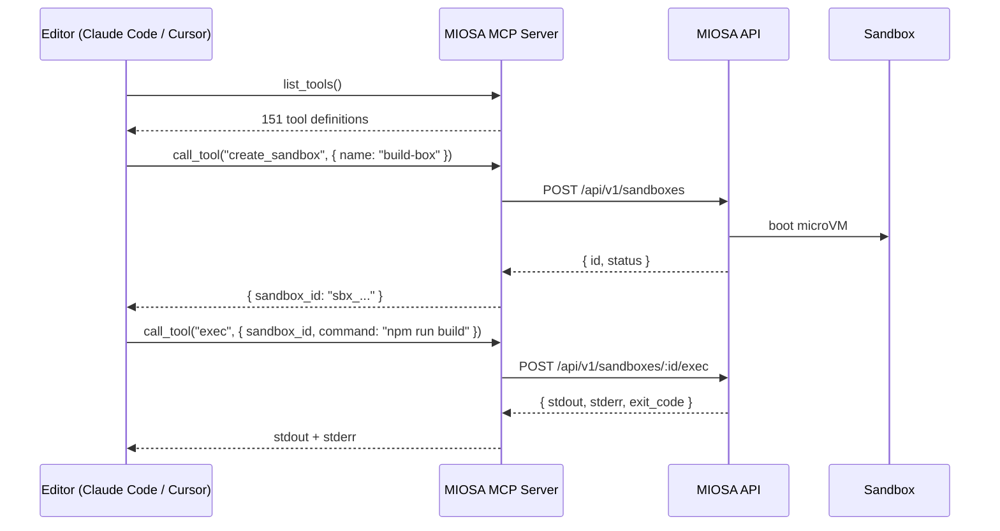

This page covers how the MCP server works under the hood, the full client configuration matrix, worked usage examples, troubleshooting, and security guidance. For the install path, see [Install and authenticate](/docs/mcp/install); for the exact tool list, see the [Tools reference](/docs/mcp/tools).

## How it works



The MCP server is a thin stateless proxy. Your API key travels with every request; the server never stores credentials.

When a client sends `initialize`, the server returns an `instructions` field containing a workflow guide  -  a compact description of MIOSA resource types, lifecycle conventions, and recommended tool patterns. MCP-aware clients like Claude Code surface this to the model at session start, so the agent understands the platform without requiring extra prompting.

---

## Configuration

### Claude Code

Add to `~/.claude/mcp.json`:

**Hosted (zero install)**

```json
{
  "mcpServers": {
    "miosa": {
      "url": "https://api.miosa.ai/api/v1/mcp",
      "headers": {
        "Authorization": "Bearer msk_u_..."
      }
    }
  }
}
```

No local process required. Restart Claude Code and the 145 MIOSA tools appear immediately.

**Python server**

```json
{
  "mcpServers": {
    "miosa": {
      "command": "miosa-mcp",
      "env": {
        "MIOSA_API_KEY": "msk_u_..."
      }
    }
  }
}
```

**TypeScript CLI**

```json
{
  "mcpServers": {
    "miosa": {
      "command": "npx",
      "args": ["@miosa/cli", "mcp", "serve"],
      "env": {
        "MIOSA_API_KEY": "msk_u_..."
      }
    }
  }
}
```

### Cursor

Open **Cursor → Settings → MCP** and add:

**Hosted (zero install)**

```json
{
  "miosa": {
    "url": "https://api.miosa.ai/api/v1/mcp",
    "headers": {
      "Authorization": "Bearer msk_u_..."
    }
  }
}
```

**Python server**

```json
{
  "miosa": {
    "command": "miosa-mcp",
    "env": { "MIOSA_API_KEY": "msk_u_..." }
  }
}
```

**TypeScript CLI**

```json
{
  "miosa": {
    "command": "npx",
    "args": ["@miosa/cli", "mcp", "serve"],
    "env": { "MIOSA_API_KEY": "msk_u_..." }
  }
}
```

### Windsurf

In `~/.codeium/windsurf/mcp_config.json`:

**Hosted (zero install)**

```json
{
  "mcpServers": {
    "miosa": {
      "url": "https://api.miosa.ai/api/v1/mcp",
      "headers": {
        "Authorization": "Bearer msk_u_..."
      }
    }
  }
}
```

**Python server**

```json
{
  "mcpServers": {
    "miosa": {
      "command": "miosa-mcp",
      "env": {
        "MIOSA_API_KEY": "msk_u_..."
      }
    }
  }
}
```

**TypeScript CLI**

```json
{
  "mcpServers": {
    "miosa": {
      "command": "npx",
      "args": ["@miosa/cli", "mcp", "serve"],
      "env": {
        "MIOSA_API_KEY": "msk_u_..."
      }
    }
  }
}
```

Reload Windsurf. Tools are available in the Cascade panel.

### Environment variable reference (local server only)

| Variable | Required | Default | Description |
|---|---|---|---|
| `MIOSA_API_KEY` | Yes |  -  | Your `msk_u_...` key |
| `MIOSA_API_URL` | No | `https://api.miosa.ai` | Override for self-hosted or staging |
| `MIOSA_DEFAULT_TEMPLATE` | No | `miosa-sandbox` | Template used when `sandbox_create` omits `template_id` |
| `MIOSA_TIMEOUT_MS` | No | `30000` | Per-request HTTP timeout in milliseconds |
| `MIOSA_LOG_LEVEL` | No | `warn` | `debug`, `info`, `warn`, `error` |

---

## Usage examples

### Create a computer and take a screenshot

```yaml
You: Create a Linux desktop and take a screenshot of whatever is on screen.
```

The assistant calls `computer_create({ template_type: "miosa-desktop", size: "small" })`, waits for it to boot, calls `desktop_screenshot()`, and describes what it sees. It can then call `desktop_click`, `desktop_type`, and `desktop_launch` to interact.

---

### Deploy a sandbox to production

```yaml
You: Build the Next.js app in the sandbox and deploy it to a permanent URL.
```

The assistant calls `sandbox_exec({ command: "npm run build" })`, confirms `exit_code: 0`, then calls `deployment_publish({ sourceSandboxId: "sbx_...", kind: "static", outputPath: "/workspace/.next/out" })` and returns the live URL.

---

### Set up a cron job

```yaml
You: Create a cron job that runs a health check script every 5 minutes.
```

The assistant calls `cron_create({ name: "health-check", schedule: "*/5 * * * *", command: "bash /workspace/health-check.sh", computer_id: "computer_..." })`. To trigger it immediately for a smoke test, it calls `cron_run_now({ cron_id: "cron_..." })`.

---

### Create a database and get credentials

```yaml
You: Provision a Postgres database and give me the connection string for my app.
```

The assistant calls `database_create({ name: "my-app-db", region: "us-east" })`, polls `database_get` until status is `running`, then calls `database_credentials({ id: "db_..." })` and returns the connection string. It can also call `deployment_env_set` to inject `DATABASE_URL` directly into a deployment.

---

## Troubleshooting

> **Tip: Debug mode (local server)**
>
> Set `MIOSA_LOG_LEVEL=debug` to see every request and response the MCP server sends to the MIOSA API. Useful for diagnosing auth or timeout issues.

**`401 Unauthorized` on hosted MCP**  -  Confirm the `Authorization` header value starts with `Bearer msk_u_` (not just the key alone). Check that the key is active under Dashboard → Settings → API Keys.

**`MIOSA_API_KEY is not set` (local server)**  -  The env var is missing from your MCP config. Confirm the `env` block is present in your client's MCP JSON and that the key starts with `msk_u_`.

**Tool calls timeout**  -  Sandbox boots take 2-8 s on first call. Increase `MIOSA_TIMEOUT_MS` if your client has a short MCP timeout. Claude Code default is 30 s; Cursor default is 10 s.

**`403 Forbidden`**  -  Your key is valid but lacks the required scope. Check [API Keys](/docs/platform/api-keys) to confirm the key has the scopes needed for the tools you're calling.

**`No tools appear in Cursor`**  -  Cursor requires the MCP config to be valid JSON. Run `node -e "JSON.parse(require('fs').readFileSync('cursor-mcp.json','utf8'))"` to validate.

---

## Security considerations

- Store `MIOSA_API_KEY` in your client's secret store, not in a `.env` file committed to git.
- Use a **scoped key** for MCP: grant only the scopes your workflow needs. Never use an admin key for editor integrations.
- The hosted MCP endpoint and local MCP server both make outbound HTTPS requests only. Neither opens inbound ports.
- Resources created through MCP are subject to the same tenant-scoped authorization as direct API calls. The MCP server cannot access another tenant's resources.

---

---

## See also

- [Install and authenticate](/docs/mcp/install): Choose the hosted endpoint or the local stdio package and set organization context.
- [Tools reference](/docs/mcp/tools): Every tool the MCP server registers, grouped by family.
