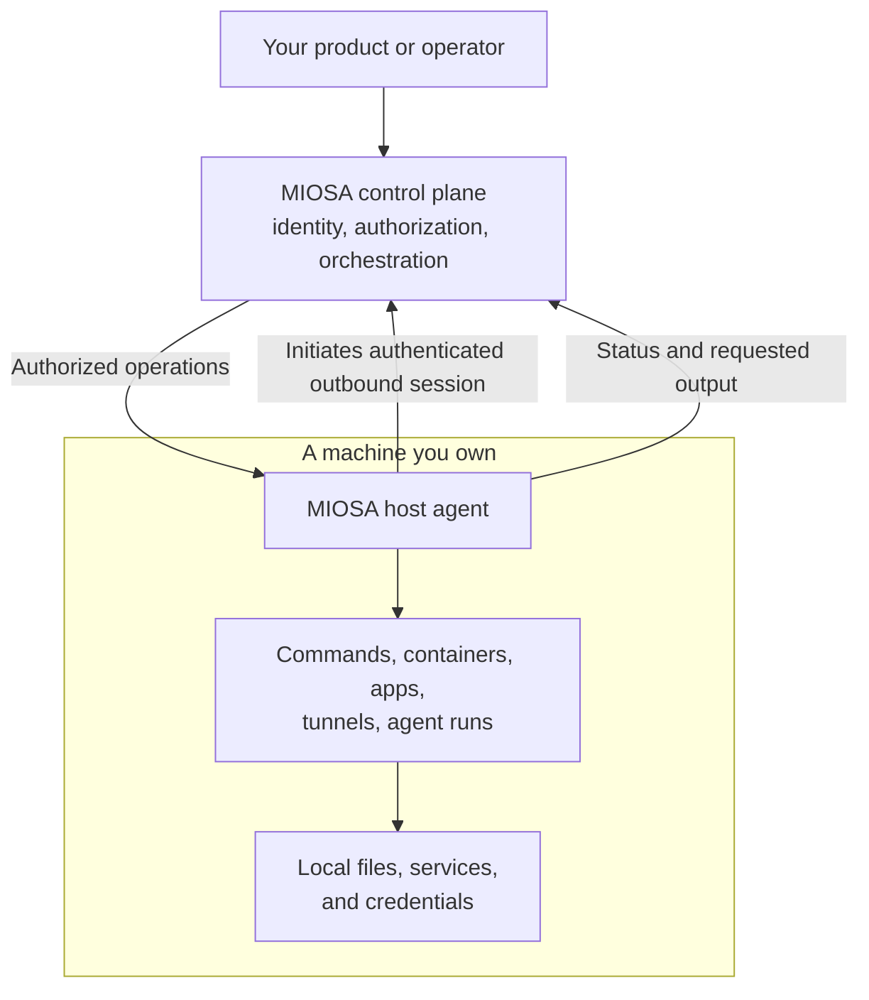

**OpenComputers** connects machines you already own to MIOSA.
You install the MIOSA host agent on a workstation, a GPU box, an on-premises server, or an existing server at a hosting provider.
The agent opens an authenticated outbound session, and MIOSA then manages that machine as a **host**.

A host is a machine in your organization.
You keep the hardware, the operating system, and the decision about what the agent may reach.
MIOSA supplies identity, authorization, orchestration, and the remote-operation surface: commands, containers, private networks, CI runners, scheduled backups, tunnels, and agent work.

Do it now

Connect your first host

Enroll a machine you own. Your first success is a completed command on that exact host.

- [Connect a host](https://miosa.ai/cloud/connect/opencomputers): (opens the MIOSA console in a new tab)

miosa host register studio --platform linux

Prints the host ID and the host key once. Install the agent on the machine first.

Next [Connect your first host, step by step](/docs/opencomputers/connect)

> **Note: Host, OpenComputer, device**
>
> A **host** is one enrolled machine. An **OpenComputer** is that machine as a MIOSA resource - the term used in the UI and in the [OpenComputers API](/docs/api-reference/open-computers). A **device** is any runtime MIOSA can run a command on, including a sandbox or a managed Computer.

## When to use OpenComputers

Choose OpenComputers when the work must run on hardware you control, or when you already have the capacity.

| You need | Use | Why |
|---|---|---|
| Run on hardware you already own or rent | OpenComputers | The agent runs the command on that exact machine, inside its OS permissions. |
| A desktop or browser session you can stream | [Managed Computer](/docs/computers/overview) | Provisioned and operated by MIOSA, with a ready desktop contract. |
| Isolated, disposable code execution | [Sandboxes](/docs/develop/sandboxes) | A fresh microVM per sandbox, no host to maintain. |
| A governed worker pool inside your own AWS account or Google Cloud project | [BYOC](/docs/infrastructure/byoc/overview) | A separate onboarding path for cloud worker capacity. |

The same MIOSA interface does not mean every host supports every operation.
Direct execution on a host runs as the host user, and a host only advertises the capabilities its agent reports.
Select the host explicitly and check the capability your workflow needs.

## What MIOSA manages



| Layer | Who operates it |
|---|---|
| Host, operating system, disks, power, network | You, or your hosting provider |
| Host agent service and its OS user and permissions | You install and run it; MIOSA delivers signed agent updates |
| Organization, API, authorization, orchestration, audit | MIOSA |
| Local files, services, and credentials the agent can reach | You, bounded by the agent user's permissions |
| Commands, status, output, artifacts, desktop streams, model requests | May pass through MIOSA as part of the workflow |

Connecting a host does not install the MIOSA platform on your premises, and it does not turn the host into a sandbox worker pool, an Docker Host host, or a BYOC region.
See [Shared responsibility](/docs/infrastructure/shared-responsibility) for the full boundary matrix.

## The OpenComputers surface

| Area | What you get | Guide |
|---|---|---|
| Hosts | Enroll machines, inspect status, capabilities, metrics, services, and jobs | [Hosts and capabilities](/docs/opencomputers/hosts) |
| Commands and files | Run a command on one host, or on every member of a group; read and write files | [Hosts and capabilities](/docs/opencomputers/hosts) |
| Containers | Run images, stream logs and stats, and keep compose projects up | [Containers](/docs/opencomputers/containers) |
| Meshes | A private encrypted WireGuard network across several of your hosts | [Meshes](/docs/opencomputers/meshes) |
| GitHub Actions runners | Self-hosted runners registered for one repository | [GitHub Actions runners](/docs/opencomputers/gha-runners) |
| Backups | Scheduled snapshots of directories, forkable onto any host | [Backups and snapshots](/docs/opencomputers/backups) |
| Tunnels | Expose a host port at a MIOSA-managed address | [Tunnels and exposing services](/docs/opencomputers/tunnels) |
| Devices | One id-addressed surface across every runtime kind | [Devices](/docs/opencomputers/devices) |
| Apps, clusters, groups, secrets | Install catalog apps, serve a model across hosts, target groups, scope secrets | [Hosts and capabilities](/docs/opencomputers/hosts) |

## Connect a host

```bash
miosa host register studio --platform linux   # prints the host key once
miosa host list
miosa host get <host>
```

`register` creates the host record and prints the **host key** exactly once.
Give that key to the agent on the machine; it is not the same credential as your platform API key.

Follow [Connect your first host](/docs/opencomputers/connect) for the install, enrollment, and verification walkthrough.

## Related

- [Connect your first host](/docs/opencomputers/connect): Install the agent, enroll the machine, and complete a command on that exact host.
- [Hosts and capabilities](/docs/opencomputers/hosts): Inspect a host, run commands on one machine or a group, and read files.
- [Security model](/docs/opencomputers/security): What the outbound session does and does not grant MIOSA.
- [API and CLI reference](/docs/opencomputers/reference): Every endpoint, command, and SDK surface for OpenComputers.

- [CLI: your own hosts](/docs/cli/platform#your-own-hosts): The full miosa host and miosa device command reference.

- [Infrastructure options](/docs/infrastructure/overview): Compare managed compute, connected machines, BYOC, and external providers.

## Next steps

- [Connect your first host](/docs/opencomputers/connect): Install the agent, enroll the machine, and run a command on it.
- [Manage hosts](/docs/opencomputers/hosts): Inspect capabilities, run commands, and read files.
- [Review the security model](/docs/opencomputers/security): What the outbound session does and does not grant.
