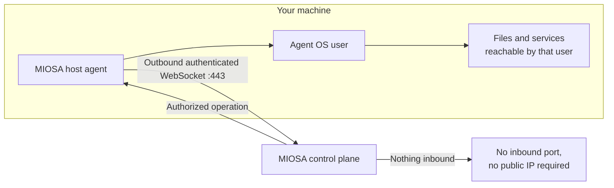

OpenComputers inverts the usual direction of a management connection.
The agent on your machine dials out to MIOSA; MIOSA never dials in.
That single design decision determines most of what is and is not possible here.



## What MIOSA can do

- Send an authorized operation over the session the agent already opened: a command, a file read or write, a container action, a backup, or a tunnel dial.
- Read the host's reported state: platform, architecture, capabilities, runtime, tags, heartbeat, agent version, and job history.
- Route an inbound HTTP request down an existing session, but only through a [tunnel you created](/docs/opencomputers/tunnels) and only if the request satisfies that tunnel's access mode.

## What MIOSA cannot do

- Open a connection to your machine spontaneously. There is no inbound management port and no requirement for a public IP.
- Act with more privilege than the agent's own operating-system user. Direct execution runs as that user, with that user's filesystem permissions and network reach.
- See files the agent user cannot read, or services that user cannot reach.
- Replace your operating-system controls. The agent is not a sandbox, a hypervisor, or a jail.

> **Caution: Direct host execution is not isolated**
>
> Running a command on a host executes it in the host's own environment, not in an isolated microVM.
> Registration alone does not make a host a sandbox worker pool or an Docker Host host.
> If you need isolation, put the work in a [sandbox](/docs/develop/sandboxes) instead of on a host.

## Credentials

Two credentials exist, they have different jobs, and they are not interchangeable.

| Credential | Who uses it | Lifetime |
|---|---|---|
| **Host key** | The agent on the machine, from `osa opencomputers login` | Returned once at registration; revocable |
| **Platform API key** | Your terminal, backend, or SDK | Managed in [API keys](/docs/platform/api-keys) |

The host also keeps an Ed25519 identity file, `~/.osa/open_computers.ed25519`, which pins the machine's identity.
Preserve that file across agent upgrades.
If it is lost, revoke the host and register a new one rather than copying another machine's identity or disabling verification.

You can check whether a host key is still valid without touching the host:

```bash
curl --fail-with-body -sS \
  -X POST "https://api.miosa.ai/api/v1/opencomputers/hosts/registration-status" \
  -H "Content-Type: application/json" \
  -d '{"host_key":"<host-key>"}'
```

It answers `{connected, state, host}`, with `410` for a revoked key and `401` for an invalid one.

## Authorization

Operations are authorized at the control plane, and every record is tenant-scoped.

- Commands dispatched to a host require the `opencomputers:write` scope.
- Host runtime registration, enrollment, and certification use `cloud:read` and `cloud:write`.
- Host listing, files, containers, tunnels, meshes, backups, and secrets rely on the API pipeline's organization authorization and workspace membership, and each handler resolves the resource through a tenant-scoped lookup.

A host ID from another organization resolves to nothing, not to someone else's machine.

## Secrets

Host and tenant secrets are encrypted key-value pairs.
List calls return names, descriptions, and IDs, never values.

```bash
miosa host secret set <host> GITHUB_TOKEN --key-stdin < token.txt
miosa host secret list <host>
```

The REST reveal endpoint, `POST /api/v1/opencomputers/hosts/{id}/secrets/{secret_id}/reveal`, is the only way to read a value back, and every call is audit-logged.

## Audit log

Every authorization-relevant action lands in the OpenComputers audit log.

```bash
curl --fail-with-body -sS "https://api.miosa.ai/api/v1/opencomputers/audit?limit=50" \
  -H "Authorization: Bearer $MIOSA_API_KEY"
```

| Endpoint | What it does |
|---|---|
| `GET /opencomputers/audit` | Cursor-paginated events; filter by `kind`, `host_id`, `actor`, `from`, and `to` |
| `GET /opencomputers/audit/export` | The same data as JSON or CSV, up to 5000 rows |
| `GET /opencomputers/audit/verify` | Verifies the integrity chain and reports the last good index |
| `GET /opencomputers/audit/:id` | One event |
| `GET /opencomputers/audit/live` | A live SSE feed |

Run `verify` on a schedule: it answers whether the stored audit history is intact, which is what makes the log useful after an incident.

## Webhooks

OpenComputers webhooks POST events to your endpoint with an HMAC-SHA256 signature over the raw body, under a signing secret returned once when the webhook is created.

```bash
curl --fail-with-body -sS -X POST "https://api.miosa.ai/api/v1/opencomputers/webhooks" \
  -H "Authorization: Bearer $MIOSA_API_KEY" \
  -H "Content-Type: application/json" \
  -d '{"name":"host-alerts","url":"https://example.com/hooks/miosa","events":["host.disconnected"]}'
```

Verify the signature over the exact bytes you received, before you parse them.
`GET .../webhooks/{id}/deliveries` shows recent attempts, and `POST .../webhooks/{id}/test` sends one on demand.
See [Webhooks](/docs/integrations/webhooks) for the general delivery contract.

## Data boundaries

Executing on your machine keeps the execution on your machine.
It does not mean every byte stays there.

| Data | Where it travels |
|---|---|
| The command and its arguments | Sent over the session; the command is recorded in audit |
| Command output and file contents you request | Returned through MIOSA as part of the workflow |
| Backup chunks | Uploaded to MIOSA storage, encrypted at rest |
| Desktop and terminal streams | Routed through MIOSA while a session is open |
| Model requests from an agent run | Sent to the model endpoint you configured, which may be a third party |

Set the agent's permissions, the tunnel access modes, and the model endpoints to match the data you are willing to move.
For a fuller treatment of hardware ownership and connectivity, see [Shared responsibility](/docs/infrastructure/shared-responsibility).

## Revocation and teardown

```bash
miosa host rm <host> --yes
```

Revoking a host ends its ability to authenticate immediately.
It does not erase the machine's files, and it does not stop a process already running there.
Before you revoke or retire a host, stop new work, inspect its [jobs](/docs/opencomputers/hosts#run-a-command), and confirm the outcome of anything in flight.

- [Connect your first host](/docs/opencomputers/connect): Install, enroll, and verify a machine.

- [Shared responsibility](/docs/infrastructure/shared-responsibility): Who operates the hardware, operating system, network, and control plane.
