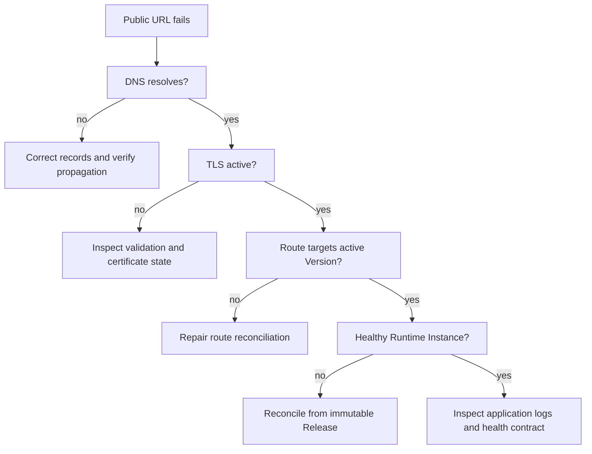

Use these playbooks when a customer-visible workflow is unhealthy.

Diagnose before mutating anything, preserve the last known-good version, and make one bounded recovery change at a time.

## First five minutes

1. Resolve the exact Organization, Workspace, Project, and affected resource.
2. Record the public URL, deployment ID, active version ID, and current health state.
3. Test the public route from outside the runtime.
4. Separate build, runtime, route, DNS, and TLS failures.
5. Preserve the previous ready Version and any operation or idempotency ID.

## Deployment is down

| Check | Healthy proof | Recovery |
|---|---|---|
| Active Version | Exact expected version ID | Promote the last verified ready Version |
| Artifact | Running digest matches Release | Replace the runtime from the immutable Release |
| Runtime | Required instances are ready | Reconcile or replace failed instances |
| Route | Public URL reaches active Version | Reconcile routing after runtime readiness |
| Application | Health endpoint succeeds | Fix configuration or publish a corrected Release |

Do not rebuild an old Release to recover it.

Rollback should select an already verified Version while preserving the Deployment and domain identities.

## Domain remains pending

1. Copy the exact record type, host, target, and ownership token returned by MIOSA.
2. Remove conflicting records at the same hostname.
3. Disable DNS proxying until ownership verification completes.
4. Query the authoritative DNS provider, then public resolvers.
5. Retry verification only after the expected answer is visible.

For a wildcard such as `*.apps.example.com`, most providers expect the host field `*.apps`, not the complete hostname.

For an apex hostname, use the provider's supported ALIAS, ANAME, or flattened CNAME behavior when a normal CNAME is not permitted.

## TLS is not active

- Confirm DNS already resolves to the MIOSA verification target.
- Confirm the hostname is attached to only one Organization and Deployment.
- Check whether a restrictive CAA record blocks the certificate authority.
- Keep proxying disabled until verification and certificate provisioning finish.
- Do not repeatedly detach and reattach the hostname because that restarts validation.

## Docker Host host is unhealthy

1. Confirm the host record points to the expected appliance and organization.
2. Confirm the appliance agent, Docker Engine, and required persistent storage are healthy.
3. Confirm the immutable Release is available to the appliance.
4. Check the last deployment operation before starting another one.
5. Reconcile the desired Deployment instead of creating a duplicate Deployment.

> **Caution: Avoid duplicate builds**
>
> If a request times out, first determine whether the remote build is still running.
> Recover with the recorded operation ID or idempotency key instead of submitting the same build again.

## Sandbox preview fails

- Confirm the Sandbox is running.
- Confirm the application listens on `0.0.0.0`, not only `localhost`.
- Confirm the requested preview port matches the application port.
- Confirm the development process is still alive.
- Recreate the Preview only after proving the Sandbox process and port are healthy.

## Escalation evidence

Provide support with resource IDs, UTC timestamps, operation IDs, expected and observed states, the public hostname, and redacted error output.

Never include API keys, cookies, database credentials, private source, customer personal data, or raw environment files.

## See also

- [Deployment domains](/docs/docker-host/domains)
- [Rollback](/docs/docker-host/rollback)
- [Docker Host hosts](/docs/docker-host/docker-deploy)
- [Known limitations](/docs/known-limitations)
