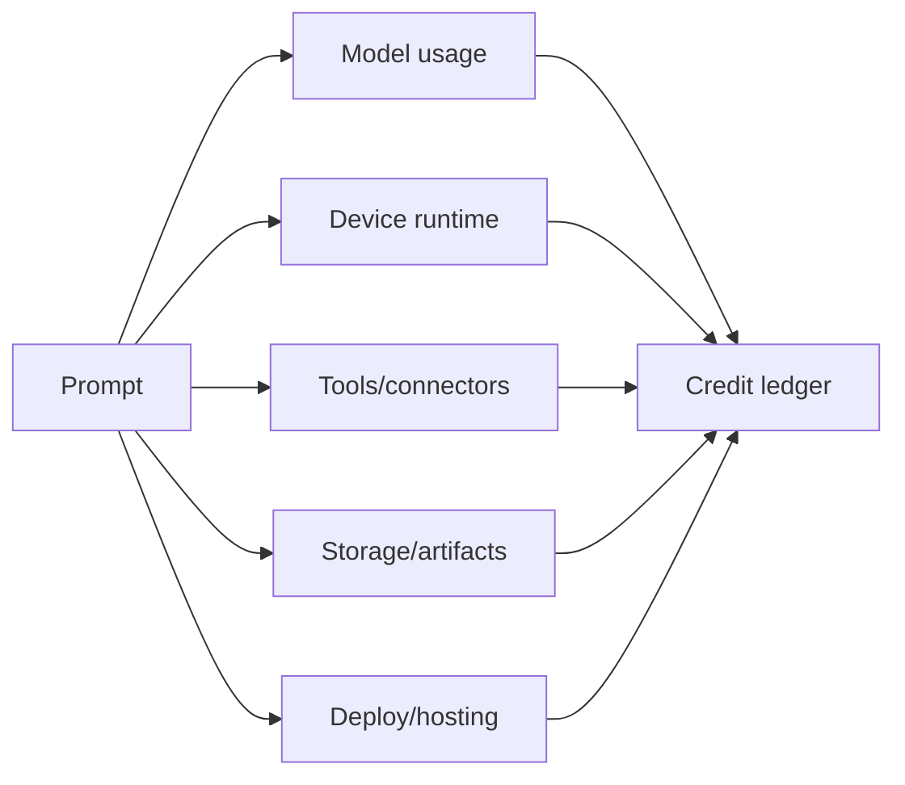

Credits are the business model for agent work on MIOSA. A user does not buy
"a sandbox" or "a model call" in isolation. They buy credits that power agents
doing useful work on devices.

```text
credits = model usage + device runtime + tools + storage + deployments
```

Use this page when building billing, quotas, usage pages, workspace budgets,
or white-label credit systems.

---

## Metered surfaces

| Surface | Examples | When charged |
|---|---|---|
| Model/runtime | OSA, Codex, Claude Code, Hermes, custom model calls | During agent reasoning and tool planning |
| Sandbox runtime | CPU/RAM while sandbox is running | While executing, previewing, installing, building |
| Computer runtime | Cloud desktop/browser time | While browser/desktop session is active |
| Local relay | Secure relay, streaming, tunnel, control channel | While paired local device is connected through MIOSA |
| Tool calls | Browser actions, web search, Refero, connector token requests | Per call or per run allocation |
| Storage | Snapshots, artifacts, logs, persistent files | By size and retention |
| Deploy hosting | MIOSA Deploy, Docker Host, domains, always-on app runtime | While deployed or always-on |

> **Note: One ledger**
>
> Even if each subsystem records internal metrics, customer-visible billing should
> land in one credit ledger with workspace, user, run, agent, and device context.

---

## Ledger shape

```sql
credit_ledger
  id
  tenant_id
  workspace_id
  project_id
  user_id
  agent_id
  run_id
  device_type
  device_id
  category
  units
  unit_price_credits
  credits
  metadata_json
  created_at
```

Recommended categories:

```text
model
device_runtime
tool
connector
storage
deployment
network
adjustment
grant
refund
```

Each ledger entry should be traceable to a run, request id, or lifecycle event.

---

## Run-level cost model



Every agent run should expose:

| Field | Purpose |
|---|---|
| `estimated_credits` | Show before high-cost work starts |
| `reserved_credits` | Prevent a run from exceeding budget mid-flight |
| `credits_used` | Final charge |
| `credit_breakdown` | Explain model/device/tool/storage/deploy split |
| `budget_remaining` | Let UI warn before next action |

---

## Simple examples

### One-shot health check

```text
User runs: miosa run "check preview"

Charges:
  model: small
  device_runtime: seconds
  storage: none
  deploy: none
```

### Sandbox app generation

```text
User asks: "Build a Next.js marketing page."

Charges:
  model: planning and code generation
  sandbox_runtime: install, build, preview
  storage: files, logs, snapshot
  deployment: only if user publishes
```

### Browser automation

```text
User asks: "Log in and test checkout."

Charges:
  model: browser planning
  computer_runtime: browser session
  tool: screenshots and browser actions
  storage: screenshots/report artifact
```

### Agent-company workflow

```text
User asks: "Launch this company campaign."

Charges:
  parent model run
  child model runs
  multiple sandboxes/computers
  connectors
  artifacts
  optional deployment
```

---

## Budget policies

Workspace owners should be able to set:

- monthly credit budget
- per-run max credits
- per-agent daily budget
- max concurrent sandboxes
- max concurrent computers
- max child agents
- max connector spend
- approval threshold
- hard stop threshold

Recommended approval gates:

| Action | Gate |
|---|---|
| Use more than run budget | Ask approval |
| Create many child devices | Ask approval |
| Start always-on deployment | Ask approval |
| Use paid connector | Ask approval or preconfigured policy |
| Send external messages | Ask approval |
| Delete snapshots/artifacts | Ask approval |

---

## Credits in white-label products

White-label products can expose credits in two ways:

| Model | Meaning |
|---|---|
| Pass-through | End customer sees MIOSA credit usage directly |
| Wrapped | Your product shows its own units, while backend maps to MIOSA credits |

For Lumen-style products, the backend should store both:

```sql
customer_usage_events
  external_workspace_id
  external_user_id
  external_project_id
  miosa_run_id
  miosa_credits
  customer_units
```

This lets your app show the product-specific balance while still reconciling to
MIOSA billing.

---

## Credit events

Emit events so the UI can update live:

| Event | When |
|---|---|
| `credits.estimated` | Before a run, publish, or expensive connector action |
| `credits.reserved` | Budget held for a run |
| `credits.charged` | Ledger entry committed |
| `credits.refunded` | Failed or cancelled work refunded |
| `credits.low_balance` | Workspace balance below threshold |
| `credits.limit_reached` | Run blocked by plan or budget |

The CLI should report the same data:

```bash
miosa billing balance
miosa workspace usage <slug>
miosa run usage <run-id>
miosa whoami --json
```

---

## Failure handling

Billing should be conservative and explainable.

| Failure | Expected billing behavior |
|---|---|
| Run rejected before start | No charge |
| Device created but agent failed before work | Charge minimal device time or refund per policy |
| Upload/import failed after resource creation | Return partial resource id and recovery command |
| User cancels | Charge work already performed, stop future charging |
| Platform error | Refund affected usage where possible |
| Connector/provider error | Charge only completed provider work |

Always include request ids and run ids in billing-support views.

---

## See also

- [Usage and billing](/docs/platform/usage-and-billing): Workspace billing, plan limits, and platform usage surfaces.
- [Agent product model](/docs/guides/agent-product-model): The product primitives that credits meter.
- [Agent workflow patterns](/docs/guides/agent-workflow-patterns): How different workflows consume credits.
- [API reference: usage rollup](/docs/api-reference/usage-rollup): Query usage summaries for dashboards and reports.
