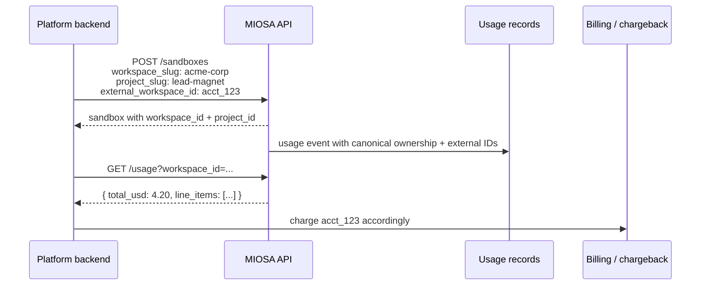

Resource ownership is how MIOSA decides where a resource lives. External attribution is how your platform maps that resource back to your own database.

- `workspace_id` and `project_id` are canonical MIOSA ownership. They affect routing, permissions, dashboard grouping, usage, and where resources appear.
- `external_workspace_id`, `external_user_id`, and `external_project_id` are opaque strings from your platform. They are copied to usage, audit, and child resources for reconciliation.

## Ownership fields

| Field | Meaning | Example |
|---|---|---|
| `workspace_id` | Existing MIOSA workspace UUID | `"550e8400-e29b-41d4-a716-446655440000"` |
| `workspace_slug` | Existing or auto-created workspace slug | `"acme-corp"` |
| `workspace_name` | Workspace display name when auto-created | `"Acme Corp"` |
| `project_id` | Existing MIOSA project UUID | `"660e8400-e29b-41d4-a716-446655440001"` |
| `project_slug` | Existing or auto-created project slug inside the workspace | `"lead-magnet"` |
| `project_name` | Project display name when auto-created | `"Lead Magnet"` |

If no workspace selector is supplied, MIOSA uses the organization's default workspace. If no project selector is supplied, MIOSA uses or creates a `default` project inside that workspace.

When you pass `external_workspace_id` or `external_project_id` without a canonical ID/slug, MIOSA resolves the matching workspace/project or creates one for this organization. The response includes `workspace_id` and `project_id`; store those IDs and use them on future calls when possible.

## Attribution fields

| Field | Meaning | Example |
|---|---|---|
| `external_workspace_id` | Your customer/workspace/account ID | `"acct_123"` |
| `external_user_id` | Your end-user ID inside that customer | `"user-456"` |
| `external_project_id` | Your project ID inside that workspace | `"project_789"` |

All three are optional, stored as text, and scoped to the authenticated MIOSA organization. They never grant access.

## How it flows


## On every create

Pass ownership and attribution in the request body of create calls:

**Sandbox**

```typescript
await miosa.sandboxes.create({
  templateId: "miosa-sandbox",
  workspaceSlug: "acme-corp",
  workspaceName: "Acme Corp",
  projectSlug: "lead-magnet",
  projectName: "Lead Magnet",
  externalWorkspaceId: "acct_123",
  externalUserId: "user-456",
  externalProjectId: "project_789",
})
```

**Computer**

```typescript
await miosa.computers.create({
  template_type: "ubuntu-desktop",
  workspaceId: "550e8400-e29b-41d4-a716-446655440000",
  projectId: "660e8400-e29b-41d4-a716-446655440001",
  externalWorkspaceId: "acct_123",
  externalUserId: "user-456",
  externalProjectId: "records_portal",
})
```

**Deployment**

```typescript
await miosa.deployments.publish(deploymentId, {
  sourceSandboxId: sandbox.id,
  workspaceId: sandbox.workspaceId,
  projectId: sandbox.projectId,
  externalWorkspaceId: "acct_123",
  externalUserId: "user-456",
  externalProjectId: "project_789",
})
```

**Custom Domain**

```typescript
await miosa.deployments.domains.add(deploymentId, {
  domain: "program.example.net",
  externalWorkspaceId: "acct_123",
  externalUserId: "user-456",
})
```

Canonical ownership and attribution are stored on the resource row and on every event / audit / usage record produced from that resource.

## Filter by ownership or attribution

List endpoints accept canonical ownership filters and external attribution filters:
```http
GET /api/v1/sandboxes?workspace_id=550e8400-e29b-41d4-a716-446655440000
GET /api/v1/sandboxes?project_id=660e8400-e29b-41d4-a716-446655440001
GET /api/v1/computers?external_project_id=records_portal&status=running
GET /api/v1/deployments?external_user_id=user-456
GET /api/v1/deployments/:id/domains?external_project_id=project_789
```

Filters are organization-scoped server-side. Another MIOSA organization cannot read your resources by guessing the same `workspace_id`, `project_id`, slug, or external ID.

## Inheritance

When a resource is derived from another, ownership and attribution are inherited by default:

- sandbox to preview
- sandbox to deployment
- deployment to build, version, service, release, runtime instance, and domain
- project to database, storage bucket, volume, function, cron job, auth, and integration
- computer to custom domain, usage records, and audit events

```typescript
const sandbox = await miosa.sandboxes.create({
  workspaceSlug: "acme-corp",
  projectSlug: "lead-magnet",
  externalWorkspaceId: "acct_123",
  externalUserId: "user-456",
})

const deployment = await miosa.deployments.publish(deploymentId, {
  sourceSandboxId: sandbox.id,
})

console.log(deployment.workspace_id) // same as sandbox.workspace_id
console.log(deployment.project_id) // same as sandbox.project_id
```

Explicit values on the descendant request override inherited external IDs. Canonical project/workspace IDs must still belong to the authenticated organization.

## Authorization vs ownership vs attribution

Critical distinction:

- **Authorization** is the MIOSA organization. It is derived server-side from your API key or JWT.
- **Ownership** is `workspace_id` and `project_id`. It controls where resources live, but must belong to the authenticated organization.
- **Attribution** is `external_*`. It never authorizes anything. It only groups and filters inside the organization.

> **Caution: Never trust external IDs for access**
>
> If you're building authorization in your own app, check your authenticated app user and the MIOSA organization first. Treat `external_*` as labels for billing, display, and reconciliation.

## Storage and indexing

Ownership and attribution are stored on:

- **Resource tables**: computers, sandboxes, sandbox previews, deployments, deployment versions, deployment builds, deployment environments, deployment services, deployment releases, runtime instances, service bindings, custom domains, databases, storage buckets, volumes, edge functions, cron jobs, preview environments, project auth, and project integrations.
- **Event tables**: usage meters, usage records, sandbox runtime events, and audit events.

Ownership filters are indexed by `tenant_id`, `workspace_id`, and `project_id`. Attribution filters are indexed by `tenant_id` plus the external ID field.

## What to use vs leave null

- Use `workspace_id` / `project_id` when you have already stored MIOSA IDs.
- Use `workspace_slug` / `project_slug` for human-readable integration code.
- Use `external_workspace_id` and `external_project_id` when your own database already has customer/project IDs.
- Use `external_user_id` when one end user triggered the action.

For white-label platforms, the best default is to pass canonical ownership and all three external IDs.

## See also

- [Overview](/docs/platform/overview)  -  the white-label model
- [API Keys](/docs/platform/api-keys)  -  the credential that ties requests to an organization
- [Browser Tokens](/docs/platform/browser-tokens)  -  for end-user-facing access
- [White-label Setup](/docs/platform/white-label)  -  domains, branding, and setup order
- [Usage & Billing](/docs/platform/usage-and-billing)  -  chargeback by workspace/project
