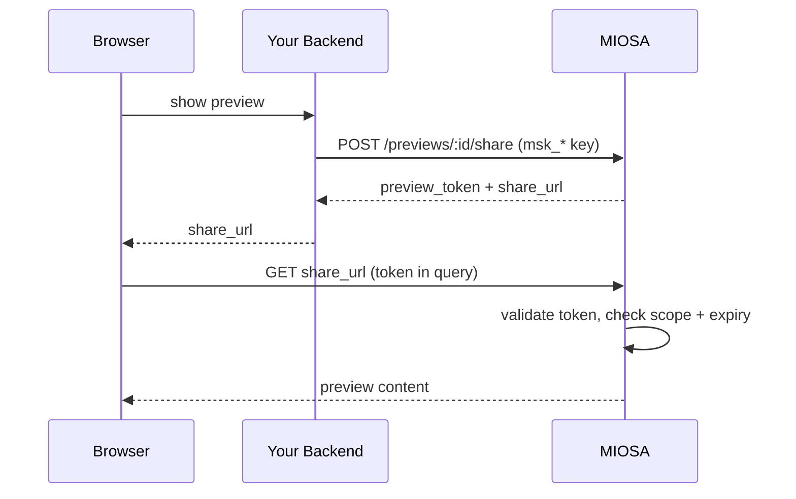

When your end-user's browser needs direct MIOSA access  -  previewing a sandbox, opening a terminal, uploading a file  -  mint a short-lived browser token server-side and hand only that to the browser. The workspace API key (`msk_*`) never leaves your backend.

## The mint flow



## The pattern

The token is resource-bound (one preview), short-lived (configurable; default 1 hour), and never grants access to anything beyond the resource it was minted for.

## Preview share tokens (the main one)

The most common browser-facing flow.

**TypeScript (backend)**

```typescript
// Inside your authenticated request handler
const share = await miosa.sandboxes.previews.share(previewId, {
  expiresInSec: 3600,
})

res.json({
  share_url: share.share_url,
  expires_at: share.data.share_token_expires_at,
})
```

**cURL**

```bash
curl -X POST https://api.miosa.ai/api/v1/sandboxes/$SBX/previews/$PREVIEW/share \
  -H "Authorization: Bearer $MIOSA_API_KEY" \
  -d '{"ttl_seconds": 3600}'
```

Response:
```json
{
  "data": {
    "id": "preview_...",
    "share_token_prefix": "first12chars",
    "share_token_expires_at": "2026-05-14T19:30:00Z"
  },
  "preview_token": "miosa_pv_<one-time-raw-token>",
  "share_url": "https://5173-abc12345.sandbox.miosa.ai?preview_token=miosa_pv_<one-time-raw-token>"
}
```

Front-end:
```jsx
// React example
<iframe
  src={shareUrl}
  sandbox="allow-same-origin allow-scripts allow-forms"
  className="w-full h-[600px] border-0"
/>
```

The token authenticates the request at MIOSA's edge proxy. The proxy strips the credential before forwarding to your dev server on the sandbox  -  your application code never sees it.

## Token formats

| Use case | Where it goes | Lifetime |
|---|---|---|
| Preview share | `?preview_token=...` query string | configurable (default 1h, max 7 days) |
| Terminal session | `wss://...?token=...` WebSocket query | typically 5-30m |
| Upload session | `Authorization: Bearer miosa_up_...` | minutes |
| Generic resource token | TBD | scoped per resource |

All formats are JWTs signed by MIOSA. The payload includes the resource ID, scopes, expiry, and an HMAC the proxy verifies. You can decode them client-side to inspect the expiry but you cannot forge them.

## Lifetime and expiry
```typescript
const share = await miosa.previews.share(previewId, {
  expiresInSec: 3600, // 1 hour
})
```

Share tokens default to 1 hour and can be set from 60 seconds up to 7 days. Longer TTL means more risk if a token leaks; for browser embedding 1-3 hours is typical.

After expiry the preview returns 401. Your frontend should:

1. Watch `share.data.share_token_expires_at`.
2. Mint a new token before expiry by re-calling your backend.
3. Reload the iframe with the new `share_url`.

## Re-minting and revoking

A preview can have **multiple active share tokens** at the same time. Minting a new one does not invalidate previous ones.

To revoke all tokens for a preview, hit:
```http
DELETE /api/v1/sandboxes/:id/previews/:preview_id/share
```

This invalidates every outstanding share token for the preview. Useful for "I accidentally shared this externally, kill all browser access immediately."

## CSP and embedding

MIOSA's preview proxy emits `Content-Security-Policy` headers that allow the preview to be embedded as an iframe under specific origins. By default:

- `*.miosa.app`
- `*.miosa.ai`
- `localhost:4000` (for local dev of MIOSA frontend)

For white-label embedding (your platform served at `app.example.com` embedding MIOSA previews), the CSP needs to include your origin. Contact support to configure the proxy CSP per tenant.

## Audit

Every token issuance emits an audit event:
```json
{
  "action": "preview.share_token.issued",
  "resource_id": "preview_...",
  "actor": "api_key:msk_u_...",
  "metadata": {
    "workspace_id": "550e8400-e29b-41d4-a716-446655440000",
    "project_id": "660e8400-e29b-41d4-a716-446655440001",
    "external_workspace_id": "acct_123",
    "external_user_id": "user-456",
    "expires_at": "2026-05-14T19:30:00Z",
    "token_prefix": "miosa_pv_xyz"
  }
}
```

`token_prefix` lets you correlate audit events to log entries without storing the raw token.

## What browser tokens cannot do

- Cannot make MIOSA API calls (sandboxes.create, deployments.publish, etc.). They're proxy-only.
- Cannot escalate to a different resource. A preview token for `preview_A` cannot read `preview_B`.
- Cannot cross tenants.
- Cannot persist past expiry. A revoked or expired token is permanently dead.

If you need broader browser-side access (e.g. a developer dashboard your end users log into), use a full MIOSA user session (JWT) instead. See [Authentication](/docs/authentication).

> **Caution: Don't put `preview_token` in logs or analytics**
>
> The raw token grants iframe access. Treat it like a session cookie  -  don't log it server-side or pass it through analytics tools. The `share_token_prefix` is safe to log.

## See also

- [Previews](/docs/develop/previews)  -  the resource these tokens grant access to
- [API Keys](/docs/platform/api-keys)  -  server-side credential the backend uses to mint
- [Attribution](/docs/platform/attribution)  -  what gets logged in audit events
