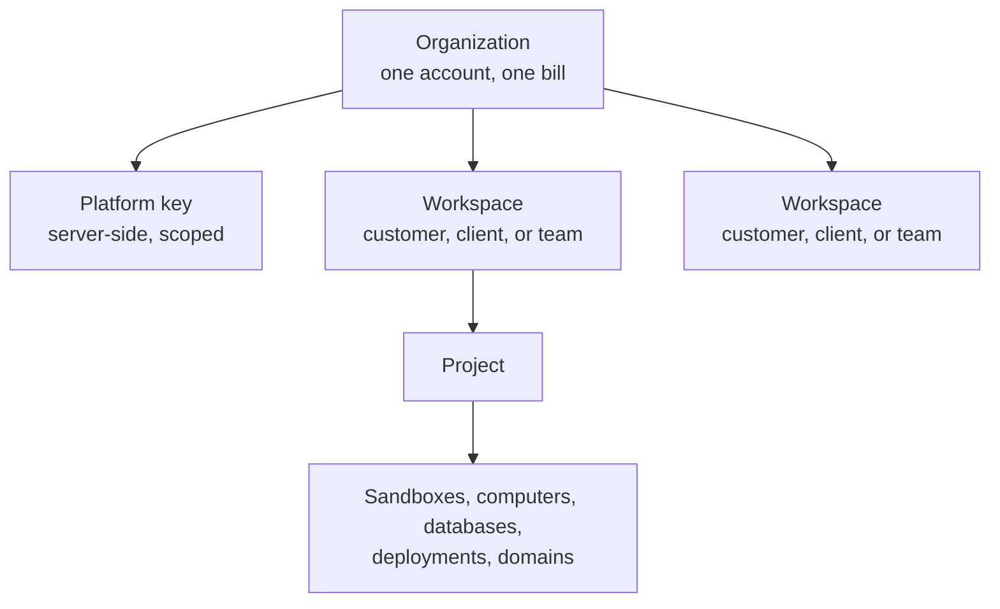
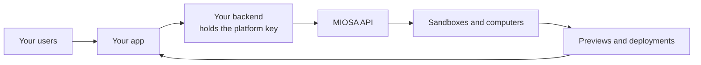

This guide shows the one model that every platform shares, then walks three concrete shapes:

Every platform on MIOSA shares one model.
This page shows that model plus the three concrete shapes: a white-label SaaS, an agency, and an internal team.

## The model

Every shape uses the same four ideas.

1. **Organization.** Your account on MIOSA. It owns the key, the balance, and the single bill.
2. **Workspace.** A boundary inside the organization. One per customer, client, or team.
3. **Project.** A thing someone is building inside a workspace. Sandboxes, computers, databases, deployments, and domains belong to a project.
4. **Your own IDs.** Opaque `external_*` strings from your database, copied onto every resource, usage event, and audit entry so you can reconcile with your own records.



Workspaces and projects decide routing, permissions, dashboard grouping, and usage.
Your `external_*` IDs are only labels.
Another organization cannot read your resources even if it knows the same slug or external ID.

## Your backend is the platform

Your users never talk to MIOSA directly.
Your backend does.



The backend owns five jobs:

1. Map each of your users or customers to a MIOSA workspace and project.
2. Create sandboxes, computers, deployments, databases, and domains for them.
3. Mint short-lived [browser tokens](/docs/platform/browser-tokens) for previews and terminals.
4. Query usage for chargeback.
5. Verify webhook signatures.

The browser only ever sees preview URLs and scoped, expiring tokens.

> **Caution: Hard rule**
>
> Never put an `msk_*` key in a browser. Treat it like a Stripe secret key: server-only, rotated on a schedule, audited.

## Name the organization

The organization slug is created once, from the organization name, and cannot change.
It appears in MIOSA-managed URLs until you attach your own domain, so set it before users create anything.
See [Branding and domain setup](/docs/platform/white-label#1-organization-identity).

## Put your brand on it

Branding has three layers, and each is configured separately.

| Layer | What it controls | Where |
|---|---|---|
| Preview domain | `5173-sbx01j9x.sandbox.example.com` instead of a MIOSA URL | [Preview domain](/docs/platform/white-label#4-organization-preview-domain) |
| Deployment domain | `lead-magnet.apps.example.com` for published apps | [Deployment domain](/docs/platform/white-label#5-deployment-domain) |
| Exact custom domain | `program.example.net` on one deployment or computer | [Custom domains](/docs/platform/white-label#6-resource-custom-domains) |

Exact domains win over the deployment domain, which wins over the MIOSA fallback (`lead-magnet.example-org.miosa.app`).
Tenant branding also controls the logo, wallpaper, support URL, and whether "Powered by MIOSA" shows.
Always display the returned `public_url` instead of building hostnames yourself.

## Lumen: a white-label SaaS

Lumen is a made-up company, and `example.com` and `example.net` are reserved example domains, not real ones.
Lumen sells an agent product.
Its customers sign up on `example.com`, describe an app, and get a running preview and a deployment.
They never see MIOSA.

- **Organization:** `Lumen`, one platform key on Lumen's backend.
- **Workspace per customer:** Acme Corp is `acme-corp`, Northwind Agency is `northwind-agency`.
- **Domains:** previews on `*.sandbox.example.com`, deployments on `*.apps.example.com`, and a customer's own `program.example.net` where they ask for it.
- **Billing:** Lumen reads usage grouped by `external_workspace_id` and charges each customer its own price.

```text
Organization: Lumen
  Workspace: Acme Corp
    Project: Summer lead magnet   ->  program.example.net
  Workspace: Northwind Agency
    Project: Booking portal
```

## Northwind Agency: client work

An agency does not sell a product.
It delivers work, and it wants every client kept apart and every client's cost visible.

- **Organization:** `Northwind Agency`, one account that pays for everything.
- **Workspace per client.** A client's machines, databases, deployments, and spend never mix with another client's.
- **Project per engagement.** A website, a booking portal, a campaign page.
- **Delivery:** each finished project is deployed and attached to the client's own domain, with the agency's name on the preview URL while the work is in review.
- **Cost:** query usage per workspace and put it on the client's invoice or retainer report.

Northwind can run this on its own organization with the CLI and dashboard.
It only needs the platform pieces (keys, browser tokens, per-user quotas) once it lets clients log in and iterate themselves.

## Acme Corp: an internal platform

Acme Corp is not launching anything.
It wants its team and its agents to work on one platform that the company owns.

- **Organization:** `Acme Corp`. It pays, owns the balance, and sets who can do what.
- **Workspace per team:** Ops, Engineering, Sales. Each team's machines and apps live there.
- **A machine per agent.** A code agent gets a sandbox, and a browsing agent gets a computer. Both get their own filesystem and network.
- **Connections and secrets** are managed centrally, so a new machine starts with exactly what it should have, and no teammate pastes a vendor token.
- **Domain:** internal apps run behind a company hostname such as `agents.example.net`.

```bash
miosa workspace create Ops
miosa create ops-agent --template miosa-sandbox --workspace ops --env prod --wait
miosa workspace usage ops
```

There is no white-label layer, no end-user browser tokens, and no resale billing.
Everything else in this guide still applies, in particular scoped keys for automation and per-workspace usage.
The full walkthrough, with connections, environments, and access control, is in [Build an internal Business OS for your team](/docs/guides/internal-business-os).

## Production checklist

**Security**

- The key lives only in your backend, injected from a secret store. Rotate it on a schedule.
- Never sign an end user's request with it. Mint a scoped browser token instead.
- Verify the webhook signature on every delivery.
- Keep your own user database as the source of truth for authorization. MIOSA ownership is for routing and grouping.

**Isolation and quotas**

- One machine per end user.
- Set per-user limits so one account cannot exhaust the organization's capacity: [Quotas](/docs/api-reference/quotas).
- Cap concurrency and runtime, and set idle timeouts so unused machines pause.

**Abuse**

- Apply your own signup checks, rate limits, and terms before you provision.
- Restrict outbound traffic with [Network policy](/docs/security/network) and review the [audit log](/docs/security/audit-log) for unexpected hosts.

**Billing**

- Persist `workspace_id` and `project_id` beside your own IDs on first create.
- Query usage every period and enforce your own spend caps.
