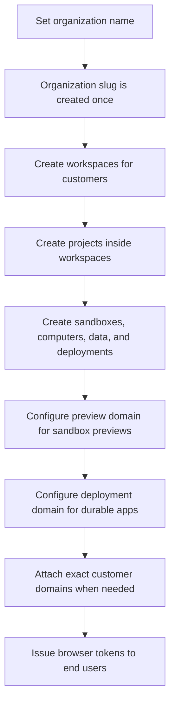

MIOSA can run behind your product and your customers' domains. The important order is: set the organization identity first, create workspaces/projects for downstream customers, configure preview and deployment domains separately, then attach exact custom domains where a customer needs their own hostname.

---

## Setup flow


## 1. Organization identity

Every account needs a real organization name. MIOSA derives the organization slug from that name, and the slug is permanent after setup. Do this before letting users create resources.

Example:

| Organization name | Organization slug | Default managed deployment URL |
|---|---|---|
| `Lumen` | `lumen` | `https://lead-magnet.example-org.miosa.app` |

If a newly created account still has a temporary setup slug such as `org-...` or a slug that does not match the organization name, require setup before normal app navigation.

```http
GET /api/v1/platform/tenants/current
Authorization: Bearer msk_u_...
```

If setup is required, update the tenant with the final organization name:
```http
PUT /api/v1/tenants/{tenant_id}
Authorization: Bearer msk_u_...
Content-Type: application/json

{
  "name": "Lumen"
}
```

The API normalizes the slug from `name`. If a `slug` is supplied, it must match the normalized organization name. After setup, `name` and `slug` are immutable.

> **Caution: One-time slug**
>
> The organization slug is used in MIOSA-managed URLs until a custom domain is attached. Make the setup screen explicit: "Create your organization name. This creates your permanent MIOSA slug and can only be done once."

## 2. Workspaces and projects

For white-label platforms, use workspaces for downstream customers and projects for the things they build.

Lumen is a made-up company, and `example.com` and `example.net` are reserved example domains.
Replace them with your own.

Lumen example:

```yaml
Organization: Lumen
  Workspace: Acme Corp
    Project: Summer lead magnet
      Sandboxes: generated app previews
      Databases: form submissions
      Deployment: production lead magnet
      Domain: program.example.net
  Workspace: Northwind Agency
    Project: Booking portal
```

Create workspaces and projects directly, or let resource create calls auto-resolve them from `workspace_slug` / `project_slug` or `external_workspace_id` / `external_project_id`.

```http
POST /api/v1/sandboxes
Content-Type: application/json

{
  "template_id": "miosa-sandbox",
  "workspace_slug": "acme-corp",
  "workspace_name": "Acme Corp",
  "project_slug": "summer-lead-magnet",
  "project_name": "Summer Lead Magnet",
  "external_workspace_id": "acct_123",
  "external_user_id": "user-456",
  "external_project_id": "project_789"
}
```

Responses include `workspace_id` and `project_id`. Store those IDs for future calls.

## 3. URL layers

White-label production has distinct URL layers. Do not mix them:

| Resource | Default URL shape |
|---|---|
| Sandbox preview | `https://{port}-{sandbox_slug}.sandbox.{preview_domain}` |
| Computer desktop | `https://{computer_slug}.computer.miosa.ai/desktop/index.html` |
| Durable deployment | `https://{deployment_slug}.{deployment_domain}` |
| Deployment fallback | `https://{deployment_slug}.{organization_slug}.miosa.app` |
| Exact custom domain | `https://customer-owned.example.com` |

For Lumen, a deployment named `Lead Magnet` defaults to something like:

```text
https://lead-magnet.example-org.miosa.app
```

The fallback is always available. If a tenant deployment domain is configured, deployment responses return that branded URL instead. SDKs, CLIs, and frontends should display the returned `public_url` / `url`, not construct hostnames.

## 4. Organization preview domain

Set a tenant preview domain when generated sandbox preview URLs should use your organization's domain instead of the MIOSA fallback.

Example:

```http
PUT /api/v1/tenant/preview-domain
Content-Type: application/json

{
  "preview_domain": "example.com"
}
```

DNS:

| Record type | Name | Value |
|---|---|---|
| `CNAME` | `*` | `proxy.miosa.ai` |

After DNS propagates:

```http
GET /api/v1/tenant/preview-domain/verify
```

Sandbox preview URLs then use:

```text
https://5173-sbx01j9x.sandbox.example.com
```

## 5. Deployment domain

Set a tenant deployment domain when published apps should use your branded production URL base.

Recommended Lumen setup:

```text
*.example.com       CNAME proxy.miosa.ai   (preview domain: record name `*`)
*.apps.example.com  CNAME proxy.miosa.ai   (deployment domain)
```

Then generated URLs look like:

| Surface | Example |
|---|---|
| Sandbox preview | `https://5173-sbx01j9x.sandbox.example.com` |
| Durable deployment | `https://lead-magnet.apps.example.com` |
| Managed fallback | `https://lead-magnet.example-org.miosa.app` |

Current V1 note: public tenant preview-domain routes are exposed. Tenant deployment-domain resolution exists in backend settings/routing; public tenant-level management routes are still operator-managed. Your client code should consume returned deployment `public_url` values.

## 6. Resource custom domains

Attach exact domains when a project, deployment, or computer needs its own public URL.

Examples:

- `example.net` for a website deployment
- `program.example.net` for a lead magnet
- `app.example.net` for an app
- `preview.example.net` for a client-specific preview surface

For deployments:

```http
POST /api/v1/deployments/{deployment_id}/domains
Content-Type: application/json

{
  "domain": "program.example.net"
}
```

For computers:

```http
POST /api/v1/computers/{computer_id}/domains
Content-Type: application/json

{
  "domain": "desktop.example.net"
}
```

The domain response returns DNS instructions and verification status. Exact resource domains take precedence over managed MIOSA URLs.

## 7. Domain precedence

When MIOSA renders or routes a URL, use this mental model:

| Priority | Source | Example |
|---|---|---|
| 1 | Exact resource domain | `program.example.net` |
| 2 | Tenant deployment domain | `lead-magnet.apps.example.com` |
| 3 | MIOSA managed fallback | `lead-magnet.example-org.miosa.app` |

Sandbox preview domains are separate from deployment domains. Computer desktop URLs are separate from both. Exact resource custom domains still win when attached.

## 8. Branding

Tenant branding controls the product UI, desktop wallpaper, logos, support URL, and whether "Powered by MIOSA" is shown.

```http
PUT /api/v1/tenant/branding
Content-Type: application/json

{
  "custom_app_name": "Lumen",
  "custom_logo_url": "https://example.com/logo-dark.png",
  "support_url": "https://help.example.com",
  "desktop_wallpaper_url": "https://example.com/wallpaper.png",
  "powered_by_visible": false
}
```

Wallpaper requirements:

| Property | Value |
|---|---|
| Format | PNG or JPEG |
| Dimensions | 1920 x 1080 recommended |
| File size | Max 5 MB |

## 9. Browser tokens

Never expose an `msk_*` API key in a browser. Your backend creates sandboxes, deployments, and domains, then issues scoped browser tokens for the end user.

```typescript
const token = await client.browserTokens.create({
  workspaceId: "550e8400-e29b-41d4-a716-446655440000",
  projectId: "660e8400-e29b-41d4-a716-446655440001",
  externalWorkspaceId: "acct_123",
  externalUserId: "user-456",
  permissions: ["sandbox:read", "sandbox:exec", "preview:read"],
  ttlSeconds: 3600,
})
```

## Complete setup checklist

- [ ] Require organization setup if the account still has a temporary slug or no organization name.
- [ ] Explain that organization name creates the permanent MIOSA slug one time.
- [ ] Create or auto-resolve workspaces for downstream customers.
- [ ] Create or auto-resolve projects for each app, website, lead magnet, document, or workflow.
- [ ] Store `workspace_id` and `project_id` from create responses.
- [ ] Use returned MIOSA fallback URLs until DNS is configured.
- [ ] Configure preview domain if sandbox previews should use your domain.
- [ ] Configure deployment domain if generated apps should use your domain by default.
- [ ] Attach exact custom domains to deployments or computers when a customer wants their own URL.
- [ ] Apply tenant branding and support links.
- [ ] Issue browser tokens from your backend only.

---

## End-to-end walkthrough: per-user provisioning

This walkthrough builds a design-tool SaaS where each customer gets an isolated workspace and never sees the MIOSA brand.

### Per-user provisioning

Create one sandbox per customer project. Pass your own IDs so you can look up, filter, and bill these resources later.

**Python**

```python
import re

def slug_from_name(name: str) -> str:
    return re.sub(r"[^a-z0-9]+", "-", name.lower()).strip("-")[:60] or "project"

sandbox = client.sandboxes.create(
    template_id="miosa-sandbox",
    name=slug_from_name("Brand Refresh 2026"),   # "brand-refresh-2026"
    external_user_id="user_42",                  # your customer's ID
    external_project_id="proj_lumen_1",    # your project's ID
    metadata={
        "customer_id": "user_42",
        "project_name": "Brand Refresh 2026",
        "source": "lumen-whitelabel",
    },
)

print(sandbox.id)     # "sbx_01hzq5pnmpgt6vdwp0r8d23c5n"
print(sandbox.state)  # "provisioning"  -  becomes "running" in ~2 seconds
```

**TypeScript**

```typescript
function slugFromName(name: string): string {
  return name.toLowerCase().replace(/[^a-z0-9]+/g, "-").replace(/^-|-$/g, "").slice(0, 60) || "project";
}

const sandbox = await client.sandboxes.create({
  templateId: "miosa-sandbox",
  name: slugFromName("Brand Refresh 2026"),   // "brand-refresh-2026"
  externalUserId: "user_42",                 // your customer's ID
  externalProjectId: "proj_lumen_1",   // your project's ID
  metadata: {
    customerId: "user_42",
    projectName: "Brand Refresh 2026",
    source: "lumen-whitelabel",
  },
});

console.log(sandbox.id);     // "sbx_01hzq5pnmpgt6vdwp0r8d23c5n"
console.log(sandbox.state);  // "provisioning"  -  becomes "running" in ~2s
```

**Field reference:**

| Field | Purpose | Example |
|---|---|---|
| `external_user_id` | Your customer's stable identifier. Used for usage rollup, quota checks, and filtering. | `"user_42"` |
| `external_project_id` | Your project's identifier within a customer. | `"proj_lumen_1"` |
| `name` | URL-safe slug that appears in preview URLs until a custom domain is set. | `"brand-refresh-2026"` |
| `metadata` | Arbitrary key-value pairs returned in webhook payloads and API responses. | `&#123;"source": "lumen"&#125;` |

### Pretty URLs

By default, sandbox previews use `*.sandbox.{preview_domain}` after you register your preview domain. To give each sandbox a human-readable subdomain, update the slug after creation:

**Python**

```python
client.sandboxes.update("sbx_01hzq5...", slug="brand-refresh-2026")
# Preview URL becomes:
# https://3000-brand-refresh-2026.sandbox.example.com
```

**TypeScript**

```typescript
await client.sandboxes.update("sbx_01hzq5...", { slug: "brand-refresh-2026" });
// Preview URL becomes:
// https://3000-brand-refresh-2026.sandbox.example.com
```

Slugs must be unique within your workspace. If a slug is already taken, MIOSA returns a `409` conflict.

### Customize after create

Update sandbox settings at any time without recreating the VM:

**Python**

```python
client.sandboxes.update(
    "sbx_01hzq5...",
    slug="brand-refresh-2026",    # pretty URL slug
    timeout_sec=7200,             # idle timeout (2 hours)
    always_on=False,              # allow idle-pause
    metadata={"phase": "v2"},     # merge into existing metadata
)
```

**TypeScript**

```typescript
await client.sandboxes.update("sbx_01hzq5...", {
  slug: "brand-refresh-2026",
  timeoutSec: 7200,
  alwaysOn: false,
  metadata: { phase: "v2" },
});
```

### Bill by user

Query compute usage keyed to your `external_user_id`. Use this for per-seat billing, usage dashboards, or chargeback reports.

**Python**

```python
usage = client.usage.get(
    external_user_id="user_42",
    period_start="2026-05-01T00:00:00Z",
    period_end="2026-06-01T00:00:00Z",
)

print(usage["compute_seconds"])  # total sandbox-seconds
print(usage["sandbox_count"])    # distinct sandboxes created
print(usage["cost_usd"])         # dollar amount for billing
```

**TypeScript**

```typescript
const usage = await client.usage.get({
  externalUserId: "user_42",
  periodStart: "2026-05-01T00:00:00Z",
  periodEnd: "2026-06-01T00:00:00Z",
});

console.log(usage.computeSeconds); // total sandbox-seconds
console.log(usage.sandboxCount);   // distinct sandboxes created
console.log(usage.costUsd);        // dollar amount for billing
```

### Per-user quotas

Prevent a single customer from consuming your entire compute budget. Set quotas at the workspace or project level, or enforce them in your own API layer:

**Python**

```python
# List sandboxes for this user and reject if at the limit.
SANDBOX_LIMIT_PER_USER = 5

existing = client.sandboxes.list(external_user_id="user_42", state="running")
if len(existing) >= SANDBOX_LIMIT_PER_USER:
    return jsonify({"error": "sandbox limit reached"}), 429
```

**TypeScript**

```typescript
const SANDBOX_LIMIT_PER_USER = 5;

const existing = await client.sandboxes.list({
  externalUserId: "user_42",
  state: "running",
});
if (existing.length >= SANDBOX_LIMIT_PER_USER) {
  return res.status(429).json({ error: "sandbox limit reached" });
}
```

### Teardown on cancellation

Destroy all sandboxes when a customer cancels their account:

**Python**

```python
sandboxes = client.sandboxes.list(external_user_id="user_42")
for sandbox in sandboxes:
    client.sandboxes.delete(sandbox["id"])
    print(f"Destroyed {sandbox['id']}")
```

**TypeScript**

```typescript
const sandboxes = await client.sandboxes.list({ externalUserId: "user_42" });
for (const sandbox of sandboxes) {
  await client.sandboxes.delete(sandbox.id);
  console.log(`Destroyed ${sandbox.id}`);
}
```

## End-user UI components

Give your users a native feel with file browsing, terminal, and run-button components backed by the MIOSA SDK. All three require a browser token with the appropriate scopes (see [Preview permission scoping](/docs/develop/previews#permission-scoping)).

### File tree

```typescript
import Miosa from "@miosa/sdk";

const client = new Miosa({ apiKey: browserToken }); // mp_ token from your backend

async function loadFileTree(sandboxId: string, path = "/workspace") {
  const entries = await client.files.list(sandboxId, path);
  return entries.map((e) => ({
    name: e.name,
    type: e.type,   // "file" | "directory"
    path: e.path,
    size: e.size,
  }));
}
```

### Terminal

```typescript
// Stream terminal output as an async iterable.
const stream = client.exec.stream(sandboxId, "bash", {
  cols: 80,
  rows: 24,
});

for await (const chunk of stream) {
  terminalEmulator.write(chunk.data);
}
```

### Run button

```typescript
// One-shot exec with streaming output.
const result = await client.exec.run(sandboxId, "npm test", {
  workingDir: "/workspace",
  timeoutMs: 30_000,
});

console.log(result.stdout);
console.log(result.exitCode); // 0 = pass
```

## End-to-end checklist

- [ ] Set branding: `product_name`, `logo_url`, `support_email`
- [ ] Register preview domain and add DNS CNAMEs
- [ ] Verify DNS propagation
- [ ] Register webhook and store the secret in your environment
- [ ] Create sandboxes with `external_user_id`, `external_project_id`, and `metadata`
- [ ] Mint preview tokens server-side only  -  never expose `msk_*` to the browser
- [ ] Verify HMAC-SHA256 on every webhook delivery
- [ ] Reject stale webhook timestamps (>5 min)
- [ ] Deduplicate webhook events by `event.id`
- [ ] Query usage by `external_user_id` for billing
- [ ] Enforce per-user sandbox quotas before creating
- [ ] Destroy sandboxes on cancellation

## See also

- **Ownership and Attribution**: Workspace/project ownership plus external IDs for chargeback and filtering.

  [Attribution reference →](/docs/platform/attribution)
- **Custom Domains**: Domain APIs, DNS records, and verification responses.

  [Custom domains →](/docs/api-reference/custom-domains)
- **Workspaces**: Workspace create, update, settings, and usage.

  [Workspaces →](/docs/api-reference/workspaces)
- **Projects**: Project create, update, and workspace scoping.

  [Projects →](/docs/api-reference/projects)
