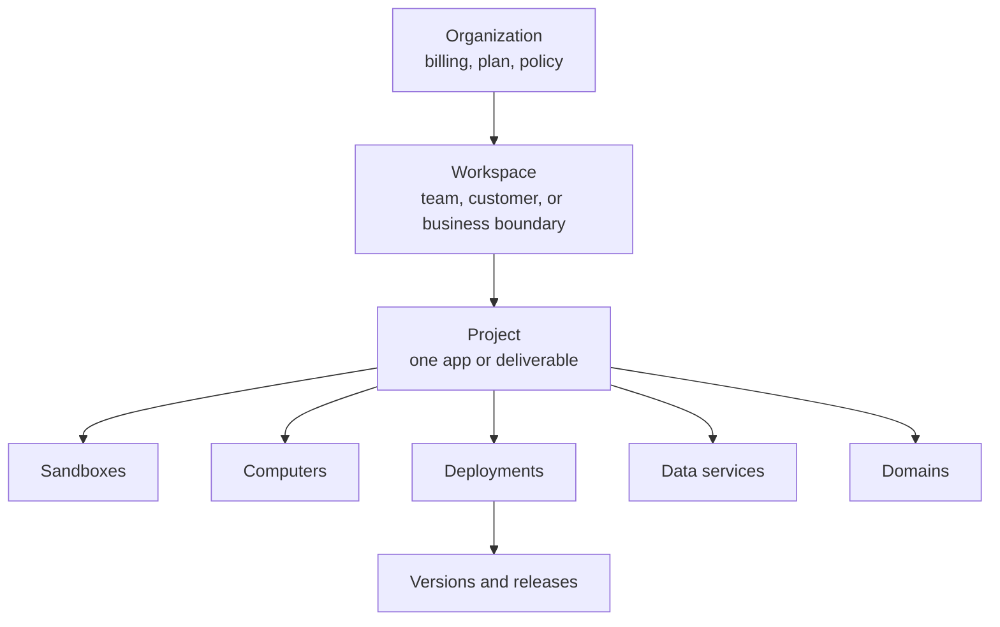

The project record itself holds only identity and attribution:

| Field | Purpose |
|---|---|
| `id` | Canonical UUID. Store this after the first resolution. |
| `tenant_id` | The Organization that owns the project. |
| `workspace_id` | The Workspace the project lives in. Required. |
| `name` | Display name, 1 to 120 characters. |
| `slug` | URL-safe key, 1 to 80 characters, unique per workspace. Derived from the name when omitted. |
| `description` | Optional free text. |
| `metadata` | Arbitrary key-value map. |
| `is_default` | True for the workspace's Default project. A client cannot set this. |
| `external_project_id` | Your own project id, unique per Organization. Attribution only. |
| `external_workspace_id` | Your own workspace id, inherited from the Workspace. Attribution only. |

## Where a project fits



> **Note: Project is not another runtime**
>
> A Sandbox, Computer, or Runtime Instance executes work.
> A Project provides ownership and organization around those resources.

Every Workspace also has one **Default project**, created on demand and marked `is_default`.
It is the home for resources created without an explicit project, and it can neither be deleted nor moved.

## What lives in a project

Resources attach to a project through a canonical `project_id` column, and most also carry `workspace_id` and your `external_project_id`.
A resource create call can resolve the project for you: pass `project_id`, `project_slug`, `project_name`, or `external_project_id` and MIOSA resolves or creates the project before inserting the resource.

| Resource | In a project | Notes |
|---|---|---|
| Sandbox | Yes | The mutable development environment. Carries `project_id` and `workspace_id`. |
| Sandbox preview | Yes | Generated preview URL for a sandbox. |
| Computer | Yes | The desktop runtime. Carries `project_id`; computers have no `workspace_id` column. |
| Deployment | Yes | Durable production identity. It owns versions, releases, services, environments, builds, runtime instances, and preview environments, and every one of those children carries the same `project_id`. |
| Managed database | Yes | Project-scoped with no workspace column. One is auto-provisioned when the project is created. |
| Database | Yes | Database attached to a sandbox. |
| Managed service | Yes | Project-scoped with no workspace column. |
| Storage bucket | Yes | S3-compatible object storage. |
| Volume | Yes | Durable filesystem. A `/data` volume is auto-created with the project. |
| Custom domain | Yes | An exact hostname attached to a sandbox, computer, or deployment. |
| Edge function | Yes | Code that runs at the edge. |
| Cron job | Yes | Scheduled executions. |
| Workflow | Yes | Carries `project_id` with no workspace column. |
| Project auth | Yes | Built-in auth for one sandbox or deployment, with an encrypted JWT secret. |
| Project integration | Yes | Provider credentials such as Stripe, Resend, and Twilio. |
| Runtime env var | Yes | `scope` is `tenant`, `workspace`, or `project`. Values are encrypted at rest. |
| Agent definition and runtime profile | Yes | Agent configuration scoped to the project. |
| Usage meter | Yes | The billing dimension a resource is metered under. |
| Run | Yes | Detached when the project is deleted: `project_id` is set to null, the run is not deleted. |
| Project member | Yes | Cascades on project delete. |
| Product link | Yes | A Product groups one or more projects inside a workspace. |
| Audit, usage, and platform events | Attribution only | Immutable history. It keeps the project it was recorded under and is never rewritten. |
| Workspace | No | The parent boundary. A project has exactly one. |
| Organization | No | Two levels above the project. It owns billing and policy. |

For the live counts, health roll-up, last deploy, and linked repository of one project, call `GET /api/v1/projects/{id}/summary`.

## Project, workspace, or organization?

| Need | Use |
|---|---|
| Separate company billing and policy | Organization |
| Separate team, customer, or business boundary | Workspace |
| Group one app and its resources | Project |
| Develop mutable source | Sandbox |
| Operate one stable production app | Deployment |
| Keep a persistent interactive desktop | Computer |

Create separate Projects when applications need independent deployment history, domains, environments, or usage attribution.

Do not create a new Project for every build, preview, or release.
Previews and releases belong to the Deployment inside the project, not to a new project.

## Domains

Preview domains are an organization-level setting, not a per-project one.
A tenant preview domain white-labels generated preview links for the whole organization; an exact custom hostname attaches to one Deployment or Computer.

The effective order is:

```text
Exact deployment/computer hostname
  -> Organization preview domain
  -> MIOSA-managed fallback
```

Always display URLs returned by MIOSA instead of rebuilding them from slugs.

Every custom domain row carries `project_id` and `workspace_id` alongside the resource it points at, so a hostname is scoped and attributed the same way the resource is.

## Mapping your own platform onto projects

| Your platform | MIOSA |
|---|---|
| Company account | Organization |
| Customer or team | Workspace |
| App, site, document, or product | Project |
| Editable build environment | Sandbox |
| Live application | Deployment |

Three worked examples:

| Platform | Shape | Why |
|---|---|---|
| Lumen | One Project per customer app, inside one Workspace | Each app gets its own deployment history, domains, and usage line while the whole platform stays on one billing account. |
| Acme Corp | One Project per internal tool, inside one Workspace per department | Tools share the company's Organization and policy but roll up their usage and members separately. |
| Northwind Agency | One Workspace per client, one Project per deliverable | The client boundary is the Workspace, so isolating clients never leaks into a per-deliverable project. |

Store the canonical `workspace_id` and `project_id` after the first resolution.
Use `external_workspace_id`, `external_project_id`, and `external_user_id` for correlation, not as substitutes for MIOSA ownership.
