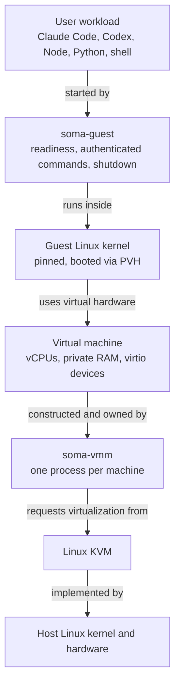
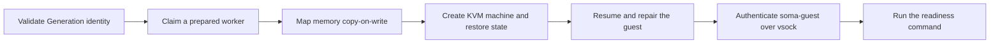

SOMA is the Secure Optimized Machine Architecture: the virtual machine monitor MIOSA builds and runs its sandboxes on.
It is open source under the Apache License 2.0 at [Miosa-osa/SOMA](https://github.com/Miosa-osa/SOMA), it is written in Rust, and it runs on Linux KVM.

A SOMA sandbox is not a container and not a userspace kernel.
It is one hardware-isolated Linux virtual machine with its own guest kernel and its own private memory, created and owned by a single VMM process for exactly one sandbox lifetime.

> **Note: You do not have to run it yourself**
>
> MIOSA runs SOMA for you. This page explains what sits under the Sandboxes and Computers you already create.
> If you only want the API switch that selects a runtime, read [Choosing a runtime](/docs/soma/choosing-a-runtime).

## What SOMA is

SOMA is a type-2 VMM for Linux guests, plus the launch runtime around it.
It boots a pinned Linux kernel directly through the paravirtualized PVH entry, so there is no BIOS or UEFI stage, and it exposes a deliberately tiny virtual machine to the guest.

Three things follow from that design:

- **Hardware isolation, per sandbox.** The guest runs on virtual CPUs backed by KVM. It is a real kernel with its own page tables, not a syscall filter or a sandboxed process.
- **A small, fixed machine.** SOMA machine contract v1 exposes at most five virtio devices and no PCI bus at all. Smaller device surface means fewer places for a hostile guest to attack.
- **Start from a certified snapshot, not from a power-on.** The expensive work happens once, when a Generation is built. Launch restores a warmed machine and then proves the guest is alive.

SOMA is not a container runtime, a provider control plane, or a billing system.
MIOSA's platform owns placement, tenancy, policy, and the public sandbox API, and SOMA sits underneath that as the execution engine.

## Why we built it

MIOSA's sandboxes ran on Firecracker, and Firecracker is still the default today (see [Choosing a runtime](/docs/soma/choosing-a-runtime)).
We built SOMA because we wanted to own the whole launch path, especially the exact moment a machine becomes command-ready, and because we wanted an engine whose contract carries no cloud, provider, or fixed machine-size assumption.

The goals come straight from [the project's mission](https://github.com/Miosa-osa/SOMA/blob/main/MISSION.md):

- One native VMM process owns one virtual machine.
- Restored memory uses immutable shared backing with private copy-on-write mappings instead of eagerly copying a whole RAM image.
- Every restore gets a fresh identity, entropy state, network identity, and repaired clock.
- Ready means an authenticated guest agent completed a real command after repair, not that a socket opened.
- Public contracts contain no cloud, provider, billing tier, or fixed machine-size assumption.

## How it works

Read the stack from the workload down to the hardware.
Each layer uses the layer below it, and the guest never talks to KVM or to physical hardware directly.



### Build time: Template, Generation, Instance

SOMA separates the slow work from the fast work.

1. A **Template** (a TOML recipe) is compiled into a **Template Lock** that pins the image to an exact OCI digest.
2. The Generation compiler turns that lock and the normalized root filesystem into an immutable **Generation**: one certified box that never runs itself.
3. Every **Launch** of that Generation opens a private **Instance**, a running machine with its own identity, memory, and disk head.

A Generation carries its own pinned kernel, a read-only root filesystem, a sterile writable-disk template, an initramfs, and a signed-off manifest.
Its identity, the Generation ID, is the SHA-256 of that manifest.
Because the manifest names every artifact by digest, two Instances of the same Generation are byte-identical at the moment they start but never share mutable state.

Shape is a build parameter, not a per-request knob.
A Generation is compiled for exactly one CPU, memory, and disk shape, and a Launch asserts that shape rather than choosing it.
That is what lets the memory image be captured once and restored many times.

### Launch time: claim, restore, repair, prove

The fast path is short by construction:



- **Prepared workers.** A node-local allocator keeps a bounded pool of already-booted machines, so a Launch usually claims one through a single-winner exchange rather than booting from scratch.
- **Copy-on-write memory.** The restored memory is shared read-only and mapped privately per Instance. One Generation can back many Instances without copying its RAM each time.
- **Repair before Ready.** A restored guest is a clone, so SOMA gives it fresh identity, fresh entropy, a fresh network identity, and a corrected clock. Readiness is only reported after the in-guest agent authenticates over vsock and completes a real command.
- **No shell.** Commands cross the boundary as argument vectors, not shell strings, and output comes back as explicit bytes.

Everything on the launch path is bounded: time, output size, and the number of control responses.

### The device surface

SOMA machine contract v1 exposes at most five modern virtio 1.0+ devices, each on its own fixed virtio-mmio version 2 page:

| Device | Present when |
|---|---|
| Immutable root block (EROFS) | Always |
| Private writable overlay block | Writable storage is declared |
| vsock (control and commands) | Always |
| Entropy | Always, so a restore is never reused |
| Network | A network capability is declared |

There is no PCI bus, no device hotplug, no graphics, no USB, and no BIOS.
The device set is part of the Generation's identity, so a snapshot captured on a machine with an overlay can never be restored onto one built without it.
That mismatch is refused before a single byte of memory is mapped.

### Isolation and evidence

One `soma-vmm` process owns one machine, and that process runs inside a jail with a narrowed syscall filter.
The guest is treated as hostile: every length, offset, descriptor, and protocol frame it sends is validated on the host side.
Each terminal operation returns an execution receipt that names the immutable workload, the effective isolation class, the preparation class, the result, the timing boundary, and the cleanup state.
If a dimension cannot be proven, the receipt says so instead of inventing a value.

## SOMA and Firecracker

Firecracker is a strong, well-understood microVM monitor, and MIOSA ran on it for years.
SOMA exists because we wanted a machine we could shape end to end, from the kernel boot entry to the readiness proof.
Both are Rust VMMs on KVM; the difference is the contract wrapped around the machine.

|  | SOMA | Firecracker |
|---|---|---|
| Built by | MIOSA, open source | AWS, open source |
| Language | Rust | Rust |
| Isolation | KVM; one process per machine | KVM; one process per microVM |
| Guest kernel | One pinned kernel per sandbox | One kernel per microVM |
| Boot entry | PVH; no BIOS or UEFI | Project kernel policy |
| Device model | Five virtio-mmio devices; no PCI | Small model; virtio over MMIO |
| Host hardening | Jailed VMM; seccomp; cgroups | Jailer; seccomp; cgroups |
| Warm start | Restore into a prepared worker | Snapshot restore |
| Startup numbers | Admission targets, not claims | Project performance specification |
| Contract around the VM | Identity repair, readiness, receipts | Mechanisms only |

Neither "startup numbers" cell is a head-to-head result.
Firecracker's own performance specification defines a typical API wall time of 12 ms, guest-init boot at or below 125 ms, and VMM overhead at or below 5 MiB.
SOMA's admission targets are lower still, below 5 ms server-side create and below 10 ms to first command, but they are targets for a path that is still being certified rather than measured results.
Firecracker's spec also does not include restore-time identity repair or an authenticated readiness proof, which is the gap SOMA was built to close.

MIOSA's own published number is a product-level figure, not an engine figure.
In the independent ComputeSDK burst benchmark on 2026-10-23, MIOSA ranked first of 32 providers with a median burst time-to-interactive of 57.09 ms.
See [Benchmarks](/docs/benchmarks) for every run and the raw JSON.

## Open source

SOMA is public and licensed under the [Apache License 2.0](https://github.com/Miosa-osa/SOMA/blob/main/LICENSE), the same license as Firecracker. The repository also carries a [NOTICE](https://github.com/Miosa-osa/SOMA/blob/main/NOTICE) file (Copyright 2026 MIOSA LLC), and the workspace declares the license the same way.
The MIOSA and SOMA names and logos are covered separately by [BRAND.md](https://github.com/Miosa-osa/SOMA/blob/main/BRAND.md).

The repository is honest about where it stands: the source version is `1.0.0-alpha.1`, and the project keeps a [claim ledger](https://github.com/Miosa-osa/SOMA/blob/main/docs/claim-ledger.md) that labels every capability as designed, component-tested, live-proved, integrated, or production-admitted, with the evidence for each.

To try it on your own machine, the supported local path today is Docker Desktop on macOS or Docker Engine on Linux, and the custom KVM engine wants a Linux host with `/dev/kvm`:

```sh
git clone https://github.com/Miosa-osa/SOMA.git
cd SOMA
cargo run --locked -p soma-cli -- doctor
cargo run --locked -p soma-cli -- --backend docker run node:22 -- /usr/local/bin/node --version
```

To contribute, start with [CONTRIBUTING.md](https://github.com/Miosa-osa/SOMA/blob/main/CONTRIBUTING.md) and [MISSION.md](https://github.com/Miosa-osa/SOMA/blob/main/MISSION.md).
A Rust change is expected to pass formatting, clippy with warnings denied, and the full workspace test suite.
Security findings go through the private process in [SECURITY.md](https://github.com/Miosa-osa/SOMA/blob/main/SECURITY.md), never a public issue.

## Status

SOMA is available to every customer.
Select the runtime on sandbox create, from the REST API, the SDKs, the CLI, or the console.
Firecracker (`standard`) remains the default.

`GET /api/v1/sandboxes/runtimes` lists the runtimes and what each one reports it supports today, so you can read SOMA's live capability flags before you choose it.

See [Choosing a runtime](/docs/soma/choosing-a-runtime) for the create examples and the shape rules.

Known gaps today:

- **Sandboxes are not persistent yet on SOMA.** State does not survive a stop or a timeout, and a disposable sandbox is deleted when its timeout expires: a SOMA create defaults to `persistent: false`, and `persistent: true` with SOMA is refused with a `422`.
- **Computers still run on Firecracker.** Only sandboxes expose a runtime choice.
- **No public per-sandbox engine latency figure.** The published benchmark is MIOSA's product-level burst number, not a breakout of SOMA's internal stages.
- **Feature parity is not complete.** SOMA's own claim ledger lists the capabilities that are integrated, live-proved, and still only designed.

- [Choosing a runtime](/docs/soma/choosing-a-runtime): Pick SOMA or Firecracker on sandbox create, and see what each option requires.
- [Benchmarks](/docs/benchmarks): MIOSA's results in the independent ComputeSDK benchmarks.
- [Sizing and limits](/docs/develop/sandboxes/sizing): Named resource contracts and the SOMA one-hop runner fast path.

## FAQ

**Is SOMA a fork of Firecracker?**
No. SOMA is an independent implementation, written from scratch in Rust against the Linux KVM interface and the virtio specification.

**Does my sandbox already run on SOMA?**
If you did not ask for a specific runtime, your sandbox runs on Firecracker, which is still the default. SOMA is available to every customer and is selected explicitly with `runtime_profile`. Either way the product contract, the API, and your data are identical.

**Can I run SOMA on my own hardware?**
Yes. The repository is public and Apache-2.0. Today the custom KVM engine requires a Linux host with `/dev/kvm`; Apple and Docker backends exist for local development.

**Does every sandbox get its own kernel?**
Yes. Each Instance boots its own copy of the Generation's pinned Linux kernel, so a kernel bug in one sandbox is not a shared kernel with its neighbors.

**Where do my containers fit?**
A SOMA sandbox is a virtual machine, so you can run a container runtime inside it. Inside the guest is your boundary; SOMA is the boundary around the guest.

**Is SOMA safe for untrusted production workloads?**
SOMA treats the guest as hostile and validates everything it sends, but the project is still labeled alpha. Treat it as a fast-moving engine you can inspect, not a finished audited product.
