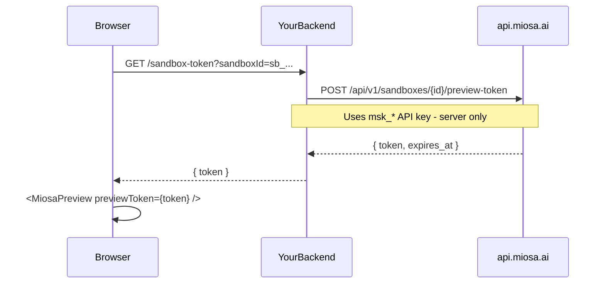

`@miosa/react`, `@miosa/vue`, and `@miosa/svelte` are drop-in component libraries that let you embed live MIOSA sandboxes directly in your own frontend  -  no iframe glue code, no WebSocket wiring, no API plumbing.

Each package ships four production-ready components:

| Component | What it renders |
|---|---|
| `<MiosaPreview>` | A sandboxed iframe showing your sandbox's HTTP preview URL |
| `<MiosaTerminal>` | A full xterm.js terminal connected to a sandbox PTY over WebSocket |
| `<MiosaFileTree>` | An interactive file browser backed by the sandbox filesystem |
| `<MiosaUsage>` | A usage summary widget (compute seconds, storage, egress) per end-user |

These are the customer-facing drop-in packages: your app imports them to embed a sandbox in your own frontend. They are separate from the MIOSA Foundation component library, which is the internal UI system for building the MIOSA product itself. Use [Foundation Component Library](/docs/component-library) for the product UI system, design tokens, cleanup rules, and reusable internal components.

## Auth model

> **Caution: Never put API keys in the browser**
>
> Your MIOSA API key (`msk_*`) must stay on your server. Components that accept an `apiKey` prop are intended for **server-rendered** or **trusted-client** contexts only. For public-facing embeds, generate a short-lived preview token on your backend and pass it as `previewToken`.

The recommended pattern for public embeds:



`<MiosaPreview>` and `<MiosaTerminal>` both accept a `previewToken` in place of an `apiKey`. Tokens are short-lived (1 hour by default) and scoped to a single sandbox.

## Which framework package to choose

| If you use... | Install |
|---|---|
| React / Next.js / Remix | `@miosa/react` |
| Vue 3 / Nuxt 3 | `@miosa/vue` |
| Svelte 5 / SvelteKit | `@miosa/svelte` |

The component APIs are structurally identical across all three packages. Prop names, event names, and behavior are the same  -  only the import path and framework idioms differ.

## Install

**React**

```bash
npm install @miosa/react
# xterm peer deps  -  required only if you use MiosaTerminal
npm install @xterm/xterm @xterm/addon-fit
```

**Vue**

```bash
npm install @miosa/vue
# xterm peer deps  -  required only if you use MiosaTerminal
npm install @xterm/xterm xterm-addon-fit
```

**Svelte**

```bash
npm install @miosa/svelte
# xterm peer deps  -  required only if you use MiosaTerminal
npm install @xterm/xterm xterm-addon-fit
```

Also add the stylesheet to your app entry point (React only  -  Vue and Svelte bundle their own scoped styles):

```ts
import '@miosa/react/styles.css';
```

## See also

- [Foundation Component Library](/docs/component-library)
- [React components](/docs/ui-components/react)
- [Vue components](/docs/ui-components/vue)
- [Svelte components](/docs/ui-components/svelte)
- [Platform: Browser Tokens](/docs/platform/browser-tokens)
- [Sandbox previews](/docs/develop/previews)
