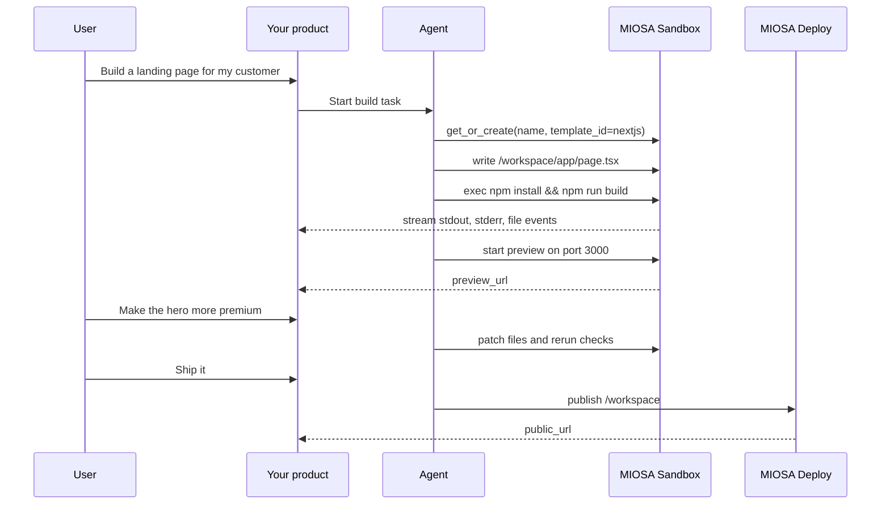

MIOSA is the infrastructure underneath AI products. Your product, or your agent, gets real machines and real URLs:

- **Sandboxes** for code, files, builds, and previews.
- **Computers** for browsers and full desktops, with human handoff.
- **Agents** you dispatch, stream, and collect artifacts from.
- **Deployments and Docker Host** for immutable releases on stable URLs, with custom domains and rollback.
- **Platform features** for white-label products: organizations, workspaces, scoped keys, domains, and usage metering.

```text
User request
  -> agent plans work
  -> sandbox does code, files, builds, tests, artifacts
  -> computer does browser, desktop, screenshots, manual-style tasks
  -> MIOSA streams events and previews
  -> deployment ships the finished app
```

MIOSA is not just a remote shell. It is the execution layer for products that need AI agents to do real work safely.

## Browse the Build gallery

Every product shape below has a step-by-step guide in the [Build gallery](/docs/build): the primitives you need, an architecture diagram, six steps from API key to custom domain, and a prompt you can hand to your coding agent.

- [AI app builders](/docs/build#bg-app-builders): Lovable, Bolt, v0, Replit-style: prompt to a deployed app.
- [Run coding agents](/docs/build#bg-run-coding-agents): Claude Code, Codex, Cursor in the cloud.
- [Autonomous agents](/docs/build#bg-autonomous-agents): Agents with their own machine that finish work.
- [Browser and computer-use agents](/docs/build#bg-browser-computer-agents): Agents that drive a real browser or desktop.
- [AI chat and companions](/docs/build#bg-chat-companions): Assistants and always-on companions.
- [Answer engines](/docs/build#bg-answer-engines): Research products that cite their sources.
- [Multi-agent](/docs/build#bg-multi-agent): One request, many agents in parallel.
- [Voice agents](/docs/build#bg-voice-agents): Agents that talk and act on calls.
- [AI design tools](/docs/build#bg-design-tools): Prompt to a designed UI or asset.
- [AI video and creative](/docs/build#bg-video-creative): Generate, edit, and produce media.
- [Vertical AI apps](/docs/build#bg-vertical-ai): Agents for a specific industry workflow.
- [Internal tools](/docs/build#bg-internal-tools): A company OS where agents, apps, and data live together.

---

## Builders and developers

- **Prompt-to-app builders**: Lovable and v0-style products where an agent turns a prompt into a live app, then fixes and republishes it.

  `Sandbox`
  `Preview`
  `Deployment`

  [Start here: build a Lovable-style app](/docs/build/lovable)
- **Coding agents in sandboxes**: Run Claude Code, Codex, or OSA inside a persistent sandbox with the files, packages, and shell a real repo needs.

  `Sandbox`
  `Agent runs`
  `Snapshots`

  [Start here: run coding agents](/docs/build/run-agents)
- **Code execution products**: Run untrusted user code in an isolated microVM, stream stdout, and collect the artifacts it produces.

  `Sandbox`
  `Events`
  `Artifacts`

  [Start here: streaming code execution](/docs/cookbook/streaming-code-execution)
- **Evaluation and benchmarking harnesses**: Run repeatable evals and benchmark bursts on real runtimes, with per-run evidence instead of mocks.

  `Sandbox`
  `Benchmarks`
  `Events`

  [Start here: evaluations](/docs/evaluations) and [benchmarks](/docs/benchmarks)

## Agent product teams

- **Always-on agents with their own computer**: dots and Grok Bot-style agents that keep a device, files, a browser, and long-running jobs across sessions.

  `Sandbox`
  `Computer`
  `Agent devices`

  [Start here: agent devices](/docs/guides/agent-devices)
- **Browser automation agents**: Browser use runs inside every sandbox: an agent drives a real browser over CDP while a human can watch.

  `Sandbox`
  `Browser use`
  `Live viewer`

  [Start here: browser use](/docs/browser-use)
- **Desktop and computer-use agents**: Agents that screenshot, click, and type on a durable Linux desktop, with human takeover when they get stuck.

  `Computer`
  `Computer use`
  `Embedding`

  [Start here: computer use](/docs/computer-use)

## Platform and agency teams

- **White-label agent platforms**: Lumen-style platforms with your brand, your domains, and your end users, while MIOSA runs behind them.

  `Org and workspaces`
  `Branding`
  `Attribution`

  [Start here: Platform builder guide](/docs/platform/overview)
- **Agency client platforms**: Northwind-style agencies that give each client an isolated workspace, build their apps, and hand over domains.

  `Multi-tenant`
  `Quotas`
  `Custom domains`

  [Start here: Platform builder guide](/docs/platform/overview#northwind-agency-client-work)
- **Internal Business OS for teams**: An Acme Corp-style internal platform where your team agents, apps, and data live together on MIOSA.

  `Sandbox`
  `Connectors`
  `Data`

  [Start here: internal Business OS](/docs/build/business-os)

## Infrastructure and enterprise

- **Bring-your-own machines**: OpenComputers enrolls machines you own so agents can run commands and files on your own hardware.

  `OpenComputers`
  `Hosts`
  `Meshes`

  [Start here: OpenComputers](/docs/opencomputers)
- **Enterprise data with Fractal**: Fractal gives enterprise data a governed home, so agents work against your systems with the right controls.

  `Fractal`
  `Data`
  `Governance`

  [Start here: Fractal enterprise data](/docs/data/fractal)

> **Note: Capability labels matter**
>
> MIOSA can host the application, data, workflow, customer boundary, and deployment for these products today.
> Specialized model and media execution may use connected providers.
> Managed GPU execution and customer-cloud placement remain gated until the availability page marks them shipped.
> See [Availability and roadmap](/docs/availability).

---

## Product primitives

| Primitive | Use it for | Not for |
|---|---|---|
| **Sandbox** | Code, files, commands, package installs, builds, tests, generated artifacts, preview servers | GUI/browser interaction |
| **Computer** | Browser automation, screenshots, mouse/keyboard, desktop apps, visual QA, user handoff | Headless code builds that do not need a desktop |
| **Deployment** | Stable public app/site/API URLs, versions, releases, rollback | Active development iteration |
| **Docker Host** | Many customer apps running as isolated containers on one workspace Docker Host host | Generic sandbox development |
| **Artifacts** | Files created by agents: PDFs, docs, images, reports, exports, screenshots | Hidden temporary state |
| **Events** | Real-time UI updates: tool calls, stdout, file writes, preview readiness, deployment status | Long-term storage |

## Build an agent-company product

Several modern AI products package the same high-level pattern: an agent, a
persistent workspace, connected apps, a browser or cloud device, jobs, files,
and generated deliverables. MIOSA exposes those primitives directly, so you can
build your own version inside your product.

```text
Your product UI
  -> agent configuration
  -> device policy
  -> sandbox/computer/local device
  -> connected accounts and managed connectors
  -> streamed tool calls and events
  -> files, artifacts, previews, jobs, and deployments
```

| Product shape | MIOSA primitives |
|---|---|
| Always-on virtual device | Persistent sandbox or computer, primary device policy, snapshots, jobs |
| Agent team | Orchestrator, child sandboxes, child computers, shared artifacts, event stream |
| Mini-app builder | Next.js sandbox, preview URL, artifact panel, publish flow |
| Operator agent | Browser computer, connected apps, schedules, approvals, memory |
| Design/research agent | Web research, a managed research connector, files, browser screenshots |
| 24/7 monitoring job | Scheduled trigger, persistent device, app connector, notifications |

The important architecture point is that the agent should work in a MIOSA
device. The local CLI, MCP client, or your backend orchestrates, but files,
commands, browser actions, previews, and artifacts live in the assigned runtime.

See [Build an agent-company platform](/docs/guides/build-agent-company),
[What MIOSA agents can do](/docs/guides/agent-capabilities),
[Agent devices](/docs/guides/agent-devices), and
[Agent orchestration](/docs/guides/agent-orchestration) for the full model.

> **Tip: Default agent loop**
>
> For AI coding products, the default loop should be sandbox-first: create or
> resume a sandbox, write files inside `/workspace`, run commands inside the
> sandbox, show the preview, snapshot progress, then publish.

---

## Example: generated app builder



Your frontend can show the same work stream users expect from modern AI
builders: tool calls, command output, generated files, preview links, screenshots,
and final deployment URLs.

---

## Example: artifact workspace

Use a sandbox when the output is a file, not a deployed app.

```text
User asks for a proposal
  -> agent writes Python or Node generator
  -> sandbox creates proposal.html
  -> sandbox renders proposal.pdf
  -> sandbox creates proposal.docx
  -> product shows artifacts in a side panel
  -> user downloads or asks for edits
```

Good artifact outputs:

- client proposals
- pitch decks
- data reports
- PDF invoices
- SVG diagrams
- PNG charts
- HTML previews
- ZIP bundles
- code archives

---

## Two sandbox choices, and both cover the jobs

| Choice | Intended job |
|---|---|
| The default sandbox (`miosa-sandbox`) | Everything in one place: Python and Node execution, generated web apps, reports and artifacts, browser testing, and database-backed apps. |
| The desktop (`miosa-desktop`) | GUI work and human takeover, when a person needs to see and drive the screen. |

The product shape stays the same: start the default sandbox, let the agent work inside it.

---

## What to show users in your product

Users should not have to understand VM internals. Show them useful work:

- current task and plan
- tool calls
- command output
- files created or edited
- artifacts generated
- preview URL
- screenshots from browser checks
- deployment URL
- rollback/version history
- credits and runtime usage

The message should be: "Your agent is working in a real cloud workspace. You can
watch it, inspect the files, preview the result, and ship when ready."

---

## See also

- [See apps you can build](/docs/build): Step-by-step guides for 20+ product shapes, from Lovable and Bolt to Devin and an internal Business OS.
- [Build an agent-company platform](/docs/guides/build-agent-company): Map always-on devices and operator agents onto MIOSA primitives.
- [Backend orchestration](/docs/integrations/backend-orchestration): Build the API layer that dispatches prompts into sandboxes, computers, and local devices.
- [Agent orchestration](/docs/guides/agent-orchestration): Coordinate sandbox agents, computer agents, artifacts, events, and deployments.
- [Sandboxes](/docs/develop/sandboxes): Persistent code workspaces for files, commands, previews, snapshots, and publishing.
- [Computers](/docs/computers/overview): Desktop/browser runtimes for screenshots, clicks, uploads, visual QA, and handoff.
