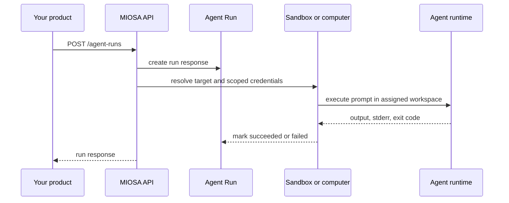

智能体运行是 MIOSA 沙箱和计算机的提示调度界面。
当您的产品需要将自然语言任务发送到设备并运行它时使用它们
通过 OSA、Codex、Claude Code、Pi、Hermes 或自定义运行时，并接收
您的 UI 可以呈现稳定的运行响应。

这是背后的API：

- `miosa agent run --sandbox ...`
- `miosa agent run --computer ...`
- `miosa prompt`
- TypeScript SDK 中的 `client.agentRuns.run(...)`
- Python SDK 中的 `client.agent_runs.run(...)`
- `miosa run files <run-id>`
- `miosa run download <run-id> <file-id>`

> **注意：智能体运行不是原始执行**
>
> 当您已经知道该命令时，请使用原始 exec。使用智能体运行时用户
> 提示应由 MIOSA 设备内的智能体运行时处理。奔跑
> 响应保留提示、提供者、目标、输出、错误、元数据和
> 产品 UI 和审核跟踪的时间戳。

## 流程



## 创建一个运行

```http
POST /api/v1/agent-runs
Authorization: Bearer msk_u_...
Content-Type: application/json
```

> **注意：当前实施**
>
> `POST /agent-runs` 适用于沙箱和计算机目标。使用沙箱目标
> 用于代码、文件、测试、构建、工件和预览服务器。使用电脑
> 任务需要浏览器、桌面、屏幕截图或交互式 UI 时的目标
> 状态。对于客户拥有的 OpenComputers 主机，请使用
> `POST /opencomputers/hosts/{id}/agent/dispatch`。

```json
{
  "target_kind": "sandbox",
  "target_id": "41026070-9bb0-4d62-90b4-8ceeb0a131b6",
  "provider": "claude-code",
  "prompt": "Update the landing page, run tests, and leave the preview running.",
  "cwd": "/workspace",
  "timeout": 1800,
  "metadata": {
    "workspace_id": "lumen",
    "task_id": "task_123"
  }
}
```

### 请求字段

|领域|类型 |必填 |描述 |
|---|---:|---:|---|
| `prompt` |字符串|是的 |要运行的自然语言任务。 |
| `target_id` | UUID/字符串 |是的 |沙箱或计算机 ID。 |
| `target_kind` | `sandbox` / `computer` |推荐|目标家庭。使用 `sandbox_id` 或 `computer_id` 时推断默认值。 |
| `sandbox_id` | UUID/字符串 |没有|带有沙箱目标的 `target_id` 的快捷方式。 |
| `computer_id` | UUID/字符串 |没有|具有计算机目标的 `target_id` 的快捷方式。 |
| `provider` |字符串|没有| `osa`、`codex`、`claude`、`claude-code`、`pi`、`hermes` 或 `custom`。 |
| `command` |字符串| `custom` | 需要自定义提供程序的运行时命令。 |
| `model` |字符串|没有|特定于提供商的模型覆盖。 |
| `cwd` |字符串|没有|工作目录，通常为 `/workspace`。 |
| `timeout` |整数 |没有|运行超时（以秒为单位）。 |
| `env` |对象|没有|非秘密运行环境覆盖。首先应用配置文件 env。 |
| `agent_runtime_profile_id` | UUID/字符串 |没有|为此运行强制使用特定的运行时配置文件。别名：`agent_profile_id`。 |
| `agent_run_group_id` | UUID/字符串 |没有|将此运行附加到智能体运行组。 |
| `parent_agent_run_id` | UUID/字符串 |没有|将此运行链接到父级/协调器运行。 |
| `orchestration_role` |字符串|没有|产品角色，例如 `coder`、`browser-qa`、`tester` 或 `artifact-generator`。 |
| `skip_agent_runtime_profile` |布尔 |没有|如果 `true`，则跳过租户/工作区默认运行时配置文件解析。 |
| `metadata` |对象|没有|产品 ID、UI 标签、任务 ID 或跟踪元数据。 |

## 回应

```json
{
  "data": {
    "id": "b1772e2f-89d1-4b59-9aa7-147eed4c902a",
    "agent_run_group_id": "grp_123",
    "parent_agent_run_id": null,
    "orchestration_role": "coder",
    "target_kind": "sandbox",
    "target_id": "41026070-9bb0-4d62-90b4-8ceeb0a131b6",
    "provider": "claude-code",
    "prompt": "Update the landing page, run tests, and leave the preview running.",
    "status": "succeeded",
    "output": "Updated app/page.tsx and started preview on port 3000.",
    "stderr": "",
    "exit_code": 0,
    "metadata": {
      "workspace_id": "lumen",
      "task_id": "task_123"
    },
    "started_at": "2026-06-14T10:30:00Z",
    "finished_at": "2026-06-14T10:31:42Z",
    "created_at": "2026-06-14T10:30:00Z",
    "updated_at": "2026-06-14T10:31:42Z"
  }
}
```

### 状态值

|状态 |意义|
|---|---|
| `running` |保留用于异步运行历史记录。 |
| `succeeded` |运行时成功完成。 |
| `failed` |运行时返回非零退出或后端错误。 |
| `canceled` |跑步被取消。对于沙箱进程支持的运行，MIOSA 还会停止记录的沙箱进程。 |

## 文物

智能体运行可以将生成的文件记录为工件。 MIOSA 捕获量已宣布
如果可能的话，将工件字节放入托管存储中，然后回退到实时状态
旧的或未持久的工件的目标文件系统。

这对于产品用户体验很重要：如果 `persisted` 是 `true`，您的用户可以下载
即使沙箱或计算机会话停止后，该文件也不会丢失。如果 `persisted`
是 `false`，保持目标运行直到文件下载完毕，
导出或出版。

在请求正文中声明工件路径：

```json
{
  "sandbox_id": "41026070-9bb0-4d62-90b4-8ceeb0a131b6",
  "provider": "claude-code",
  "prompt": "Create /workspace/report.html",
  "metadata": {
    "artifact_paths": ["/workspace/report.html"]
  }
}
```

列出工件：

```http
GET /api/v1/agent-runs/{run_id}/artifacts
Authorization: Bearer msk_u_...
```

下载一件产物：

```http
GET /api/v1/agent-runs/{run_id}/artifacts/{artifact_id}/download
Authorization: Bearer msk_u_...
```

将 HTML/PDF/图像工件嵌入到您自己的工件中时使用 `?disposition=inline`
预览用户界面。默认响应是附件。工件列表响应还包括短暂的 `signed_download_url` 值
当后端可以铸造它们时。使用这些 URL 进行面向浏览器的下载
您自己的用户界面；它们不需要公开用户的 API 密钥。

工件记录包括持久性元数据：

|领域|意义|
|---|---|
| `status` |工件生命周期状态，例如 `created`、`available` 或 `failed`。 |
| `sha256` | MIOSA 捕获字节时的内容哈希。 |
| `persisted` | `true` 当字节存储在实时运行时之外时。 |
| `storage_backend` |存储后端标签，例如 `s3` 或 `local`。 |
| `persisted_at` | MIOSA 捕获字节时的时间戳。 |

MIOSA 不会在公共 API 中公开内部存储密钥或存储桶 URL。
请改用下载端点或签名的下载 URL。

## 活动

智能体运行事件是持久的。使用它们来构建时间表、进度源、
审计跟踪和编排 UI。

|活动 |意义|
|---|---|
| `created` |运行记录已创建。 |
| `command_started` | MIOSA 开始执行运行时命令。 |
| `process_started` |沙箱进程支持的运行启动并记录沙箱进程 ID。 |
| `command_finished` |运行时命令已完成，运行标记为成功或失败。 |
| `artifacts_recorded` |已申报的文物被捕获或记录。 |
| `failed` |在正常命令完成之前运行失败。 |
| `canceled` |运行被取消。 |

列出持久事件：

```http
GET /api/v1/agent-runs/{run_id}/events
Authorization: Bearer msk_u_...
```

使用 SSE 流式传输事件：

```http
GET /api/v1/agent-runs/{run_id}/events?stream=true
Accept: text/event-stream
Authorization: Bearer msk_u_...
```

流首先发送现有的持久事件，然后发送实时 PubSub 事件。终端
`command_finished`、`failed` 和 `canceled` 等事件关闭流。

## 取消

```http
POST /api/v1/agent-runs/{run_id}/cancel
Authorization: Bearer msk_u_...
```

根据目标类型尽力取消：

|目标|行为 |
|---|---|
|沙盒进程支持的运行 | MIOSA 停止记录的沙箱进程，标记运行 `canceled`，并发出 `canceled`。 |
|较旧的同步沙箱路径 | MIOSA 标记运行 `canceled`；在收到取消消息时，该命令可能已经完成。 |
|计算机/BYOC 目标 | MIOSA 标记运行 `canceled`；计算机运行时中断取决于目标智能体的实现。 |

对于沙箱进程支持的运行，运行元数据包括：

```json
{
  "agent_process": {
    "target_kind": "sandbox",
    "target_id": "41026070-9bb0-4d62-90b4-8ceeb0a131b6",
    "process_id": "proc_123",
    "pid": 123,
    "started_at": "2026-06-15T16:45:00Z"
  }
}
```

## 运行历史记录

使用 `POST /agent-runs` 的响应来获取即时任务结果。对于
长时间运行的浏览器或桌面对话，请继续使用计算机会话
API 与智能体运行一起，以便您的 UI 可以显示交互式会话和
每个提示的运行结果。

## SDK 示例

**打字稿**

```typescript
import { Miosa } from "@miosa/sdk";

const client = new Miosa({ apiKey: process.env.MIOSA_API_KEY! });

const run = await client.agentRuns.run({
  sandboxId: "41026070-9bb0-4d62-90b4-8ceeb0a131b6",
  targetKind: "sandbox",
  agentRunGroupId: "grp_123",
  orchestrationRole: "coder",
  agentRuntimeProfileId: "arp_123",
  provider: "claude-code",
  cwd: "/workspace",
  timeout: 1800,
  prompt: "Build the dashboard, run tests, and keep the preview live.",
  metadata: {
    artifact_paths: ["/workspace/report.html"],
  },
});

console.log(run.id, run.status, run.output);

const artifacts = await client.agentRuns.artifacts(run.id);
const report = await client.agentRuns.downloadArtifact(run.id, artifacts[0].id);
```

**Python**

```python
from miosa import Miosa

client = Miosa()

run = client.agent_runs.run(
    sandbox_id="41026070-9bb0-4d62-90b4-8ceeb0a131b6",
    target_kind="sandbox",
    agent_run_group_id="grp_123",
    orchestration_role="coder",
    agent_runtime_profile_id="arp_123",
    provider="claude-code",
    cwd="/workspace",
    timeout=1800,
    prompt="Build the dashboard, run tests, and keep the preview live.",
    metadata={"artifact_paths": ["/workspace/report.html"]},
)

print(run["id"], run["status"], run.get("output", ""))

artifacts = client.agent_runs.artifacts(run["id"])
report = client.agent_runs.download_artifact(run["id"], artifacts[0]["id"])
```

## 命令行界面

选择运行执行的目标时使用 `miosa prompt`：

```bash
miosa prompt "Build the dashboard, run tests, and keep the preview live." \
  --sandbox 41026070-9bb0-4d62-90b4-8ceeb0a131b6 \
  --harness claude-code \
  --max-time 1800 \
  --json

miosa prompt "Open the CRM and verify the lead import" \
  --computer desktop-prod-1 \
  --harness osa \
  --json

miosa api POST /opencomputers/hosts/host_abc123/agent/dispatch \
  -d '{"task": "Audit the local browser workflow"}'

miosa run files <run-id> --json
miosa run download <run-id> <file-id> --output ./report.html
```

当您有保存的智能体可以使用标准运行时，请使用 `miosa agent run`
运行框架：

```bash
miosa agent run builder \
  --sandbox 41026070-9bb0-4d62-90b4-8ceeb0a131b6 \
  --json \
  "Build the dashboard, run tests, and keep the preview live."
```

当您携带您的
自己的运行时工具。 CLI 首先公开内置提供程序。

## 产品指导

- **在 UI 中显示**：在中渲染运行状态、提供程序、目标、提示、输出和请求 id
  您的任务流，以便用户可以看到智能体做了什么。
- **在设备内部继续工作**：智能体应该在沙箱内写入文件并运行命令，而不是构建
  本地并随后上传完成的结果。
- **使用元数据**：将您的工作区、用户、项目、工件或任务 ID 存储在元数据中，以便
  您可以将 MIOSA 运行连接到您的产品记录。
- **计划幂等性**：从队列发送工作时，将您自己的调度 id 存储在 `metadata` 中。的
  可查询的运行存储在重试安全时将使用相同的响应形状
  历史土地。

## 另请参阅

- [智能体编排](/docs/guides/agent-orchestration)
- [后端编排](/docs/integrations/backend-orchestration)
- [沙箱 API](/docs/api-reference/sandboxes)
- [计算机 API](/docs/api-reference/computers)
- [CLI](/docs/cli)
