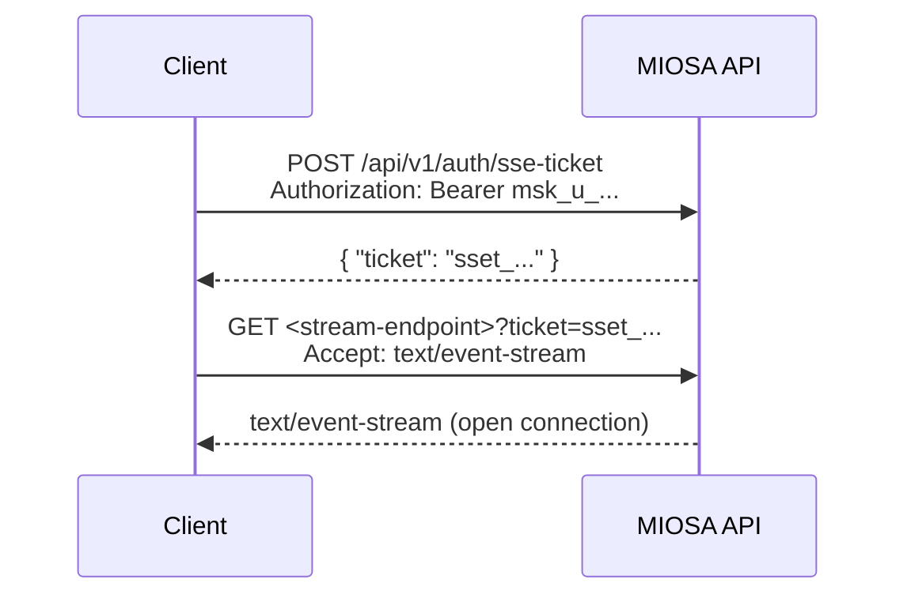

MIOSA 公开 SSE 流以获取产生定时事件的资源：沙箱、计算机会话、部署构建、沙箱模板构建和计算机日志。所有流都遵循相同的身份验证和信封模式。

---

## 身份验证模式

浏览器 `EventSource` API 无法发送 `Authorization` 标头。对所有 SSE 连接使用两步票证流程：


**第 1 步 - 造票：**
```bash
curl -X POST https://api.miosa.ai/api/v1/auth/sse-ticket \
  -H "Authorization: Bearer $MIOSA_API_KEY" \
  -H "Content-Type: application/json"
# Response: { "ticket": "sset_01hx9z...", "expires_in": 60 }
```

门票是一次性的，并在 60 秒后过期。在打开 `EventSource` 之前立即制作一个。

**第 2 步 - 打开流：**
```bash
curl -N "https://api.miosa.ai/api/v1/sandboxes/{id}/events?ticket=sset_01hx9z..." \
  -H "Accept: text/event-stream"
```

---

## SSE 直播

|流 |端点|描述 |
|---|---|---|
|沙盒活动 | `GET /sandboxes/{id}/events` |执行进度、文件更改通知、预览准备情况 |
|计算机智能体事件 | `GET /computers/{id}/agent/events` |智能体任务进度和计算机生命周期|
|电脑日志| `GET /computers/{id}/logs/stream` |计算机进程中的 stdout/stderr |
|沙盒日志 | `GET /sandboxes/{id}/logs/stream` |沙箱模板生命周期中的 stdout/stderr |
|构建活动 | `GET /sandbox-template-builds/{id}/logs/stream` |自定义模板构建进度 |

---

## 活动信封

所有事件均以标准 SSE 格式到达：
```text

event: <event_type>
data: <JSON payload>
id: <monotonic ULID>
```

所有有效负载均为 JSON。 `id:` 行允许客户端在重新连接时使用 `Last-Event-ID` 恢复。

---

## 沙盒事件类型

|活动 |有效负载|描述 |
|---|---|---|
| `sandbox.started` | `{sandbox_id, region}` |开机完成；准备好接受执行|
| `sandbox.exec.started` | `{exec_id, command}` |命令开始 |
| `sandbox.exec.stdout` | `{exec_id, line}` |标准输出块 |
| `sandbox.exec.stderr` | `{exec_id, line}` |标准错误块 |
| `sandbox.exec.completed` | `{exec_id, exit_code, duration_ms}` |命令退出 |
| `sandbox.preview.ready` | `{preview_id, url, port}` |预览网址可用 |
| `sandbox.idle` | `{sandbox_id, last_activity_at}` |即将自动暂停 |
| `sandbox.suspended` | `{sandbox_id}` |空闲窗口后自动暂停 |

---

## 部署事件类型

|活动 |有效负载|描述 |
|---|---|---|
| `deployment.publish.queued` | `{version_id}` |发布已接受，等待构建器 |
| `deployment.publish.building` | `{version_id, stage}` |生成器运行 |
| `deployment.publish.uploading` | `{version_id, size_bytes}` |发布产物上传|
| `deployment.publish.promoting` | `{version_id}` |切换活动版本 |
| `deployment.publish.completed` | `{version_id, deployment_id, url}` |直播 |
| `deployment.publish.failed` | `{version_id, error_code, message}` |构建或运行状况检查失败 |

---

## 计算机事件类型

|活动 |有效负载|描述 |
|---|---|---|
| `computer.started` | `{computer_id, region}` | VM 已启动，桌面就绪 |
| `computer.stream.token_ready` | `{token, expires_at}` |新的短期流凭证 |
| `computer.idle` | `{computer_id, idle_seconds}` |接近自动停止 |
| `computer.stopped` | `{computer_id, reason}` |停止（手动或自动）|

---

## 重新连接并重播

发送 `Last-Event-ID: &lt;ULID&gt;` 重新订阅请求。服务器重播自该 ID 以来的所有事件。每个资源的事件保留 **15 分钟**。
```bash
curl -N "https://api.miosa.ai/api/v1/sandboxes/{id}/events?ticket=sset_..." \
  -H "Accept: text/event-stream" \
  -H "Last-Event-ID: 01hwqz4b3c2v1x..."
```

---

## 错误处理

如果连接断开或票证过期，下一个请求将返回 `401`。制作新票并重新订阅：
```typescript
async function openStream(sandboxId: string): Promise<void> {
  const { ticket } = await fetch('/api/v1/auth/sse-ticket', {
    method: 'POST',
    headers: { Authorization: `Bearer ${process.env.MIOSA_API_KEY}` },
  }).then(r => r.json());

  const es = new EventSource(
    `https://api.miosa.ai/api/v1/sandboxes/${sandboxId}/events/stream?ticket=${ticket}`
  );

  es.addEventListener('error', () => {
    es.close();
    setTimeout(() => openStream(sandboxId), 1000);
  });

  es.addEventListener('sandbox.exec.completed', (e) => {
    console.log('Exec done:', JSON.parse(e.data));
  });
}
```

---

## 另请参阅

- **沙箱**：创建沙箱，运行执行，写入文件，打开预览。

  [沙箱→](/docs/develop/sandboxes)
- **发布**：构建器、发布、版本 - 完整的部署管道。

  [发布→](/docs/docker-host/publishing)
- **计算机**：桌面生命周期、屏幕截图、单击、键盘 API。

  [计算机→](/docs/computers/overview)
- **身份验证**：API 密钥、浏览器令牌、SSE 票证。

  [验证→](/docs/authentication)

---

## 沙箱事件流

**`GET /api/v1/sandboxes/{id}/events`**

打开发出沙箱生命周期事件的服务器发送事件 (SSE) 流。当沙箱达到 `destroyed` 或 `error` 时，连接会自动关闭。

### 授权

需要不记名令牌（作为 `Authorization: Bearer &lt;key&gt;` 标头发送）。

### 路径参数

|参数|类型 |描述 |
|------------|------|-------------|
| `id` |字符串|沙箱 ID。 |

### 响应 - `200 OK`（事件流）

`Content-Type: text/event-stream`

**事件：`state_changed`**
```text

event: state_changed
data: {"state":"running","previous_state":"provisioning","timestamp":"2026-04-25T10:00:07Z"}
```

**事件：`exec_output`**
```text

event: exec_output
data: {"exec_id":"exec_abc","stream":"stdout","data":"2\n","timestamp":"2026-04-25T10:00:10Z"}
```

**事件：`error`**
```text

event: error
data: {"message":"VM terminated unexpectedly","timestamp":"2026-04-25T10:05:00Z"}
```
```bash
curl -N "https://api.miosa.ai/api/v1/sandboxes/sbx_01j9xr2t4fk8me3n5q/events" \
  -H "Authorization: Bearer $MIOSA_API_KEY" \
  -H "Accept: text/event-stream"
```
