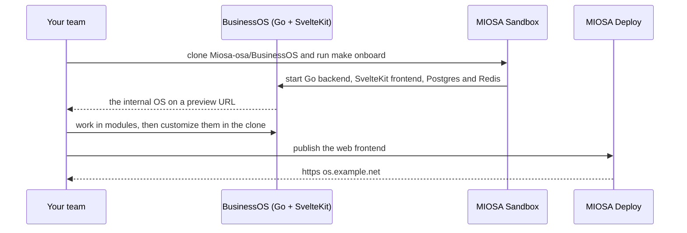

`~15 min` `TypeScript` `Python`

> **您正在构建的**：MIOSA 自己的 BusinessOS 模板 Apache 2.0 - 一种私有内部公司操作系统，您的团队的智能体、应用程序和数据共同存在于其中。
>
> **您将使用的原语**：组织和 API 密钥、沙箱、计算机、Postgres、部署（Docker 主机）、自定义域


* BusinessOS 桌面 - 可拖动的模块窗口、真正的本地终端和 OSA 助手。来自 BusinessOS 存储库 (Apache-2.0) 的屏幕截图。*

## 你正在构建什么

用于运营业务的开源操作层：工作区、模块、终端和智能体

本地优先的桌面和 Web 应用程序：带有 PostgreSQL 和 Redis 的 Go 后端、SvelteKit 前端、可选的 Electron shell 以及用于知识和智能体上下文的捆绑Optimal Engine。

您将使用的基元：组织和 API 密钥 · 沙箱 · 计算机 · Postgres · 部署 (App Engine) · 自定义域

- 可拖动、持久的模块窗口
- 工作空间、角色和团队
- 真实终端（PTY）表面
- 通过Optimal Engine管理知识和记忆
- 自定义模块构建器

您在 MIOSA 上安装并**运行真正的 BusinessOS**。首先阅读官方文档：[github.com/Miosa-osa/BusinessOS](https://github.com/Miosa-osa/BusinessOS)。下面的每个安装命令都来自他们；如果文档和本指南不一致，则文档获胜。 BusinessOS 是开源的 (Apache-2.0)，来自 MIOSA。

## MIOSA 需要什么

每一行都是在开始之前创建的一件事。该数字与使用它的步骤相匹配。

1. 组织和 API 密钥 - 确定每次调用的范围；工作人员只需要一把工作区钥匙即可。 - `miosa api-key create app-key --preset agent` [文档](/docs/platform/api-keys)
2. 沙箱 - 智能体在其中编写代码和运行命令的隔离 Linux 工作区。 - `miosa create app-box --template nextjs --wait` [Docs](/docs/develop/sandboxes)
3. 计算机 - 用于浏览器、鼠标和屏幕截图工作的持久 Linux 桌面。 - `miosa computer create app-desktop` [文档](/docs/computers/overview)
4. Postgres - 托管关系数据，在机器和生产中作为 DATABASE_URL 注入。 - `miosa api POST /databases -d '{"name":"app-db","engine":"postgresql"}'` [文档](/docs/data/postgres)
5. 每个客户一个工作区 - 隔离每个客户的机器、部署和数据。 - `miosa workspace create customer-1` [文档](/docs/platform/white-label)
6. 品牌和白标签 - 您的名字和预览、部署和桌面上的 slug；顾客永远不会看到 MIOSA。 - `miosa org` [文档](/docs/platform/white-label)
7. 使用计量和计费 - 每个客户的使用情况，以及哪个帐户为新机器付费。 - `miosa org bill` [文档](/docs/platform/usage-and-billing)
8. 部署 (App Engine) - 将应用程序发布到不可变的版本化 URL，并进行回滚。 - `miosa deploy create --from-sandbox app-box --name app --wait` [文档](/docs/docker-host/overview)
9. 自定义域 - 将应用程序放置在您拥有的主机名上，使用 HTTPS。 - `miosa deploy domain-add app app.example.com` [文档](/docs/docker-host/domains)

## 架构



## 它如何在 MIOSA 上运行

它运行的地方 -> MIOSA 沙箱（一个独立的 Linux 工作区）

状态和文件->不删除`.run/pgdata`;它是本地数据库。持久的沙箱可以让它跨越暂停。

模型 -> 您自己的提供商密钥，而不是 MIOSA 平台密钥

其 Web 端口 5273 -> MIOSA 预览 URL (`miosa preview create`)

您的客户 -> 各一个工作空间，彼此隔离

## 授权和租赁

您的组织就是平台；客户永远不会获得 MIOSA 帐户，他们会登录您的产品。每个客户在入职时创建一个工作区，隔离他们的机器、运行和数据。

```bash
miosa workspace create business-os-customer-1
```

标记每台机器并使用 `metadata` 中的客户 ID 运行，并且切勿跨客户查询。使用 GET /api/v1/usage 计量每个客户的使用情况，并使用 PUT /api/v1/bill-to (/docs/platform/usage-and-billing) 设置付款人。

## 安装 BusinessOS

按顺序在沙箱内运行它们（例如 `miosa exec business-os-box -- bash -lc '<command>'`）。命令来自官方文档。

```bash
git clone https://github.com/Miosa-osa/BusinessOS.git /workspace/BusinessOS
```

```bash
cd /workspace/BusinessOS
```

```text
make onboard
```

检查：安装完成，没有错误；接下来的部分将配置并启动它。

## 配置`make onboard` 检查工具，创建本地环境文件，在 `.run/` 下初始化独立的 PostgreSQL 集群和 Redis，启动捆绑的Optimal Engine，安装依赖项并启动后端、前端和（除非 `BUSINESSOS_HEADLESS=1`）Electron shell。它需要 Node 22+、pnpm 9.15.4、Go 1.26.2、PostgreSQL 14+、Redis 7+、Elixir/Mix 和 Python 3。

型号：由您的智能体商选择。使用我已连接的提供商的当前模型；如果没有的话就问哪一个。

## 运行它

启动它并证明它有效。

```text
make dev-local-verify
```

```text
make dev-local-status
```

检查：工具启动无错误并响应。

## 持久化和访问

不要删除`.run/pgdata`；它是本地数据库。持久的沙箱可以让它跨越暂停。

它侦听端口 5273。将其作为后台进程运行，以便它比您的 shell 寿命更长，然后打开预览：

```bash
miosa preview create business-os-box 5273 --name web
```

检查：预览 URL 应答，并且在机器暂停和恢复后仍然应答（预览根据请求唤醒它）。

## 使其成为产品

它是一个公司内部操作系统；在未阅读其许可证和自述文件的情况下，请勿将其作为多租户产品转售。

## 限制和成本

固定您测试的版本并刻意更新；这些工具变化很快。

仅向该工具提供其所需的凭据（作为秘密），而不是写入文件中。

原型：将其保留在默认大小的一台计算机上，跳过不需要的副本和自定义主机名，并在完成后删除所有内容。

## 验收检查

BusinessOS 在 MIOSA 沙箱上运行并回答实际任务。

状态在暂停和恢复后仍然存在。

每个客户都有自己的工作区和自己的实例；他们之间没有任何东西是共享的。

它创建的所有内容都可以被删除，而不会留下任何运行的内容。

## 后续步骤

- [智能体提示生成器选择产品形状并将简介交给您的智能体。](/docs/build)
- [运行编码智能体 在云中运行 Claude Code、Codex 或 Cursor，或在其上构建产品。](/docs/build/run-agents)
- [比较 MIOSA MIOSA 与其他沙箱和智能体平台的比较。](/docs/compare)
- [您可以构建什么 MIOSA 支持的每个产品模式。](/docs/use-cases)

## 自定义它

BusinessOS 是一个模板，而不是一个固定的产品：模块的含义来自您的公司，而不是来自存储库。全新安装会显示故意未成形的模块屏幕，直到您赋予其形状。您编辑的所有内容都存在于您已有的克隆中：

- **前端和模块**位于 `frontend/` (SvelteKit) 中。模块是一条路线加上它所拥有的人员、智能体、记录、状态和策略；从现有的基础路线作为模板开始。
- **Go backend** 位于 `desktop/` 中：您的模块为获取数据而调用的 API。
- **知识和智能体**来自 `optimal-engine/` 中捆绑的Optimal Engine，它为助手提供了对您自己的数据的记忆、搜索和智能体上下文。
- **工作空间形状**存在于 `workspaces/` 中：团队、角色和工作空间起始的私人投影。

更改运行机器中的代码并重新启动堆栈即可看到它：

```bash
miosa exec business-os-box --cwd /workspace/BusinessOS -- make dev-local-restart
```

存储库自己的 [docs/](https://github.com/Miosa-osa/BusinessOS/tree/main/docs) 深入涵盖了架构、模块创作和操作。
