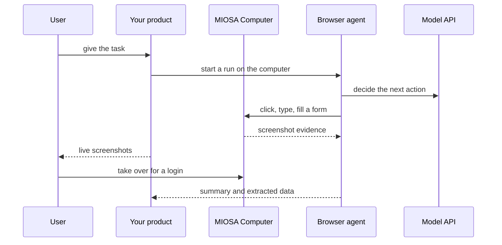

`~25 min` `TypeScript` `Python`

> **您正在构建的**：通过浏览、单击和填写表格来完成任务的智能体。
>
> **您将使用的原语**：计算机、沙箱、智能体和工具

> **提示：构建您自己的，或运行开源的**
>
> 在这里，您可以在 MIOSA 上自行构建智能体：CDP 上的[沙箱](/docs/browser-use)内的实时浏览器，或完整的[计算机](/docs/computer-use)，具有您自己的模型和循环。
> 更喜欢现成的框架？请在 MIOSA 上运行 [浏览器使用](/docs/build/browser-use) 或 [Stagehand](/docs/build/stagehand)。
> 想要一个完整的人工智能浏览器产品吗？请参阅[构建Polar风格的AI浏览器](/docs/build/polar)。

## 你正在构建什么

驱动真实浏览器或桌面完成任务的智能体，并由人员批准后续步骤

目标发送给智能体，该智能体会循环查看屏幕（屏幕截图）、做出决定并采取行动（单击、键入、按键、启动），直到任务完成；登录和确认等待同一实时桌面上的人。

您将使用的原语：计算机·沙箱·智能体和工具

- 驱动真正的浏览器或桌面
- 真实站点上的多步骤任务
- 人工接管登录和批准
- 返回摘要及其生成的文件

这是一种模式，而不是某种产品的复制品。从[相关的 MIOSA 指南](/docs/computers/overview)开始，构建具有上述功能的最小版本。

## MIOSA 需要什么

每一行都是在开始之前创建的一件事。该数字与使用它的步骤相匹配。

1. 组织和 API 密钥 - 确定每次调用的范围；工作人员只需要一把工作区钥匙即可。 - `miosa api-key create app-key --preset agent` [文档](/docs/platform/api-keys)
2. 计算机 - 用于浏览器、鼠标和屏幕截图工作的持久 Linux 桌面。 - `miosa computer create app-desktop` [文档](/docs/computers/overview)
3. 沙箱 - 智能体在其中编写代码和运行命令的隔离 Linux 工作区。 - `miosa create app-box --template nextjs --wait` [Docs](/docs/develop/sandboxes)
4. 每个客户一个工作区 - 隔离每个客户的机器、部署和数据。 - `miosa workspace create customer-1` [文档](/docs/platform/white-label)
5. 品牌和白标签 - 您的名字和预览、部署和桌面上的 slug；顾客永远不会看到 MIOSA。 - `miosa org` [文档](/docs/platform/white-label)
6. 使用计量和计费 - 每个客户的使用情况，以及哪个帐户为新机器付费。 - `miosa org bill` [文档](/docs/platform/usage-and-billing)
7. 智能体和工具 - 将提示转化为工作：选择运行使用的工具和模型。 - `miosa agent harnesses` [文档](/docs/api-reference/agent-runs)

## 架构



## 它如何映射到 MIOSA

真正的桌面和浏览器 -> 一台 MIOSA 计算机（带有浏览器的持久 Linux 桌面）

查看屏幕并对其进行操作 -> computer.screenshot()、click()、type()、key()、launch()

智能体循环 -> 智能体运行 (`miosa prompt`, client.runs) 驱动计算机的流事件

批准和接管 -> 智能体运行（`miosa prompt`, client.runs）流式传输事件、智能体批准以及一个人可以接管的共享桌面

## 数据和存储

数据存储中的任务表：任务 ID、目标、计划、计算机 ID、运行 ID、状态、批准记录和工件链接。桌面自己的文件和浏览器配置文件保留在计算机上。

智能体编写和运行的代码属于工作沙箱，而不是桌面。

## 授权和租赁

您的组织就是平台；客户永远不会获得 MIOSA 帐户，他们会登录您的产品。每个客户在入职时创建一个工作区，隔离他们的机器、运行和数据。

```bash
miosa workspace create chatgpt-agent-customer-1
```

标记每台机器并使用 `metadata` 中的客户 ID 运行，并且切勿跨客户查询。使用 GET /api/v1/usage 计量每个客户的使用情况，并使用 PUT /api/v1/bill-to (/docs/platform/usage-and-billing) 设置付款人。

## 智能体循环

运行框架：OSA 是 MIOSA 自己的运行框架，可与您连接的任何模型提供商配合使用，包括您自己的模型。

模型：人类（克劳德）。呼叫使用我自己的提供商密钥（`miosa connections add models`）； MIOSA 平台密钥从未被使用过。

会话：每个项目或对话一次聊天，因此智能体可以保留其上下文。电脑上第一个`miosa prompt`使用`--new-chat`（打印一个聊天id）；之后的每个回合都会经过 `--chat <chat-id>`。 `--reuse chat` 每个聊天保留一台新计算机，以便文件保留。流式传输：使用 `miosa run follow <run-id>` 或 client.runs.streamEvents(run.id) 跟踪运行，并使用 `miosa run steer` 和 `miosa run interrupt` 引导或停止运行。

该运行框架驱动计算机：它看起来（屏幕截图）、决定和行动（单击、键入、按键、启动），然后重复。明确告诉它哪些操作需要批准。

每个用户或每个任务一台计算机可以防止浏览器会话和登录帐户混合。

## 步骤

1. 创建智能体工作的计算机：带有真实浏览器的持久 Linux 桌面。
   ```bash
   miosa computer create chatgpt-agent-desktop
   ```
   ```bash
   miosa create chatgpt-agent-work --template python-data --wait
   ```
   检查：computer.screenshot() 返回桌面图像并且工作沙箱正在运行。
2. 行动前计划：让智能体编写一个简短的计划（步骤以及“完成”的含义）并将其与任务放在一起，以便人们可以阅读。
   检查：在执行第一个操作之前，计划已存储并显示在 UI 中。
3. 将目标发送至计算机上的运行框架。
   ```bash
   miosa prompt --computer chatgpt-agent-desktop --harness osa --model <anthropic-model-id> --chat <chat-id> "Goal: <goal>. Plan first, then work in the browser and files, and save deliverables to /workspace/out"
   ```
   检查：运行开始，第一个屏幕截图在几秒钟内到达。
4.“观察-行动”循环：屏幕截图、决定、行动、再次屏幕截图。存储每个屏幕截图作为证据。
   ```text
   computer.screenshot()
   ```
   ```text
   computer.click(x, y)
   ```
   ```text
   computer.type(text)
   ```
   ```text
   computer.key("Enter")
   ```
   ```text
   computer.launch(app)
   ```
   检查：每个操作后面都有一个可以重播的存储的屏幕截图。
5. 审批和人工接管。后续操作（发送、购买、删除、登录）等待一个人；该人可以接管同一个实时桌面进行登录或验证码并将其交还。
   ```bash
   miosa agent approvals
   ```
   检查：没有批准记录，任何后续运行都不会发生，接管后智能体可以继续。
6. 长时间运行的工作：留出时间、观察进度、转向或停止。
   ```bash
   miosa run follow <run-id>
   ```
   ```bash
   miosa run steer --computer chatgpt-agent-desktop "focus on the pricing page"
   ```
   ```bash
   miosa run interrupt --computer chatgpt-agent-desktop
   ```
   ```bash
   miosa extend chatgpt-agent-desktop
   ```
   检查：关闭 UI 不会停止运行，重新打开会显示当前进度。
7. 收集工件（文件、文档、导出）并返回它们并附上所做工作的摘要。
   ```bash
   miosa run files <run-id>
   ```
   ```bash
   miosa run download <run-id> <file-id> --output ./result
   ```
   检查：用户收到完成的文件，而不仅仅是文件的描述。

## 限制和成本

计算机在运行时计费：设置 TTL，故意使用 `miosa extend` 延长，并暂停空闲的。

在运行时设置 `--max-time`；小时数是正常的，无限制则不然。

切勿将长期有效的凭据放在桌面上；通过人工接管登录，以便用户掌握秘密。

原型：将其保留在默认大小的一台计算机上，跳过不需要的副本和自定义主机名，并在完成后删除所有内容。

## 验收检查

智能体完成了真实的浏览器任务，屏幕截图显示了结果。

后续行动已停止等待批准。

工件已交付，并且计算机在轮流中持续存在。

每个客户都被隔离在自己的工作空间中，并且根据他们的使用情况进行计量。

它创建的所有内容都可以被删除，而不会留下任何运行的内容。

## 后续步骤

- [智能体提示构建器选择产品形状并将简介交给您的智能体。](/docs/build)
- [运行编码智能体 在云中运行 Claude Code、Codex 或 Cursor，或在其上构建产品。](/docs/build/run-agents)
- [比较 MIOSA MIOSA 与其他沙箱和智能体平台的比较。](/docs/compare)
- [您可以构建什么 MIOSA 支持的每个产品模式。](/docs/use-cases)
