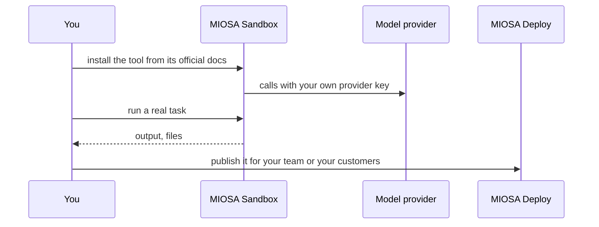

`~15 min` `TypeScript` `Python`

> **您正在构建的内容**：在包含流式事件的沙箱中安装 Codex CLI。
>
> **您将使用的原语**：沙盒、智能体和利用

## 你正在构建什么

OpenAI 的编码智能体 由 OpenAI 在 Codex 上建模。

Codex 接受任务，在与存储库隔离的环境中工作，运行命令和测试，并返回更改以供审核；许多任务可以并行运行。

您将使用的基元：沙箱·智能体和利用

- 委托编码任务并行运行
- 在隔离环境中编辑文件并运行测试
- 返回可审查的更改
- 从 CLI 或云端工作

您在 MIOSA 上安装并**运行真正的 Codex**。首先阅读官方文档：[github.com/openai/codex](https://github.com/openai/codex)。下面的每个安装命令都来自他们；如果文档和本指南不一致，则文档获胜。 Codex 是来自 OpenAI 的 Codex CLI；使用官方安装脚本或 npm 安装。

## MIOSA 需要什么

每一行都是在开始之前创建的一件事。该数字与使用它的步骤相匹配。

1. 组织和 API 密钥 - 确定每次调用的范围；工作人员只需要一把工作区钥匙即可。 - `miosa api-key create app-key --preset agent` [文档](/docs/platform/api-keys)
2. 沙箱 - 智能体在其中编写代码和运行命令的隔离 Linux 工作区。 - `miosa create app-box --template nextjs --wait` [Docs](/docs/develop/sandboxes)
3. 每个客户一个工作区 - 隔离每个客户的机器、部署和数据。 - `miosa workspace create customer-1` [文档](/docs/platform/white-label)
4. 品牌和白标 - 您的姓名和预览、部署和桌面上的 slug；顾客永远不会看到 MIOSA。 - `miosa org` [文档](/docs/platform/white-label)
5. 使用计量和计费 - 每个客户的使用情况，以及哪个帐户为新机器付费。 - `miosa org bill` [文档](/docs/platform/usage-and-billing)
6. 智能体和工具 - 将提示转化为工作：选择运行使用的工具和模型。 - `miosa agent harnesses` [文档](/docs/api-reference/agent-runs)

## 架构



## 它如何在 MIOSA 上运行

它运行的地方 -> MIOSA 沙箱（一个独立的 Linux 工作区）

状态和文件 -> 将存储库保留在 /workspace 中；持久沙箱会在暂停期间保留它和 `~/.codex` 配置。

模型 -> 您自己的提供商密钥，而不是 MIOSA 平台密钥

MIOSA 还可以将其作为内置 `codex` 工具进行调度：运行、事件、文件和批准都随之而来

您的客户 -> 各一个工作空间，彼此隔离

## 授权和租赁

您的组织就是平台；客户永远不会获得 MIOSA 帐户，他们会登录您的产品。每个客户在入职时创建一个工作区，隔离他们的机器、运行和数据。

```bash
miosa workspace create codex-customer-1
```

标记每台机器并使用 `metadata` 中的客户 ID 运行，并且切勿跨客户查询。使用 GET /api/v1/usage 计量每个客户的使用情况，并使用 PUT /api/v1/bill-to (/docs/platform/usage-and-billing) 设置付款人。

## 安装法典

按顺序在沙箱内运行它们（例如 `miosa exec codex-task-1 -- bash -lc '<command>'`）。命令来自官方文档。

```text
curl -fsSL https://chatgpt.com/codex/install.sh | sh
```

检查：安装完成，没有错误；接下来的部分将配置并启动它。

## 配置

使用您自己的 OpenAI 密钥进行身份验证：导出 OPENAI_API_KEY="..." （或使用 `codex` 登录）。

型号：OpenAI。调用使用我自己的提供商密钥（OPENAI_API_KEY）； MIOSA 平台密钥从未被使用过。

```bash
export OPENAI_API_KEY="..."   # set it in the process environment, or the Secrets API; never write it into files you commit
```

## 运行它

启动它并证明它有效。

```text
codex --version
```

脚本化、非交互式使用（产品或队列的调用方式）：

```text
codex exec "summarise this repository and list the failing tests"
```

MIOSA 也在本地运行它。通过 MIOSA 分派任务并流式传输其事件、文件和批准：

```bash
miosa prompt --sandbox codex-task-1 --harness codex --model <openai-model-id> "summarise this repository"
```

会话：每个项目或对话一次聊天，因此智能体可以保留其上下文。沙箱上的第一个 `miosa prompt` 使用 `--new-chat` （打印聊天 ID）；之后的每个回合都会经过 `--chat <chat-id>`。 `--reuse chat` 每个聊天保留一台新计算机，以便文件保留。

```bash
miosa run follow <run-id>
```

检查：无头任务完成并打印结果。

## 持久化和访问

将存储库保存在 /workspace 中；持久沙箱会在暂停期间保留它和 `~/.codex` 配置。

检查：机器暂停并恢复后，工具再次启动，状态完好。

## 使其成为产品

使用 `miosa prompt --harness codex` 在该客户的工作区中运行每个客户任务，并将事件流式传输到您自己的 UI 中。

## 限制和成本

固定您测试的版本并刻意更新；这些工具变化很快。

仅向该工具提供其所需的凭据（作为秘密），而不是写入文件中。

原型：将其保留在默认大小的一台计算机上，跳过不需要的副本和自定义主机名，并在完成后删除所有内容。

## 验收检查

Codex 在 MIOSA 沙箱上运行并回答实际任务。

状态在暂停和恢复后仍然存在。

每个客户都有自己的工作区和自己的实例；他们之间没有任何东西是共享的。

它创建的所有内容都可以被删除，而不会留下任何运行的内容。

## 后续步骤

- [智能体提示构建器选择产品形状并将简介交给您的智能体。](/docs/build)
- [运行编码智能体 在云中运行 Claude Code、Codex 或 Cursor，或在其上构建产品。](/docs/build/run-agents)
- [比较 MIOSA MIOSA 与其他沙箱和智能体平台的比较。](/docs/compare)
- [您可以构建什么 MIOSA 支持的每个产品模式。](/docs/use-cases)
