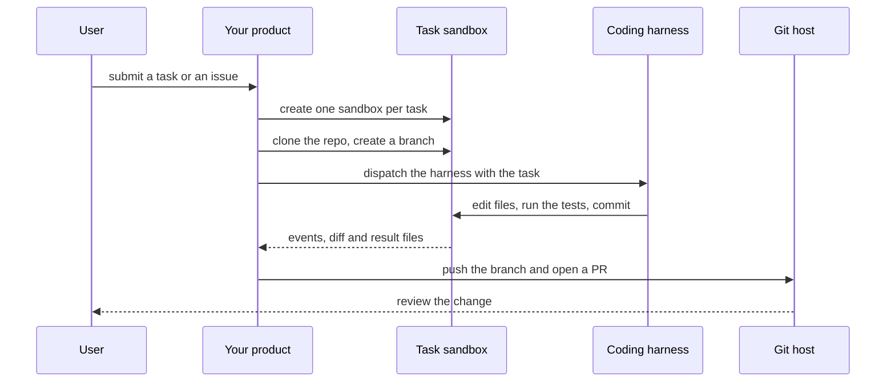

`~25 min` `TypeScript` `Python`

> **您正在构建的东西**：将运行框架包裹在您自己的品牌产品中。
>
> **您将使用的原语**：沙箱、智能体和利用、部署（Docker 主机）

## 你正在构建什么

您自己的产品，将编码工具（Claude Code、Codex、OSA、Hermes 或您自己的）包装在您的 UI 中，并在您的品牌编码智能体产品上建模（构建在开放工具上）。

您的产品接受客户的任务，在该客户的隔离 MIOSA 机器内运行运行框架，将进度传输到您的 UI 并收取使用费用。

您将使用的基元：沙箱·智能体和利用·部署（App Engine）

- 客户在您的 UI 中提交编码任务
- 运行框架独立运行每项任务
- 实时进展和可审查的结果
- 您的品牌和计费

来源：[/docs/build/run-agents](/docs/build/run-agents)。品牌编码剂产品是 You 的商标（建立在开放式运行框架上）；本指南不隶属于他们，也不受他们认可。

## MIOSA 需要什么

每一行都是在开始之前创建的一件事。该数字与使用它的步骤相匹配。

1. 组织和 API 密钥 - 确定每次调用的范围；工作人员只需要一把工作区钥匙即可。 - `miosa api-key create app-key --preset agent` [文档](/docs/platform/api-keys)
2. 沙箱 - 智能体在其中编写代码和运行命令的隔离 Linux 工作区。 - `miosa create app-box --template nextjs --wait` [Docs](/docs/develop/sandboxes)
3. 每个客户一个工作区 - 隔离每个客户的机器、部署和数据。 - `miosa workspace create customer-1` [文档](/docs/platform/white-label)
4. 品牌和白标 - 您的姓名和预览、部署和桌面上的 slug；顾客永远不会看到 MIOSA。 - `miosa org` [文档](/docs/platform/white-label)
5. 使用计量和计费 - 每个客户的使用情况，以及哪个帐户为新机器付费。 - `miosa org bill` [文档](/docs/platform/usage-and-billing)
6. 智能体和工具 - 将提示转化为工作：选择运行使用的工具和模型。 - `miosa agent harnesses` [文档](/docs/api-reference/agent-runs)
7. 部署 (App Engine) - 将应用程序发布到不可变的版本化 URL，并进行回滚。 - `miosa deploy create --from-sandbox app-box --name app --wait` [文档](/docs/docker-host/overview)

## 架构



## 它如何映射到 MIOSA

智能体可以安全破坏的工作空间 -> 每个任务一个 MIOSA 沙箱，并将存储库克隆到 /workspace

智能体编辑文件并运行命令 -> 智能体在该沙箱上运行 (`miosa prompt`, client.runs) 流事件 (`miosa prompt --sandbox ... --harness ...`)

并行任务 -> 每个任务或分支一个沙箱，沙箱快照和分支以尝试第二种方法

您可以查看的结果 -> `miosa run files`、`miosa run outputs` 以及沙箱内的 git diff

您的客户保持独立 -> 每个客户一个工作区，使用量通过收单方计量和计费

## 数据和存储

在您自己的数据存储中保留一个任务表：任务 ID、存储库、分支、沙箱 ID、运行 ID、状态、结果链接以及它所属的用户或客户。代码本身存在于沙箱和 Git 中，而不是存在于数据库中。

每个客户的使用情况（运行次数、分钟数）将用于您的计费；用`miosa run usage --group-by model`阅读它。

## 授权和租赁

您的组织就是平台；客户永远不会获得 MIOSA 帐户，他们会登录您的产品。每个客户在入职时创建一个工作区，隔离他们的机器、运行和数据。

```bash
miosa workspace create coding-agent-product-customer-1
```

标记每台机器并使用 `metadata` 中的客户 ID 运行，并且切勿跨客户查询。使用 GET /api/v1/usage 计量每个客户的使用情况，并使用 PUT /api/v1/bill-to (/docs/platform/usage-and-billing) 设置付款人。

## 智能体循环

运行框架：OSA 是 MIOSA 自己的运行框架，可与您连接的任何模型提供商配合使用，包括您自己的模型。

模型：人类（克劳德）。呼叫使用我自己的提供商密钥 (`miosa connections add models`)； MIOSA 平台密钥从未被使用过。

会话：每个项目或对话一次聊天，因此智能体可以保留其上下文。沙箱上的第一个 `miosa prompt` 使用 `--new-chat` （打印聊天 ID）；之后的每个回合都会经过 `--chat <chat-id>`。 `--reuse chat` 每个聊天保留一台新计算机，以便文件保留。

流式传输：使用 `miosa run follow <run-id>` 或 client.runs.streamEvents(run.id) 跟踪运行，并使用 `miosa run steer` 和 `miosa run interrupt` 引导或停止运行。该运行框架在签出存储库的任务沙箱内无头运行。它编辑文件，运行项目自己的命令并提交；你永远不会从外部应用它的编辑。

并行会话是单独的沙箱（和单独的聊天）。在有风险的更改和分叉之前进行快照以尝试第二种方法。

## 步骤

1.为每个任务或分支创建一个沙箱，这样并行任务就不会共享状态。
   ```bash
   miosa create coding-agent-product-task-1 --size medium --wait
   ```
   检查：沙箱正在运行；两个任务有两个沙箱。
2. 克隆存储库并创建任务分支。每次执行或通过 Secrets API 传递 Git 令牌；不要将其存储在沙箱中 `env`。
   ```bash
   miosa exec coding-agent-product-task-1 -- git clone <repo-url> /workspace/repo
   ```
   ```bash
   miosa exec coding-agent-product-task-1 --cwd /workspace/repo -- git checkout -b task/<task-id>
   ```
   检查：存储库位于任务分支上的 /workspace/repo 中。
3. 分配任务的运行框架。
   ```bash
   miosa prompt --sandbox coding-agent-product-task-1 --harness osa --model <anthropic-model-id> --chat <chat-id> "Do the task; run the tests; commit your work"
   ```
   检查：`miosa run list --status running` 显示运行和事件开始流式传输。
4. 跟随跑步，并通过 UI 控制或停止它。
   ```bash
   miosa run follow <run-id>
   ```
   ```bash
   miosa run steer --sandbox coding-agent-product-task-1 "also add tests"
   ```
   ```bash
   miosa run interrupt --sandbox coding-agent-product-task-1
   ```
   检查：UI显示实时事件；一头公牛在下一个转弯处着陆；中断会停止智能体。
5. 独立于智能体进行验证：自己运行测试命令。
   ```bash
   miosa exec coding-agent-product-task-1 --cwd /workspace/repo -- npm test
   ```
   检查：在沙箱中测试出口 0，而不仅仅是在智能体的摘要中。
6. 交回结果：收集文件和差异，如果任务需要则推送分支。
   ```bash
   miosa run files <run-id>
   ```
   ```bash
   miosa run download <run-id> <file-id> --output ./result
   ```
   ```bash
   miosa exec coding-agent-product-task-1 --cwd /workspace/repo -- git push origin task/<task-id>
   ```
   检查：差异可以在沙箱外进行审查，并且运行 ID 已附加到其中。
7. 平仓。对于一次性任务，让 MIOSA 来完成 (`miosa prompt --new-machine ... --after-run destroy`);当用户可以继续时，保留沙箱或对沙箱进行快照。
   检查：任务关闭后不存在任何孤立的沙箱。
8. 将您的产品 UI（普通 Web 应用程序：任务表单、实时事件、差异查看器）作为部署交付，构建在自己的沙箱中。
   ```bash
   miosa create coding-agent-product-ui --template nextjs --wait
   ```
   ```bash
   miosa deploy create --from-sandbox coding-agent-product-ui --name coding-agent-product --dir /workspace --port 3000 --run-command "npm start" --wait
   ```
   检查：public_url 为任务 UI 提供服务并端到端提交任务。

## 限制和成本

每次运行时设置 `--max-time`，这样卡住的智能体就不能永远运行；使用 `--notify-email` 或 webhook 来执行长任务。

为智能体提供一个范围仅限于一个存储库的令牌，并且仅提供任务所需的权限。

并行任务会增加成本：限制每个用户或客户的并发数。

原型：将其保留在默认大小的一台计算机上，跳过不需要的副本和自定义主机名，并在完成后删除所有内容。

## 验收检查

两个任务在两个沙箱中同时运行，互不接触。

完成的任务会留下可审查的分支或差异以及运行 ID。

没有部署或发布任何内容：可交付成果是差异。

每个客户都被隔离在自己的工作空间中，并且根据他们的使用情况进行计量。

它创建的所有内容都可以被删除，而不会留下任何运行的内容。

## 后续步骤

- [智能体提示构建器选择产品形状并将简介交给您的智能体。](/docs/build)
- [运行编码智能体 在云中运行 Claude Code、Codex 或 Cursor，或在其上构建产品。](/docs/build/run-agents)
- [比较 MIOSA MIOSA 与其他沙箱和智能体平台的比较。](/docs/compare)
- [您可以构建什么 MIOSA 支持的每个产品模式。](/docs/use-cases)
