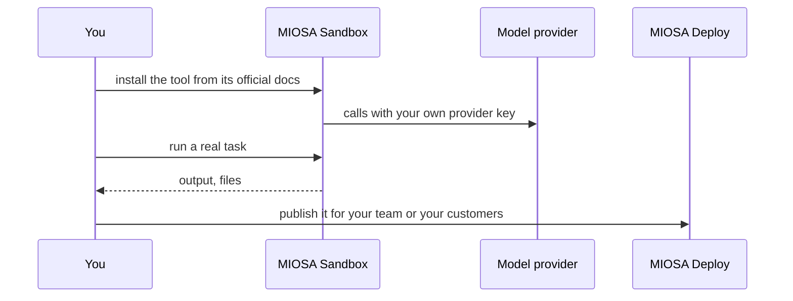

`~15 min` `TypeScript` `Python`

> **您正在构建的内容**：安装 Cursor CLI 智能体并在隔离的计算机上无头运行它。
>
> **您将使用的基元**：沙箱

## 你正在构建什么

一个 AI 代码编辑器，其智能体也可以在云端后台运行，以 Anysphere 的 Cursor 为模型。

Cursor 是一个带有智能体的编辑器，可以跨代码库进行编辑；后台智能体在远程环境中处理任务并返回报告。

您将使用的基元：沙箱

- 智能体跨代码库编辑
- 远程机器上的后台智能体
- 以差异形式查看结果
- 同时运行多个智能体

您在 MIOSA 上安装并**运行真正的 Cursor**。首先阅读官方文档：[cursor.com/docs/cli/overview](https://cursor.com/docs/cli/overview)。下面的每个安装命令都来自他们；如果文档和本指南不一致，则文档获胜。 Cursor是Cursor的命令行智能体；使用官方安装脚本进行安装。

## MIOSA 需要什么

每一行都是在开始之前创建的一件事。该数字与使用它的步骤相匹配。

1. 组织和 API 密钥 - 确定每次调用的范围；工作人员只需要一把工作区钥匙即可。 - `miosa api-key create app-key --preset agent` [文档](/docs/platform/api-keys)
2. 沙箱 - 智能体在其中编写代码和运行命令的隔离 Linux 工作区。 - `miosa create app-box --template nextjs --wait` [文档](/docs/develop/sandboxes)
3. 每个客户一个工作区 - 隔离每个客户的机器、部署和数据。 - `miosa workspace create customer-1` [文档](/docs/platform/white-label)
4. 品牌和白标 - 您的姓名和预览、部署和桌面上的 slug；顾客永远不会看到 MIOSA。 - `miosa org` [文档](/docs/platform/white-label)
5. 使用计量和计费 - 每个客户的使用情况，以及哪个帐户为新机器付费。 - `miosa org bill` [文档](/docs/platform/usage-and-billing)

## 架构



## 它如何在 MIOSA 上运行

它运行的地方 -> MIOSA 沙箱（一个独立的 Linux 工作区）

状态和文件 -> 将存储库保留在 /workspace 中；持久的沙箱可以让它跨越暂停。如果没有 `--force`，打印模式仅建议更改。

模型 -> 您自己的提供商密钥，而不是 MIOSA 平台密钥

您的客户 -> 各一个工作空间，彼此隔离

## 授权和租赁

您的组织就是平台；客户永远不会获得 MIOSA 帐户，他们会登录您的产品。每个客户在入职时创建一个工作区，隔离他们的机器、运行和数据。

```bash
miosa workspace create cursor-customer-1
```

标记每台机器并使用 `metadata` 中的客户 ID 运行，并且切勿跨客户查询。使用 GET /api/v1/usage 计量每个客户的使用情况，并使用 PUT /api/v1/bill-to (/docs/platform/usage-and-billing) 设置付款人。

## 安装光标

按顺序在沙箱内运行它们（例如 `miosa exec cursor-task-1 -- bash -lc '<command>'`）。命令来自官方文档。

```text
curl https://cursor.com/install -fsS | bash
```

检查：安装完成，没有错误；接下来的部分将配置并启动它。

## 配置

使用您自己的密钥对脚本进行身份验证：export CURSOR_API_KEY="..."（请参阅 Cursor CLI 身份验证文档）。

模型：人类（克劳德）。呼叫使用我自己的提供商密钥（在工具自己的设置中输入）； MIOSA 平台密钥从未被使用过。

## 运行它

启动它并证明它有效。

```text
agent --version
```

脚本化、非交互式使用（产品或队列的调用方式）：

```text
agent -p --force "add JSDoc comments to src/index.js"
```

```text
agent -p --output-format stream-json "review the changes on this branch"
```

检查：无头任务完成并打印结果。

## 持久化和访问

将存储库保存在 /workspace 中；持久的沙箱可以让它跨越暂停。如果没有 `--force`，打印模式仅建议更改。

检查：机器暂停并恢复后，工具再次启动，状态完好。

## 使其成为产品

作为您自己的任务队列后面的工作人员，在客户工作区中按客户任务运行它。它不是内置MIOSA运行框架，因此将其安装在机器中并用`miosa exec`调用。

## 限制和成本

固定您测试的版本并刻意更新；这些工具变化很快。

仅向该工具提供其所需的凭据（作为秘密），而不是写入文件中。

原型：将其保留在默认大小的一台计算机上，跳过不需要的副本和自定义主机名，并在完成后删除所有内容。

## 验收检查

Cursor 在 MIOSA 沙箱上运行并回答实际任务。

状态在暂停和恢复后仍然存在。每个客户都有自己的工作区和自己的实例；他们之间没有任何东西是共享的。

它创建的所有内容都可以被删除，而不会留下任何运行的内容。

## 后续步骤

- [智能体提示词构建器：选择一种产品形态，把需求交给你的智能体。](/docs/build)
- [运行编码智能体：在云端运行 Claude Code、Codex 或 Cursor，或基于它们构建产品。](/docs/build/run-agents)
- [对比 MIOSA：MIOSA 与其他沙箱和智能体平台有何不同。](/docs/compare)
- [您可以构建什么：MIOSA 支持的每一种产品模式。](/docs/use-cases)
