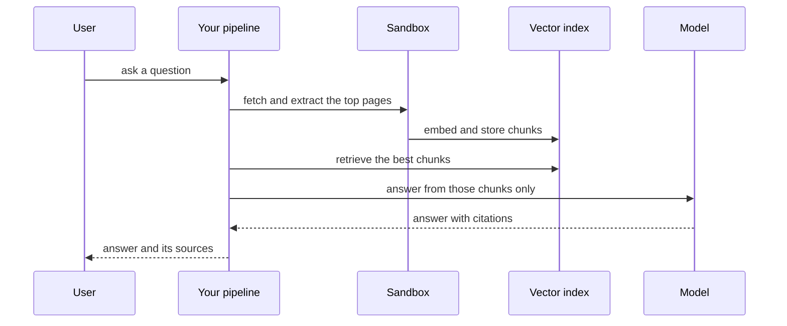

`~25 min` `TypeScript` `Python`

> **您正在构建的**：一个长期运行的研究智能体，正在制作一份报告。
>
> **您将使用的原语**：沙箱、智能体和利用、Qdrant 向量、部署（Docker 主机）

## 你正在构建什么

一个长期运行的研究智能体，生成了一份引用的报告，该报告以 OpenAI 的 ChatGPT 深度研究为模型。

该智能体计划一个研究问题，在几分钟内搜索和阅读许多资源，并撰写带有引文的结构化报告。

您将使用的基元：沙箱·智能体和利用·Qdrant向量·部署（App Engine）

- 长期进行的多源研究
- 搜索前做好计划
- 结构化的、被引用的报告
- 工作时显示进度

来源：[openai.com](https://openai.com/)。 ChatGPT 深度研究是 OpenAI 的商标；本指南不隶属于他们，也不受他们认可。

## MIOSA 需要什么

每一行都是在开始之前创建的一件事。该数字与使用它的步骤相匹配。

1. 组织和 API 密钥 - 确定每次调用的范围；工作人员只需要一把工作区钥匙即可。 - `miosa api-key create app-key --preset agent` [文档](/docs/platform/api-keys)
2. 沙箱 - 智能体在其中编写代码和运行命令的隔离 Linux 工作区。 - `miosa create app-box --template nextjs --wait` [Docs](/docs/develop/sandboxes)
3. Qdrant 矢量 - 用于搜索和嵌入的托管矢量存储，作为 QDRANT_URL 注入。 - `miosa api POST /databases -d '{"name":"app-index","engine":"qdrant"}'` [文档](/docs/data/qdrant)
4. 每个客户一个工作区 - 隔离每个客户的机器、部署和数据。 - `miosa workspace create customer-1` [文档](/docs/platform/white-label)
5. 品牌和白标签 - 您的名字和预览、部署和桌面上的 slug；顾客永远不会看到 MIOSA。 - `miosa org` [文档](/docs/platform/white-label)
6. 使用计量和计费 - 每个客户的使用情况，以及哪个帐户为新机器付费。 - `miosa org bill` [文档](/docs/platform/usage-and-billing)
7. 智能体和工具 - 将提示转化为工作：选择运行使用的工具和模型。 - `miosa agent harnesses` [文档](/docs/api-reference/agent-runs)
8. 部署 (App Engine) - 将应用程序发布到不可变的版本化 URL，并进行回滚。 - `miosa deploy create --from-sandbox app-box --name app --wait` [文档](/docs/docker-host/overview)

## 架构



## 它如何映射到 MIOSA

搜索并读取源 -> 运行获取/提取作业的 MIOSA 沙箱（当页面需要真正的浏览器时需要一台计算机）

检索其读取的内容 -> 用于块嵌入的托管 Qdrant (`QDRANT_URL`)

带引用的答案 -> 智能体运行 (`miosa prompt`, client.runs) 流事件，仅从检索到的块中应答并返回源 ID

提供答案 UI 或 API -> MIOSA 部署 (`miosa deploy create`)，不可变且版本化

一个长时间运行的作业，有进度 -> 智能体运行 (`miosa prompt`, client.runs) 流事件，`miosa run follow`，一个长的 `--max-time`

## 数据和存储

Qdrant 保存块嵌入；有效负载携带 url、标题、块 id 和 fetched_at，因此每个答案都可以引用已保存的页面。

将话题和答案及其引用保存在您自己的数据存储中。

## 授权和租赁

您的组织就是平台；客户永远不会获得 MIOSA 帐户，他们会登录您的产品。每个客户在入职时创建一个工作区，隔离他们的机器、运行和数据。

```bash
miosa workspace create deep-research-customer-1
```

标记每台机器并使用 `metadata` 中的客户 ID 运行，并且切勿跨客户查询。使用 GET /api/v1/usage 计量每个客户的使用情况，并使用 PUT /api/v1/bill-to (/docs/platform/usage-and-billing) 设置付款人。

## 智能体循环

运行框架：OSA 是 MIOSA 自己的运行框架，可与您连接的任何模型提供商配合使用，包括您自己的模型。

模型：人类（克劳德）。呼叫使用我自己的提供商密钥（`miosa connections add models`）； MIOSA 平台密钥从未被使用过。

会话：每个项目或对话一次聊天，因此智能体可以保留其上下文。沙箱上的第一个 `miosa prompt` 使用 `--new-chat` （打印聊天 ID）；之后的每个回合都会经过 `--chat <chat-id>`。 `--reuse chat` 每个聊天保留一台新计算机，以便文件保留。

流式传输：使用 `miosa run follow <run-id>` 或 client.runs.streamEvents(run.id) 跟踪运行，并使用 `miosa run steer` 和 `miosa run interrupt` 引导或停止运行。

检索第一，生成第二：模型只看到检索到的块，并且必须引用它们。该工具在管道沙箱中运行，因此获取和提取代码是隔离的。

## 步骤1. 创建向量索引。
   ```bash
   miosa api POST /databases -d '{"name":"deep-research-index","engine":"qdrant"}'
   ```
   检查：QDRANT_URL 和 QDRANT_API_KEY 可用于管道。
2. 创建用于获取、提取和索引页面的管道沙箱。
   ```bash
   miosa create deep-research-box --template agent-python --wait
   ```
   检查：沙箱正在运行并且可以获取公共 URL。
3. 检索：对于问题，调用您自带的搜索源（搜索 API）或抓取定义的语料库，获取页面，并提取带有 url、标题和 fetched_at 的干净文本。
   检查：每个存储的页面都有一个 URL 和一个获取时间。
4. 使用有效负载中的 url、标题和块 ID 进行块、嵌入和更新插入到 Qdrant 中。
   检查：Qdrant 中的块计数与您提取的内容相符。
5. 研究运行：计划子​​问题，搜索和阅读许多资源，并撰写带有引文的结构化报告。这需要几分钟的时间，因此请长时间运行并报告进度。
   ```bash
   miosa prompt --sandbox deep-research-box --harness osa --model <anthropic-model-id> --chat <chat-id> "Research: <question>. Plan, read sources, write report.md with numbered citations"
   ```
   ```bash
   miosa run follow <run-id>
   ```
   ```bash
   miosa run files <run-id>
   ```
   检查：生成带有编号引用的报告文件，并且运行时进度可见。
6.后续：保留线程id和最后的回合，并在检索之前将后续重写为独立查询。
   检查：“那么它的价格呢？”检索正确的产品。
7. 发布答案 UI：首先流式传输答案文本，然后流式传输引文。
   ```bash
   miosa deploy create --from-sandbox deep-research-box --name deep-research --dir /workspace --port 3000 --run-command "npm start" --wait
   ```
   检查：public_url 端到端地回答了一个问题。

## 限制和成本

抓取时遵守 robots.txt 和速率限制；缓存获取的页面，因此重复的问题不会重新获取。

绑定检索：每个答案固定数量的块可以保持延迟和成本可预测。

深入研究需要几分钟：设置 `--max-time` 并显示进度。

原型：将其保留在默认大小的一台计算机上，跳过不需要的副本和自定义主机名，并在完成后删除所有内容。

## 验收检查

答案引用来源，引文解析为保存的页面。

指数无法回答的问题是被拒绝的，而不是发明的。

每个客户都被隔离在自己的工作空间中，并且根据他们的使用情况进行计量。

它创建的所有内容都可以被删除，而不会留下任何运行的内容。

## 后续步骤

- [智能体提示生成器选择产品形状并将简介交给您的智能体。](/docs/build)
- [运行编码智能体 在云中运行 Claude Code、Codex 或 Cursor，或在其上构建产品。](/docs/build/run-agents)
- [比较 MIOSA MIOSA 与其他沙箱和智能体平台的比较。](/docs/compare)
- [您可以构建什么 MIOSA 支持的每个产品模式。](/docs/use-cases)
