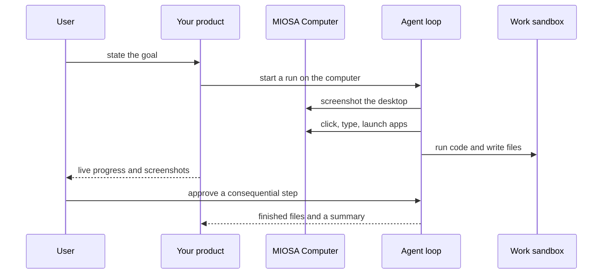

`~25 min` `TypeScript` `Python`

> **您正在构建的东西**：拥有 shell、IDE 和浏览器的自主工程师。
>
> **您将使用的原语**：沙箱、计算机、智能体和工具

## 你正在构建什么

一位自主软件工程师，在自己的虚拟机中工作，该虚拟机带有外壳、编辑器和浏览器，以 Cognition 的 Devin 为模型。

你给德文一项任务；它计划、在自己的虚拟机（shell、代码编辑器、浏览器）中工作、运行测试并通过拉取请求或其他输出进行报告。

您将使用的原语：沙箱·计算机·智能体和利用

- 承担整个工程任务
- 它自己的外壳、编辑器和浏览器
- 长期运行的工作并有进度更新
- 提交拉取请求

来源：[devin.ai](https://devin.ai/)。 Devin 是 Cognition 的商标；本指南不隶属于他们，也不受他们认可。

## MIOSA 需要什么

每一行都是在开始之前创建的一件事。该数字与使用它的步骤相匹配。

1. 组织和 API 密钥 - 确定每次调用的范围；工作人员只需要一把工作区钥匙即可。 - `miosa api-key create app-key --preset agent` [文档](/docs/platform/api-keys)
2. 沙箱 - 智能体在其中编写代码和运行命令的隔离 Linux 工作区。 - `miosa create app-box --template nextjs --wait` [Docs](/docs/develop/sandboxes)
3. 计算机 - 用于浏览器、鼠标和屏幕截图工作的持久 Linux 桌面。 - `miosa computer create app-desktop` [文档](/docs/computers/overview)
4. 每个客户一个工作区 - 隔离每个客户的机器、部署和数据。 - `miosa workspace create customer-1` [文档](/docs/platform/white-label)
5. 品牌和白标签 - 您的名字和预览、部署和桌面上的 slug；顾客永远不会看到 MIOSA。 - `miosa org` [文档](/docs/platform/white-label)
6. 使用计量和计费 - 每个客户的使用情况，以及哪个帐户为新机器付费。 - `miosa org bill` [文档](/docs/platform/usage-and-billing)
7. 智能体和工具 - 将提示转化为工作：选择运行使用的工具和模型。 - `miosa agent harnesses` [文档](/docs/api-reference/agent-runs)

## 架构



## 它如何映射到 MIOSA

每个任务有自己的机器 -> 每个任务一个 MIOSA 沙箱（长 TTL，尺寸大）

长时间运行的工作、进度和指导 -> 智能体运行 (`miosa prompt`, client.runs) 流事件，`miosa run follow`, `miosa run steer`

浏览器验证其工作 -> 由computer.agent.run驱动的MIOSA计算机（带有浏览器的持久Linux桌面）

可交付成果 -> `miosa run files` 加上从沙箱推送的分支

## 数据和存储

任务表：票证、存储库、分支、沙箱 ID、运行 ID、状态、工件链接。代码存在于 Git 和沙箱中；浏览器会话驻留在计算机上。

## 授权和租赁

您的组织就是平台；客户永远不会获得 MIOSA 帐户，他们会登录您的产品。每个客户在入职时创建一个工作区，隔离他们的机器、运行和数据。

```bash
miosa workspace create devin-customer-1
```

标记每台机器并使用 `metadata` 中的客户 ID 运行，并且切勿跨客户查询。使用 GET /api/v1/usage 计量每个客户的使用情况，并使用 PUT /api/v1/bill-to (/docs/platform/usage-and-billing) 设置付款人。

## 智能体循环

运行框架：OSA 是 MIOSA 自己的运行框架，可与您连接的任何模型提供商配合使用，包括您自己的模型。

模型：人类（克劳德）。呼叫使用我自己的提供商密钥（`miosa connections add models`）； MIOSA 平台密钥从未被使用过。

会话：每个项目或对话一次聊天，因此智能体可以保留其上下文。电脑上第一个`miosa prompt`使用`--new-chat`（打印一个聊天id）；之后的每个回合都会经过 `--chat <chat-id>`。 `--reuse chat` 每个聊天保留一台新计算机，以便文件保留。

流式传输：使用 `miosa run follow <run-id>` 或 client.runs.streamEvents(run.id) 跟踪运行，并使用 `miosa run steer` 和 `miosa run interrupt` 引导或停止运行。

该运行框架像工程师一样在沙箱中工作：读取、编辑、运行、修复。计算机的存在只是为了验证浏览器中的行为，因此智能体可以看到用户所看到的内容。

## 步骤1. 为每个任务提供自己的大型、长期存在的沙箱：这是带有 shell 和编辑器的智能体虚拟机。
   ```bash
   miosa create devin-swe-1 --template agent-node --size large --ttl 4h --wait
   ```
   ```bash
   miosa computer create devin-desktop
   ```
   检查：沙箱正在以 4h TTL 运行，并且计算机在 computer.screenshot() 中显示桌面。
2. 克隆存储库并创建任务分支（每次执行或通过 Secrets API 传递 Git 令牌）。
   ```bash
   miosa exec devin-swe-1 -- git clone <repo-url> /workspace/repo
   ```
   ```bash
   miosa exec devin-swe-1 --cwd /workspace/repo -- git checkout -b swe/<task-id>
   ```
   检查：存储库位于任务分支上。
3. 将任务分派到沙箱上的运行框架。它自行计划、编辑、运行测试和迭代。
   ```bash
   miosa prompt --sandbox devin-swe-1 --harness osa --model <anthropic-model-id> --chat <chat-id> "Task: <ticket>. Plan, implement, run the tests, commit"
   ```
   检查：运行开始并且事件流。
4. 观察和驾驶：跑步可能需要几个小时。
   ```bash
   miosa run follow <run-id>
   ```
   ```bash
   miosa run steer --sandbox devin-swe-1 "prefer the existing logger"
   ```
   ```bash
   miosa run interrupt --sandbox devin-swe-1
   ```
   检查：关闭UI并不会停止运行；转向在下一个转弯处着陆。
5. 在真实浏览器中验证：在沙箱中启动应用程序，通过预览公开它，然后让智能体单击计算机上的流程。
   ```bash
   miosa preview create devin-swe-1 3000 --name web
   ```
   ```text
   computer.agent.run("Open the preview URL and click through the signup flow")
   ```
   检查：屏幕截图跟踪显示工作流程或失败的确切步骤。
6. 交付：推送分支、收集工件（测试输出、屏幕截图）并对沙箱进行快照以供审核。
   ```bash
   miosa exec devin-swe-1 --cwd /workspace/repo -- git push origin swe/<task-id>
   ```
   ```bash
   miosa run files <run-id>
   ```
   ```text
   sandbox.snapshots.create("ready for review")
   ```
   检查：审阅者可以打开分支、工件和快照。

## 限制和成本

长任务需要长TTL和`--max-time`；两者都有约束成本。

为智能体提供一个范围仅限于一个存储库的令牌。

每个任务一个沙箱：限制每个用户或客户的并发任务。

原型：将其保留在默认大小的一台计算机上，跳过不需要的副本和自定义主机名，并在完成后删除所有内容。

## 验收检查

任务从票证转移到通过测试的推送分支。

结果在浏览器中验证，并有截图。

关闭 UI 并没有停止运行。

每个客户都被隔离在自己的工作空间中，并且根据他们的使用情况进行计量。

它创建的所有内容都可以被删除，而不会留下任何运行的内容。

## 后续步骤

- [智能体提示构建器选择产品形状并将简介交给您的智能体。](/docs/build)
- [运行编码智能体 在云中运行 Claude Code、Codex 或 Cursor，或在其上构建产品。](/docs/build/run-agents)
- [比较 MIOSA MIOSA 与其他沙箱和智能体平台的比较。](/docs/compare)
- [您可以构建什么 MIOSA 支持的每个产品模式。](/docs/use-cases)
