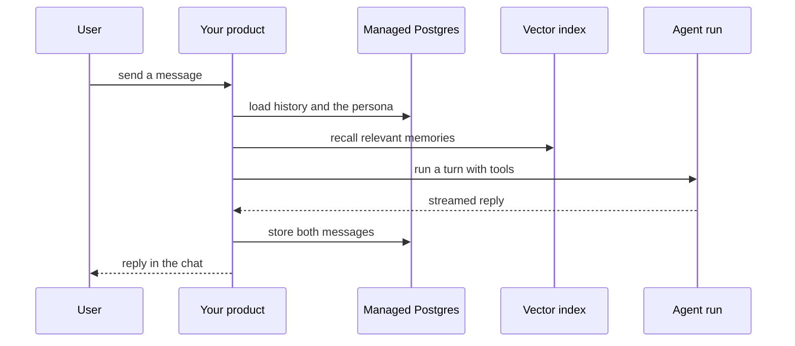

`~25 min` `TypeScript` `Python`

> **您正在构建的**：永远在线的伙伴，每个伙伴都有自己的云计算机。
>
> **您将使用的原语**：计算机、沙箱、Postgres、智能体和工具、部署（Docker 主机）

## 你正在构建什么

永远在线的智能体，每个智能体都在自己的云计算机中运行，并有自己的浏览器，由 OpenAI 以点为模型。

每个点都是一个持久智能体，拥有自己的云计算机；它在对话之间持续工作并记住用户。

您将使用的基元：计算机·沙箱·Postgres·智能体和利用·部署（App Engine）

- 永远在线的智能体
- 每个人都有自己的云电脑和浏览器
- 记住会话之间的上下文
- 空闲时后台工作吗

来源：[openai.com/index/introducing-dots/](https://openai.com/index/introducing-dots/)。点是 OpenAI 的商标；本指南不隶属于他们，也不受他们认可。

## MIOSA 需要什么

每一行都是在开始之前创建的一件事。该数字与使用它的步骤相匹配。

1. 组织和 API 密钥 - 确定每次调用的范围；工作人员只需要一把工作区钥匙即可。 - `miosa api-key create app-key --preset agent` [文档](/docs/platform/api-keys)
2. 计算机 - 用于浏览器、鼠标和屏幕截图工作的持久 Linux 桌面。 - `miosa computer create app-desktop` [文档](/docs/computers/overview)
3. 沙箱 - 智能体在其中编写代码和运行命令的隔离 Linux 工作区。 - `miosa create app-box --template nextjs --wait` [Docs](/docs/develop/sandboxes)
4. Postgres - 托管关系数据，在机器和生产中作为 DATABASE_URL 注入。 - `miosa api POST /databases -d '{"name":"app-db","engine":"postgresql"}'` [文档](/docs/data/postgres)
5. 每个客户一个工作区 - 隔离每个客户的机器、部署和数据。 - `miosa workspace create customer-1` [文档](/docs/platform/white-label)
6. 品牌和白标签 - 您的名字和预览、部署和桌面上的 slug；顾客永远不会看到 MIOSA。 - `miosa org` [文档](/docs/platform/white-label)
7. 使用计量和计费 - 每个客户的使用情况，以及哪个帐户为新机器付费。 - `miosa org bill` [文档](/docs/platform/usage-and-billing)
8. 智能体和工具 - 将提示转化为工作：选择运行使用的工具和模型。 - `miosa agent harnesses` [文档](/docs/api-reference/agent-runs)
9. 部署 (App Engine) - 将应用程序发布到不可变的版本化 URL，并进行回滚。 - `miosa deploy create --from-sandbox app-box --name app --wait` [文档](/docs/docker-host/overview)

## 架构



## 它如何映射到 MIOSA

记住用户 -> 管理的 Postgres (`DATABASE_URL`) 的消息、配置文件和内存

每个回复背后的模型和工具 -> 智能体在沙箱中运行 (`miosa prompt`, client.runs) 流事件，每个用户轮流运行一次

每个点一台云计算机 -> 一台 MIOSA 计算机（带有浏览器的持久 Linux 桌面）

在会话之间保持活动状态 -> 长 TTL 和 `miosa extend`

## 数据和存储

Postgres 是一个记录系统：用户、角色、对话、消息（带有角色和时间戳）和记忆（摘要文本、源消息 ID、重要性）。

将内存作为摘要和关键事实保存在 Postgres 中。

## 授权和租赁

您的组织就是平台；客户永远不会获得 MIOSA 帐户，他们会登录您的产品。每个客户在入职时创建一个工作区，隔离他们的机器、运行和数据。

```bash
miosa workspace create dots-customer-1
```

标记每台机器并使用 `metadata` 中的客户 ID 运行，并且切勿跨客户查询。使用 GET /api/v1/usage 计量每个客户的使用情况，并使用 PUT /api/v1/bill-to (/docs/platform/usage-and-billing) 设置付款人。

## 智能体循环

运行框架：OSA 是 MIOSA 自己的运行框架，可与您连接的任何模型提供商配合使用，包括您自己的模型。

模型：人类（克劳德）。呼叫使用我自己的提供商密钥（`miosa connections add models`）； MIOSA 平台密钥从未被使用过。

会话：每个项目或对话一次聊天，因此智能体可以保留其上下文。沙箱上的第一个 `miosa prompt` 使用 `--new-chat` （打印聊天 ID）；之后的每个回合都会经过 `--chat <chat-id>`。 `--reuse chat` 每个聊天保留一台新计算机，以便文件保留。

流式传输：使用 `miosa run follow <run-id>` 或 client.runs.streamEvents(run.id) 跟踪运行，并使用 `miosa run steer` 和 `miosa run interrupt` 引导或停止运行。

每个命名智能体都是针对计算机运行的已保存智能体。计算机上的状态必须比对话（文件、登录的浏览器）存在得更久；关于此人居住在 Postgres 中的状态。

## 步骤1. 创建数据库和模式：用户、角色（或机器人）、对话、消息、记忆。
   ```bash
   miosa api POST /databases -d '{"name":"dots-memory","engine":"postgresql"}'
   ```
   ```bash
   miosa db connection dots-memory
   ```
   检查：您可以通过DATABASE_URL插入和读取消息。
2. 创建服务于聊天和 UI 的后端沙箱；给它 DATABASE_URL。智能体本身在他们的计算机上运行，​​而不是在这里。
   ```bash
   miosa create dots-box --template agent-node --wait
   ```
   检查：后端在Postgres中读取和写入消息。
3. 创建计算机：每个点一台计算机。他们在谈话之间保持活力。
   ```bash
   miosa computer create dots-ada
   ```
   ```bash
   miosa extend dots-ada
   ```
   检查：在一个会话中创建的文件在下一个会话中仍然存在；除非故意共享计算机，否则两个机器人（或点）永远不会看到彼此的文件。
4. 定义每个指定智能体一次，并以其角色作为说明。
   ```bash
   miosa agent new dots-ada --harness osa --instructions-file persona.md
   ```
   检查：`miosa agent list` 显示它，并且每个角色都存在版本化定义。
5. 对于每条消息，针对其计算机运行正确的智能体并将回复流式传输到聊天中。
   ```bash
   miosa prompt --computer dots-ada --agent dots-ada "<message>"
   ```
   检查：回复流被写入消息，并且智能体可以使用其浏览器和文件。
6. 让座席在空闲时进行只读后台工作，并在下次对话中进行报告。
   检查：闲置工作从不发送、购买或删除任何东西。
7. 记忆：在 Postgres 中保留每个用户的滚动摘要和关键事实，并将摘要放在每个回合中。
   检查：本周是否正确回忆了上周所说的事情。
8. 发布聊天UI和API。
   ```bash
   miosa deploy create --from-sandbox dots-box --name dots --dir /workspace --port 3000 --run-command "npm start" --wait
   ```
   检查：public_url 提供聊天服务，并且新对话可以端到端运行。

## 限制和成本

聊天是高容量和低计算量的：保持后端较小并在机器大小之前扩展副本；除非使用工具，否则不要为每个对话提供自己的机器。

Cap内存增长：总结并过期；嵌入摘要，而不是每条消息。

计算机在运行时计费：设置 TTL、暂停空闲的 TTL，以及仅为活动用户延长时间。

原型：将其保留在默认大小的一台计算机上，跳过不需要的副本和自定义主机名，并在完成后删除所有内容。

## 验收检查

几天后，对话以正确的角色和记住的事实重新开始。

用户可以删除他们的历史记录，它就会从 Postgres 和索引中消失。

该产品告诉用户他们正在与人工智能交谈。

每个智能体在会话之间保留自己的文件和浏览器状态。

每个客户都被隔离在自己的工作空间中，并且根据他们的使用情况进行计量。

它创建的所有内容都可以被删除，而不会留下任何运行的内容。

## 后续步骤

- [智能体提示构建器选择产品形状并将简介交给您的智能体。](/docs/build)
- [运行编码智能体 在云中运行 Claude Code、Codex 或 Cursor，或在其上构建产品。](/docs/build/run-agents)
- [比较 MIOSA MIOSA 与其他沙箱和智能体平台的比较。](/docs/compare)
- [您可以构建什么 MIOSA 支持的每个产品模式。](/docs/use-cases)
