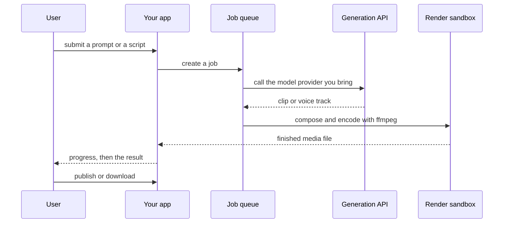

`~25 min` `TypeScript` `Python`

> **您正在构建的内容**：提示或记录到精美的、可共享的平台或页面。
>
> **您将使用的原语**：沙箱、智能体和利用、部署（Docker 主机）

## 你正在构建什么

AI 演示应用程序：提示或文档变成精美的、可编辑的平台或单页网站，以 Gamma Tech, Inc. 的 Gamma 为模型。

将提示或文档转为大纲，然后通过文本模型滑动；用户编辑内联（文本和图像），应用主题，并将甲板作为链接共享或将其发布为网页。

您将使用的基元：沙箱·智能体和利用·部署（App Engine）

- 提示或记录到甲板上
- 内联人工智能文本和图像生成
- 主题和布局系统
- 分享链接、嵌入内容和已发布的页面

来源：[gamma.app](https://gamma.app/)。 Gamma 是 Gamma Tech, Inc. 的商标；本指南不隶属于他们，也不受他们认可。

## MIOSA 需要什么

每一行都是在开始之前创建的一件事。该数字与使用它的步骤相匹配。

1. 组织和 API 密钥 - 确定每次调用的范围；工作人员只需要一把工作区钥匙即可。 - `miosa api-key create app-key --preset agent` [文档](/docs/platform/api-keys)
2. 沙箱 - 智能体在其中编写代码和运行命令的隔离 Linux 工作区。 - `miosa create app-box --template nextjs --wait` [Docs](/docs/develop/sandboxes)
3. 每个客户一个工作区 - 隔离每个客户的机器、部署和数据。 - `miosa workspace create customer-1` [文档](/docs/platform/white-label)
4. 品牌和白标 - 您的姓名和预览、部署和桌面上的 slug；顾客永远不会看到 MIOSA。 - `miosa org` [文档](/docs/platform/white-label)
5. 使用计量和计费 - 每个客户的使用情况，以及哪个帐户为新机器付费。 - `miosa org bill` [文档](/docs/platform/usage-and-billing)
6. 智能体和工具 - 将提示转化为工作：选择运行使用的工具和模型。 - `miosa agent harnesses` [文档](/docs/api-reference/agent-runs)
7. 部署 (App Engine) - 将应用程序发布到不可变的版本化 URL，并进行回滚。 - `miosa deploy create --from-sandbox app-box --name app --wait` [文档](/docs/docker-host/overview)

## 架构



## 它如何映射到 MIOSA

平台应用程序和渲染/发布服务器 -> 要构建的 MIOSA 沙箱，然后是 MIOSA 部署 (`miosa deploy create`)，对于公共 URL 来说是不可变的和版本化的

每张幻灯片都经过布局和渲染 -> 沙箱使用无头浏览器将幻灯片 JSON 渲染为 HTML、图像和 PDF

文本和图像生成->您自带的文本和图像模型API； MIOSA 上没有重建模型

Decks、图像和模板 -> 托管 Postgres (`DATABASE_URL`) 用于甲板元数据，用于渲染资源的对象存储

已发布的平台和站点 -> MIOSA 部署 (`miosa deploy create`)，不可变且版本化加上自定义域 (`miosa deploy domain-add`)

## 数据和存储

Deck 元数据（所有者、主题、状态、输出路径）很小；渲染的幻灯片、图像和 PDF 是渲染沙箱或对象存储中的文件，而不是 Postgres 中的文件。

将幻灯片 JSON 保留为记录系统，以便编辑重新呈现而不是重新生成文本。

## 授权和租赁

您的组织就是平台；客户永远不会获得 MIOSA 帐户，他们会登录您的产品。每个客户在入职时创建一个工作区，隔离他们的机器、运行和数据。

```bash
miosa workspace create gamma-customer-1
```

标记每台机器并使用 `metadata` 中的客户 ID 运行，并且切勿跨客户查询。使用 GET /api/v1/usage 计量每个客户的使用情况，并使用 PUT /api/v1/bill-to (/docs/platform/usage-and-billing) 设置付款人。

## 智能体循环

运行框架：OSA 是 MIOSA 自己的运行框架，可与您连接的任何模型提供商配合使用，包括您自己的模型。

模型：人类（克劳德）。呼叫使用我自己的提供商密钥（`miosa connections add models`）； MIOSA 平台密钥从未被使用过。

会话：每个项目或对话一次聊天，因此智能体可以保留其上下文。沙箱上的第一个 `miosa prompt` 使用 `--new-chat` （打印聊天 ID）；之后的每个回合都会经过 `--chat <chat-id>`。 `--reuse chat` 每个聊天保留一台新计算机，以便文件保留。

流式传输：使用 `miosa run follow <run-id>` 或 client.runs.streamEvents(run.id) 跟踪运行，并使用 `miosa run steer` 和 `miosa run interrupt` 引导或停止运行。文本生成和渲染是独立的、可重试的步骤：模型编写甲板 JSON，沙箱渲染它。只有文本步骤需要模型密钥；渲染器是确定性的。

## 步骤

1. 创建渲染沙箱：它包含甲板模板和无头浏览器，可将 HTML 转换为幻灯片、图像和 PDF。
   ```bash
   miosa create gamma-box --template nextjs --size medium --wait
   ```
   检查：沙箱正在运行，并且无头渲染会生成一张幻灯片。
2. 使用您带来的文本模型生成幻灯片结构：首先是大纲，然后是每张幻灯片一个记录（标题、项目符号、演讲者注释）。返回 JSON，而不是 HTML；布局是你的。
   ```bash
   miosa prompt --sandbox gamma-box --harness osa --model <anthropic-model-id> --chat <chat-id> "Turn <document> into slide JSON: outline first, then one object per slide; no markup"
   ```
   检查：文档成为渲染器接受的幻灯片 JSON，并且可以自行重新生成幻灯片。
3. 在沙箱中渲染：您的模板将幻灯片 JSON 转换为 HTML，无头浏览器渲染图像和 PDF。图片来自您自带的图片模型，通过提示进行缓存。
   ```text
   sandbox.process.start("npm run render", { name: "render", cwd: "/workspace" })
   ```
   检查：甲板渲染为 PDF 和每张幻灯片图像，而无需打开真实的显示。
4. 显示进度：流式传输运行事件，让长牌组永远不会显得停滞。
   ```bash
   miosa run follow <run-id>
   ```
   检查：UI 显示进度，然后显示完成的牌组。
5. 预览该套牌，然后发布它：为观众提供一个共享链接，并在用户要求时发布一个网页。
   ```bash
   miosa preview create gamma-box 3000 --name web
   ```
   检查：预览播放幻灯片，共享链接打开同一幻灯片。
6. 发布采用提示或文档并为平台提供服务的应用程序。
   ```bash
   miosa deploy create --from-sandbox gamma-box --name gamma --dir /workspace --port 3000 --run-command "npm start" --wait
   ```
   检查：public_url 接受提示并提供渲染的牌组。

## 限制和成本

渲染就是成本：根据作业调整沙箱的大小，限制每个甲板上的幻灯片，并暂停空闲的渲染工作人员。

按提示缓存生成的图像，因此同一张幻灯片不会调用图像模型两次。

文本和图像模型的使用由这些提供商计费；存储您自己的每副牌的成本。

原型：将其保留在默认大小的一台计算机上，跳过不需要的副本和自定义主机名，并在完成后删除所有内容。

## 验收检查

提示或文档成为渲染的、可共享的平台。

无需重做幻灯片即可重新生成一张幻灯片。

发布的页面或共享链接会打开同一个平台。

每个客户都被隔离在自己的工作空间中，并且根据他们的使用情况进行计量。

它创建的所有内容都可以被删除，而不会留下任何运行的内容。

## 后续步骤

- [智能体提示构建器选择产品形状并将简介交给您的智能体。](/docs/build)
- [运行编码智能体 在云中运行 Claude Code、Codex 或 Cursor，或在其上构建产品。](/docs/build/run-agents)
- [比较 MIOSA MIOSA 与其他沙箱和智能体平台的比较。](/docs/compare)
- [您可以构建什么 MIOSA 支持的每个产品模式。](/docs/use-cases)
