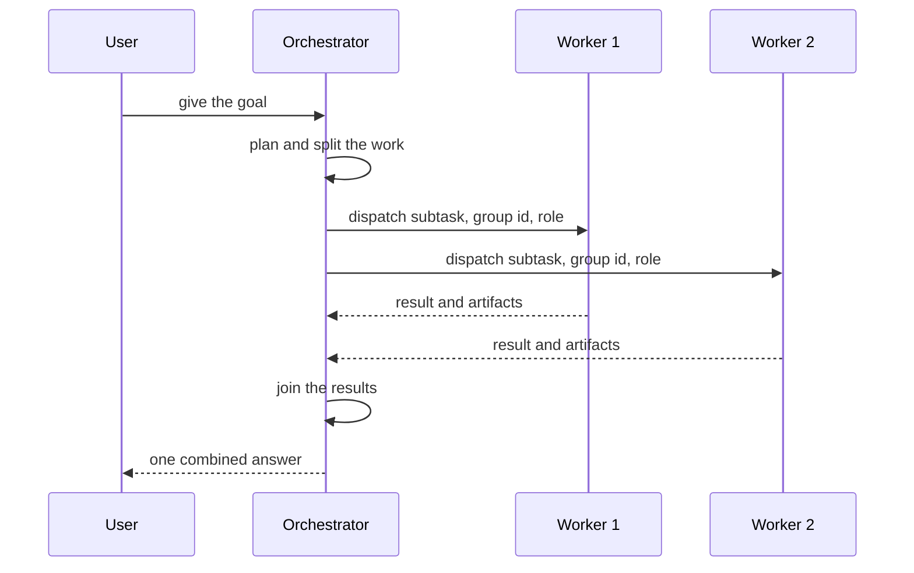

`~25 min` `TypeScript` `Python`

> **您正在构建的**：一个智能体负责规划、委托给子智能体并加入结果。
>
> **您将使用的原语**：沙箱、智能体和工具、Postgres、部署（Docker 主机）

## 你正在构建什么

一个智能体计划一个目标，将每个部分委托给其自己机器上的子智能体，然后加入结果

顶级智能体读取目标，编写计划，将每个部分交给在自己的环境中运行的专业子智能体，并合并它们返回的内容；一个人批准敏感步骤。

您将使用的基元：沙箱·智能体和工具·Postgres·部署（App Engine）

- 计划和委托给子智能体
- 每个子智能体独立运行
- 将结果合并为一个答案
- 敏感步骤的人工批准

这是一种模式，而不是某种产品的复制品。从[相关的 MIOSA 指南](/docs/guides/agent-orchestration)开始，构建具有上述功能的最小版本。

## MIOSA 需要什么

每一行都是在开始之前创建的一件事。该数字与使用它的步骤相匹配。

1. 组织和 API 密钥 - 确定每次调用的范围；工作人员只需要一把工作区钥匙即可。 - `miosa api-key create app-key --preset agent` [文档](/docs/platform/api-keys)
2. 沙箱 - 智能体在其中编写代码和运行命令的隔离 Linux 工作区。 - `miosa create app-box --template nextjs --wait` [Docs](/docs/develop/sandboxes)
3. Postgres - 托管关系数据，在机器和生产中作为 DATABASE_URL 注入。 - `miosa api POST /databases -d '{"name":"app-db","engine":"postgresql"}'` [文档](/docs/data/postgres)
4. 每个客户一个工作区 - 隔离每个客户的机器、部署和数据。 - `miosa workspace create customer-1` [文档](/docs/platform/white-label)
5. 品牌和白标签 - 您的名字和预览、部署和桌面上的 slug；顾客永远不会看到 MIOSA。 - `miosa org` [文档](/docs/platform/white-label)
6. 使用计量和计费 - 每个客户的使用情况，以及哪个帐户为新机器付费。 - `miosa org bill` [文档](/docs/platform/usage-and-billing)
7. 智能体和工具 - 将提示转化为工作：选择运行使用的工具和模型。 - `miosa agent harnesses` [文档](/docs/api-reference/agent-runs)
8. 部署 (App Engine) - 将应用程序发布到不可变的版本化 URL，并进行回滚。 - `miosa deploy create --from-sandbox app-box --name app --wait` [文档](/docs/docker-host/overview)

## 架构



## 它如何映射到 MIOSA

计划和委托 -> 智能体运行 (`miosa prompt`, client.runs) 的编排器在其自己的沙箱中从编排器进程流式传输事件

并行运行的工作进程 -> 每个工作进程一个沙箱（`orchestration_role`、`agent_run_group_id` 将它们捆绑在一起）

共享起始状态 -> 沙箱快照和分叉：快照一次，恢复到每个worker中

连接结果 -> client.runs.waitForCompletion，然后运行每个工作人员的输出和文件

## 数据和存储

保留计划（子任务、所有者、状态）和每个工作人员的结果由运行组 ID 键入，以便可以恢复失败的加入，并且 UI 可以显示谁做了什么。

## 授权和租赁

您的组织就是平台；客户永远不会获得 MIOSA 帐户，他们会登录您的产品。每个客户在入职时创建一个工作区，隔离他们的机器、运行和数据。

```bash
miosa workspace create gemini-agent-customer-1
```

标记每台机器并使用 `metadata` 中的客户 ID 运行，并且切勿跨客户查询。使用 GET /api/v1/usage 计量每个客户的使用情况，并使用 PUT /api/v1/bill-to (/docs/platform/usage-and-billing) 设置付款人。

## 智能体循环

运行框架：OSA 是 MIOSA 自己的运行框架，可与您连接的任何模型提供商配合使用，包括您自己的模型。

模型：人类（克劳德）。呼叫使用我自己的提供商密钥（`miosa connections add models`）； MIOSA 平台密钥从未被使用过。

会话：每个项目或对话一次聊天，因此智能体可以保留其上下文。沙箱上的第一个 `miosa prompt` 使用 `--new-chat` （打印聊天 ID）；之后的每个回合都会经过 `--chat <chat-id>`。 `--reuse chat` 每个聊天保留一台新计算机，以便文件保留。

流式传输：使用 `miosa run follow <run-id>` 或 client.runs.streamEvents(run.id) 跟踪运行，并使用 `miosa run steer` 和 `miosa run interrupt` 引导或停止运行。

协调器是决定子任务的智能体；工人是独立的运行框架运行，每个人都在自己的机器上。为每个工人分配一个狭窄的角色，并只提供其所需的工具。限制工作人员的数量和授权的深度。

## 步骤1. 创建编排器自己的沙箱。它计划并授权；它不做这项工作。
   ```bash
   miosa create gemini-agent-orchestrator --wait
   ```
   检查：orchestrator 可以使用 SDK 创建其他沙箱。
2.为每个子智能体创建一个工作沙箱（每个子智能体一台新的、隔离的机器）。
   ```bash
   miosa create gemini-agent-worker-1 --wait
   ```
   ```bash
   miosa create gemini-agent-worker-2 --wait
   ```
   检查：两个worker正在运行并且无法看到彼此的文件。
3. 连接子智能体所操作的业务系统作为工具服务器，每个系统一个连接，范围满足每个子智能体的需求。
   ```bash
   miosa connections add models anthropic --key-stdin <<< "$ANTHROPIC_API_KEY"
   ```
   ```bash
   miosa connections add tools --name <system> --url <mcp-server-url> --header-env Authorization=<ENV_VAR>
   ```
   检查：每个子智能体只能调用自己系统的工具。
4. 为 Orchestrator 工作区创建一次快照，并将其恢复到每个工作线程中，以便它们从相同的状态开始。
   ```text
   sandbox.snapshots.create("shared start")
   ```
   检查：每个工作人员都以相同的文件开始。
5. 扇出：为每个工作人员分派一次运行，通过组 ID 和角色绑定在一起。
   ```bash
   miosa prompt --sandbox gemini-agent-worker-1 --harness osa --model <anthropic-model-id> --chat <chat-id> "<subtask>"
   ```
   ```text
   client.agentRuns.run({ provider: "osa", targetKind: "sandbox", targetId: worker1.id, orchestration_role: "researcher", agent_run_group_id: "grp_1", prompt: "<subtask>" })
   ```
   检查：运行并行执行并显示相同的组 ID。
6.加入：等待每次运行，收集每个输出和文件，然后让协调器合并它们。仅重试失败的工作程序。
   ```text
   client.runs.waitForCompletion(run.id)
   ```
   ```bash
   miosa run outputs <run-id>
   ```
   ```bash
   miosa run files <run-id>
   ```
   检查：重试一个失败的工作程序，而不重新运行其他工作程序。
7. 坚持该计划，每个工作人员都会在 Postgres 中生成结果，以便崩溃的协调器可以恢复。
   ```bash
   miosa api POST /databases -d '{"name":"gemini-agent-state","engine":"postgresql"}'
   ```
   检查：在运行中终止协调器并重新启动它会从存储的状态恢复。
8. 发布已加入的报告或orchestrator UI。
   ```bash
   miosa deploy create --from-sandbox gemini-agent-orchestrator --name gemini-agent --dir /workspace --wait
   ```
   检查：public_url显示了连接结果。

## 限制和成本

并行性会成倍增加成本：限制每个作业的工人数量并给予每次运行`--max-time`。

在重试循环中对 `sandboxes.create` 使用 `idempotency_key`，以便重试扇出不会创建重复项。

比起许多肤浅的工人，更喜欢数量更少、范围更广的工人。

原型：将其保留在默认大小的一台计算机上，跳过不需要的副本和自定义主机名，并在完成后删除所有内容。

## 验收检查

每个子运行都会完成并收集其输出。

孩子们彼此隔离。

编排者的最终答案引用了哪个工人生产了什么。

每个客户都被隔离在自己的工作空间中，并且根据他们的使用情况进行计量。

它创建的所有内容都可以被删除，而不会留下任何运行的内容。

## 后续步骤

- [智能体提示构建器选择产品形状并将简介交给您的智能体。](/docs/build)
- [运行编码智能体 在云中运行 Claude Code、Codex 或 Cursor，或在其上构建产品。](/docs/build/run-agents)
- [比较 MIOSA MIOSA 与其他沙箱和智能体平台的比较。](/docs/compare)
- [您可以构建什么 MIOSA 支持的每个产品模式。](/docs/use-cases)
