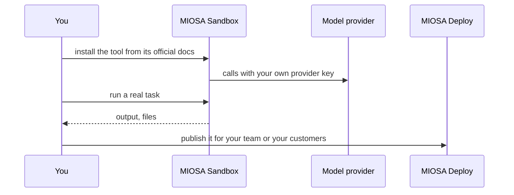

`~15 min` `TypeScript` `Python`

> **您正在构建的内容**：安装开源智能体工具并运行许多使用工具的智能体。
>
> **您将使用的原语**：沙盒、智能体和利用

## 你正在构建什么

一个开源智能体工具，可运行许多使用工具的智能体，以 Hermes Agent 为模型，由 Nous Research 开发。

Hermes Agent 是一个开放的智能体工具：编排智能体调用工具并将工作委托给在自己的环境中运行的其他智能体。

您将使用的基元：沙箱·智能体和利用

- 开源智能体工具
- 使用工具的智能体
- 委托给子智能体
- 在您自己的基础设施上运行

您在 MIOSA 上安装并**运行真正的 Hermes Agent**。首先阅读官方文档：[hermes-agent.nousresearch.com/docs/getting-started/installation](https://hermes-agent.nousresearch.com/docs/getting-started/installation)。下面的每个安装命令都来自他们；如果文档和本指南不一致，则文档获胜。 Hermes Agent 是开源的（Nous Research）。

## MIOSA 需要什么

每一行都是在开始之前创建的一件事。该数字与使用它的步骤相匹配。

1. 组织和 API 密钥 - 确定每次调用的范围；工作人员只需要一把工作区钥匙即可。 - `miosa api-key create app-key --preset agent` [文档](/docs/platform/api-keys)
2. 沙箱 - 智能体在其中编写代码和运行命令的隔离 Linux 工作区。 - `miosa create app-box --template nextjs --wait` [Docs](/docs/develop/sandboxes)
3. 每个客户一个工作区 - 隔离每个客户的机器、部署和数据。 - `miosa workspace create customer-1` [文档](/docs/platform/white-label)
4. 品牌和白标 - 您的姓名和预览、部署和桌面上的 slug；顾客永远不会看到 MIOSA。 - `miosa org` [文档](/docs/platform/white-label)
5. 使用计量和计费 - 每个客户的使用情况，以及哪个帐户为新机器付费。 - `miosa org bill` [文档](/docs/platform/usage-and-billing)
6. 智能体和工具 - 将提示转化为工作：选择运行使用的工具和模型。 - `miosa agent harnesses` [文档](/docs/api-reference/agent-runs)

## 架构



## 它如何在 MIOSA 上运行

它运行的地方 -> MIOSA 沙箱（一个独立的 Linux 工作区）

状态和文件 -> Hermes 将其配置和内存保留在 `~/.hermes` 下；持久的沙箱可以让它跨越暂停。

模型 -> 您自己的提供商密钥，而不是 MIOSA 平台密钥

您的客户 -> 各一个工作空间，彼此隔离

## 授权和租赁

您的组织就是平台；客户永远不会获得 MIOSA 帐户，他们会登录您的产品。每个客户在入职时创建一个工作区，隔离他们的机器、运行和数据。

```bash
miosa workspace create hermes-agent-customer-1
```

标记每台机器并使用 `metadata` 中的客户 ID 运行，并且切勿跨客户查询。使用 GET /api/v1/usage 计量每个客户的使用情况，并使用 PUT /api/v1/bill-to (/docs/platform/usage-and-billing) 设置付款人。

## 安装 Hermes 智能体

按顺序在沙箱内运行它们（例如 `miosa exec hermes-agent-box -- bash -lc '<command>'`）。命令来自官方文档。

```text
curl -fsSL https://hermes-agent.nousresearch.com/install.sh | bash
```

```text
source ~/.bashrc
```

检查：安装完成，没有错误；接下来的部分将配置并启动它。

## 配置

使用 `hermes model` 选择提供商和模型（Nous Portal、OpenRouter、OpenAI 或您自己的端点），然后选择 `hermes setup` 以获取完整向导。

模型：人类（克劳德）。呼叫使用我自己的提供商密钥（在工具自己的设置中输入）； MIOSA 平台密钥从未被使用过。

## 运行它

启动它并证明它有效。

```text
hermes doctor
```

检查：工具启动无错误并响应。

## 持久化和访问

Hermes 将其配置和内存保留在 `~/.hermes` 下；持久的沙箱可以让它跨越暂停。

检查：机器暂停并恢复后，工具再次启动，状态完好。

## 使其成为产品

MIOSA 作为 `hermes` 运行时（client.agentRuns.run 与提供者“hermes”）路由到 Hermes：为每个客户工作区运行一个并将其事件流式传输到您的 UI。

## 限制和成本

固定您测试的版本并刻意更新；这些工具变化很快。

仅向该工具提供其所需的凭据（作为秘密），而不是写入文件中。

原型：将其保留在默认大小的一台计算机上，跳过不需要的副本和自定义主机名，并在完成后删除所有内容。

## 验收检查

Hermes Agent 在 MIOSA 沙箱上运行并回答真实任务。

状态在暂停和恢复后仍然存在。每个客户都有自己的工作区和自己的实例；他们之间没有任何东西是共享的。

它创建的所有内容都可以被删除，而不会留下任何运行的内容。

## 后续步骤

- [智能体提示构建器选择产品形状并将简介交给您的智能体。](/docs/build)
- [运行编码智能体 在云中运行 Claude Code、Codex 或 Cursor，或在其上构建产品。](/docs/build/run-agents)
- [比较 MIOSA MIOSA 与其他沙箱和智能体平台的比较。](/docs/compare)
- [您可以构建什么 MIOSA 支持的每个产品模式。](/docs/use-cases)
