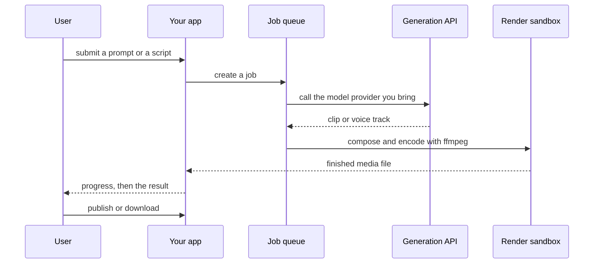

`~25 min` `TypeScript` `Python`

> **你正在构建什么**：一个多模型工作室：简要介绍、控制相机、观察、生成。
>
> **您将使用的原语**：沙箱、智能体和工具、Postgres、部署（Docker 主机）

## 你正在构建什么

多模型视频工作室：一个导演风格的工作区，可控制摄像机、外观和动作，然后调用第三方视频模型来生成由 Higgsfield AI 在 Higgsfield 上建模的电影剪辑。

用户编写简介并设置镜头（摄像机移动、镜头、灯光、风格）；该应用程序将提示分散到您带来的多个视频模型 API，保持镜头中的角色和位置一致，并将每个剪辑和静态图像存储在资源库中。

您将使用的基元：沙箱·智能体和工具·Postgres·部署（App Engine）

- 导演风格的镜头设置（摄像机、外观、动作）
- 跨多个视频模型的提示和参考编排
- 镜头中一致的角色和位置
- 具有重新生成和重拍功能的拍摄列表
- 包含剪辑、剧照和参考资料的资源库

来源：[higgsfield.ai](https://higgsfield.ai/)。 Higgsfield 是 Higgsfield AI 的商标；本指南不隶属于他们，也不受他们认可。

## MIOSA 需要什么

每一行都是在开始之前创建的一件事。该数字与使用它的步骤相匹配。

1. 组织和 API 密钥 - 确定每次调用的范围；工作人员只需要一把工作区钥匙即可。 - `miosa api-key create app-key --preset agent` [文档](/docs/platform/api-keys)
2. 沙箱 - 智能体在其中编写代码和运行命令的隔离 Linux 工作区。 - `miosa create app-box --template nextjs --wait` [Docs](/docs/develop/sandboxes)
3. Postgres - 托管关系数据，在机器和生产中作为 DATABASE_URL 注入。 - `miosa api POST /databases -d '{"name":"app-db","engine":"postgresql"}'` [文档](/docs/data/postgres)
4. 每个客户一个工作区 - 隔离每个客户的机器、部署和数据。 - `miosa workspace create customer-1` [文档](/docs/platform/white-label)
5. 品牌和白标签 - 您的名字和预览、部署和桌面上的 slug；顾客永远不会看到 MIOSA。 - `miosa org` [文档](/docs/platform/white-label)
6. 使用计量和计费 - 每个客户的使用情况，以及哪个帐户为新机器付费。 - `miosa org bill` [文档](/docs/platform/usage-and-billing)
7. 智能体和工具 - 将提示转化为工作：选择运行使用的工具和模型。 - `miosa agent harnesses` [文档](/docs/api-reference/agent-runs)
8. 部署 (App Engine) - 将应用程序发布到不可变的版本化 URL，并进行回滚。 - `miosa deploy create --from-sandbox app-box --name app --wait` [文档](/docs/docker-host/overview)

## 架构



## 它如何映射到 MIOSA

提示资产 -> 智能体运行 (`miosa prompt`, client.runs) 流事件，调用您的生成提供程序并将结果写入沙箱

繁重的渲染和编码 -> MIOSA 沙箱作业（ffmpeg 或无头渲染），大小为 `--size`

项目和资产 -> 用于作业元数据的托管 Postgres (`DATABASE_URL`)；媒体文件和卷

导出前预览 -> 沙箱预览 URL (`miosa preview create`)

工作室应用程序和编排服务器 -> 要构建的 MIOSA 沙箱，然后是 MIOSA 部署 (`miosa deploy create`)，不可变且版本化以提供服务

每一代调用 -> 您带来的提供者 API（Veo、Kling、Sora、Seedance 等）；该模型未在 MIOSA 上重建

作业队列和实时生成状态 -> 托管 Redis (`REDIS_URL`) 加上 websockets，流式传输到 UI

剪辑、剧照和参考 -> 对象存储（S3 兼容存储桶），项目和信用状态位于托管 Postgres 中 (`DATABASE_URL`)

## 数据和存储

作业（状态、输入、输出路径）是元数据；媒体本身很大，因此将其作为文件保存在渲染沙箱和卷中，而不是保存在 Postgres 中。

资产通过哈希进行内容寻址，因此永远不会重新生成相同的输入。

## 授权和租赁

您的组织就是平台；客户永远不会获得 MIOSA 帐户，他们会登录您的产品。每个客户在入职时创建一个工作区，隔离他们的机器、运行和数据。

```bash
miosa workspace create higgsfield-customer-1
```

标记每台机器并使用 `metadata` 中的客户 ID 运行，并且切勿跨客户查询。使用 GET /api/v1/usage 计量每个客户的使用情况，并使用 PUT /api/v1/bill-to (/docs/platform/usage-and-billing) 设置付款人。

## 智能体循环

运行框架：OSA 是 MIOSA 自己的运行框架，可与您连接的任何模型提供商配合使用，包括您自己的模型。模型：人类（克劳德）。呼叫使用我自己的提供商密钥 (`miosa connections add models`)； MIOSA 平台密钥从未被使用过。

会话：每个项目或对话一次聊天，因此智能体可以保留其上下文。沙箱上的第一个 `miosa prompt` 使用 `--new-chat` （打印聊天 ID）；之后的每个回合都会经过 `--chat <chat-id>`。 `--reuse chat` 每个聊天保留一台新计算机，以便文件保留。

流式传输：使用 `miosa run follow <run-id>` 或 client.runs.streamEvents(run.id) 跟踪运行，并使用 `miosa run steer` 和 `miosa run interrupt` 引导或停止运行。

生成模型是你带来的一个提供者；该工具在沙箱中编排工作并运行 ffmpeg 以实现所有确定性。将生成和渲染作为单独的、可重试的步骤进行。

## 步骤

1. 创建渲染工作器：一个更大的沙箱，用于编码和合成。
   ```bash
   miosa create higgsfield-box --size large --wait
   ```
   检查：沙箱正在运行。
2. 创建作业表：id、输入、状态、输出路径、错误、所有者。
   ```bash
   miosa api POST /databases -d '{"name":"higgsfield-db","engine":"postgresql"}'
   ```
   检查：通过 DATABASE_URL 创建和更新作业或项目行。
3、通过提示或者图片调用你自带的生成模型（你提供商的API）；存储返回的剪辑。
   检查：提供商返回剪辑或脚本，您存储其作业 ID。
4. 在沙箱中进行后处理：修剪、缝合、添加字幕和音频，并使用 ffmpeg 进行编码（将其安装在模板中一次，而不是每个作业）。
   ```bash
   miosa prompt --sandbox higgsfield-box --harness osa --model <anthropic-model-id> --chat <chat-id> "Assemble the final video from /workspace/jobs/<id> with ffmpeg and write it to /workspace/out"
   ```
   检查：输出播放，具有正确的持续时间，并且作业行指向它。
5. 显示进度：将运行事件流式传输到 UI，以便长时间渲染不会看起来挂起。
   ```bash
   miosa run follow <run-id>
   ```
   检查：UI 显示作业运行时的进度以及完成后的最终文件。
6. 预览和导出：提供输出以进行播放，并提供下载。
   ```bash
   miosa preview create higgsfield-box 3000 --name web
   ```
   勾选：预览播放剪辑；下载的大小和格式正确。
7. 发布接受作业并播放结果的应用程序。
   ```bash
   miosa deploy create --from-sandbox higgsfield-box --name higgsfield --dir /workspace --port 3000 --run-command "npm start" --wait
   ```
   检查：public_url 接受作业并播放完成的结果。

## 限制和成本

渲染是成本：根据作业调整沙箱大小，将 `timeout_sec` 设置为最长渲染，并在队列为空时暂停或销毁工作线程。

提供商的使用（发电、语音）由这些提供商计费；存储您自己的工作级别成本。

原型：将其保留在默认大小的一台计算机上，跳过不需要的副本和自定义主机名，并在完成后删除所有内容。

## 验收检查

作业从输入运行到可播放的输出文件。

失败的提供者调用使作业可以重试，而不是卡住。

作业运行时进度可见。

每个客户都被隔离在自己的工作空间中，并且根据他们的使用情况进行计量。

它创建的所有内容都可以被删除，而不会留下任何运行的内容。

## 后续步骤

- [智能体提示构建器选择产品形状并将简介交给您的智能体。](/docs/build)
- [运行编码智能体 在云中运行 Claude Code、Codex 或 Cursor，或在其上构建产品。](/docs/build/run-agents)
- [比较 MIOSA MIOSA 与其他沙箱和智能体平台的比较。](/docs/compare)
- [您可以构建什么 MIOSA 支持的每个产品模式。](/docs/use-cases)
