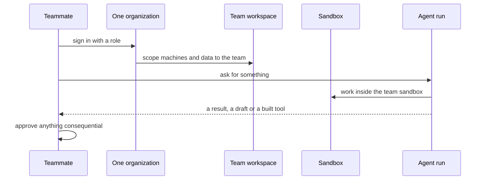

`~25 min` `TypeScript` `Python`

> **您正在构建的内容**：提示您进入域后面的已发货仪表板。
>
> **您将使用的原语**：沙箱、智能体和利用、部署（Docker 主机）

## 你正在构建什么

一个智能体，可以根据简短的提示构建小型内部工具和仪表板并将其发布到公司域后面

队友描述了一个工具；智能体在沙箱中构建它，审查预览，然后将其发布在内部主机名上。

您将使用的基元：沙箱·智能体和利用·部署（App Engine）

- 根据提示构建仪表板或管理表单
- 发布前预览
- 在公司域名后面发布
- 无平台团队排队

这是一种模式，而不是某种产品的复制品。从[相关的 MIOSA 指南](/docs/cookbook/agent-builds-app)开始，构建具有上述功能的最小版本。

## MIOSA 需要什么

每一行都是在开始之前创建的一件事。该数字与使用它的步骤相匹配。

1. 组织和 API 密钥 - 确定每次调用的范围；工作人员只需要一把工作区钥匙即可。 - `miosa api-key create app-key --preset agent` [文档](/docs/platform/api-keys)
2. 沙箱 - 智能体在其中编写代码和运行命令的隔离 Linux 工作区。 - `miosa create app-box --template nextjs --wait` [Docs](/docs/develop/sandboxes)
3. 每个客户一个工作区 - 隔离每个客户的机器、部署和数据。 - `miosa workspace create customer-1` [文档](/docs/platform/white-label)
4. 品牌和白标 - 您的姓名和预览、部署和桌面上的 slug；顾客永远不会看到 MIOSA。 - `miosa org` [文档](/docs/platform/white-label)
5. 使用计量和计费 - 每个客户的使用情况，以及哪个帐户为新机器付费。 - `miosa org bill` [文档](/docs/platform/usage-and-billing)
6. 智能体和工具 - 将提示转化为工作：选择运行使用的工具和模型。 - `miosa agent harnesses` [文档](/docs/api-reference/agent-runs)
7. 部署 (App Engine) - 将应用程序发布到不可变的版本化 URL，并进行回滚。 - `miosa deploy create --from-sandbox app-box --name app --wait` [文档](/docs/docker-host/overview)

## 架构



## 它如何映射到 MIOSA

每个工具一个沙箱 -> 每个项目一个 MIOSA 沙箱

预览供审核 -> 沙箱预览 URL (`miosa preview create`)

内部发布 -> MIOSA 部署 (`miosa deploy create`)，不可变且版本化

公司主机名 -> 自定义域 (`miosa deploy domain-add`)

## 数据和存储

将应用程序数据保存在具有行级所有者（成员 ID 或团队）的托管 Postgres 中，并为智能体操作保留仅附加审核表。

## 授权和租赁

您的组织就是平台；客户永远不会获得 MIOSA 帐户，他们会登录您的产品。每个客户在入职时创建一个工作区，隔离他们的机器、运行和数据。

```bash
miosa workspace create internal-tools-builder-customer-1
```

标记每台机器并使用 `metadata` 中的客户 ID 运行，并且切勿跨客户查询。使用 GET /api/v1/usage 计量每个客户的使用情况，并使用 PUT /api/v1/bill-to (/docs/platform/usage-and-billing) 设置付款人。

## 智能体循环

运行框架：OSA 是 MIOSA 自己的运行框架，可与您连接的任何模型提供商配合使用，包括您自己的模型。

模型：人类（克劳德）。呼叫使用我自己的提供商密钥（`miosa connections add models`）； MIOSA 平台密钥从未被使用过。

会话：每个项目或对话一次聊天，因此智能体可以保留其上下文。沙箱上的第一个 `miosa prompt` 使用 `--new-chat` （打印聊天 ID）；之后的每个回合都会经过 `--chat <chat-id>`。 `--reuse chat` 每个聊天保留一台新计算机，以便文件保留。

流式传输：使用 `miosa run follow <run-id>` 或 client.runs.streamEvents(run.id) 跟踪运行，并使用 `miosa run steer` 和 `miosa run interrupt` 引导或停止运行。

智能体充当成员：每次运行都在 `metadata` 中携带请求成员的 ID，使用仅限于该成员或团队的凭据，并且不能超出该成员可以执行的操作。

## 步骤1.为每个工具创建一个沙箱。
   ```bash
   miosa create internal-tools-builder-box --template nextjs --wait
   ```
   检查：沙箱正在运行。
2. 队友描述该工具；智能体使用只读数据凭据在沙箱中构建它。
   ```bash
   miosa prompt --sandbox internal-tools-builder-box --harness osa --model <anthropic-model-id> --chat <chat-id> "Build the internal tool described; read data only through the provided connection"
   ```
   检查：该工具构建并显示真实数据。
3. 为请求者预览，然后在公司主机名后面发布。
   ```bash
   miosa preview create internal-tools-builder-box 3000 --name web
   ```
   ```bash
   miosa deploy create --from-sandbox internal-tools-builder-box --name internal-tools-builder --dir /workspace --port 3000 --run-command "npm start" --wait
   ```
   检查：只有会员才能打开发布的 URL。
4. 控制访问：成员和角色，以及对智能体所做操作的审计跟踪。
   ```bash
   miosa member add dana@internal-tools-builder.com --role member
   ```
   ```bash
   miosa audit
   ```
   检查：被删除的成员将立即失去访问权限。
5. 在客户加入时为每个客户附加一个域。当 DNS 传播时，平台 URL 继续工作。
   ```bash
   miosa deploy domain-add internal-tools-builder app.internal-tools-builder.com
   ```
   ```bash
   miosa deploy domains internal-tools-builder
   ```
   ```bash
   miosa deploy domain-verify internal-tools-builder <domain-id>
   ```
   检查：MIOSA 显示 DNS 记录，您在 DNS 提供商处添加它，并在验证后在主机名上进行 HTTPS 应答。

## 限制和成本

连接器是真正的工作：为每个源系统的身份验证、速率限制和数据形状预算时间。

设置 `idle_timeout_sec` 以便未使用的团队沙箱暂停。

默认情况下首选只读访问权限；授予每个任务写入。

原型：将其保留在默认大小的一台计算机上，跳过不需要的副本和自定义主机名，并在完成后删除所有内容。

## 验收检查

成员只能看到其团队的数据和工具。

每个智能体操作都可归因于审核日志中的成员。

如果没有指南所述的批准，任何后果都不会发生。

每个客户都被隔离在自己的工作空间中，并且根据他们的使用情况进行计量。

它创建的所有内容都可以被删除，而不会留下任何运行的内容。

## 后续步骤

- [智能体提示构建器选择产品形状并将简介交给您的智能体。](/docs/build)
- [运行编码智能体 在云中运行 Claude Code、Codex 或 Cursor，或在其上构建产品。](/docs/build/run-agents)
- [比较 MIOSA MIOSA 与其他沙箱和智能体平台的比较。](/docs/compare)
- [您可以构建什么 MIOSA 支持的每个产品模式。](/docs/use-cases)
