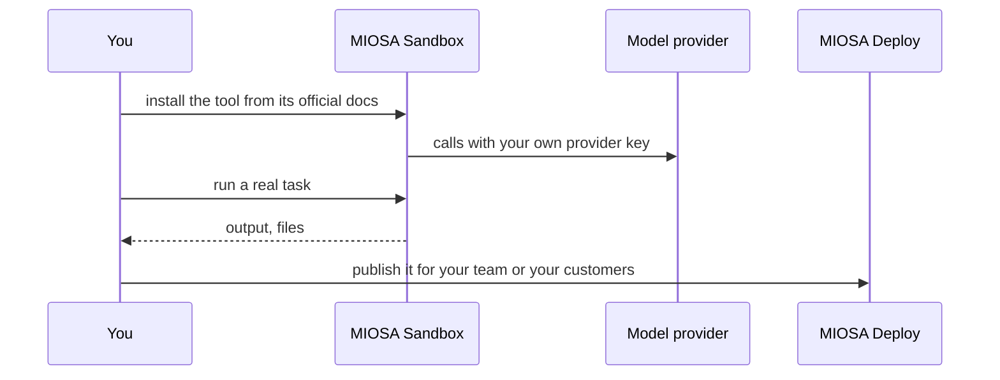

`~15 min` `TypeScript` `Python`

> **您正在构建的**：领先的开源实时语音智能体框架。
>
> **您将使用的原语**：沙盒、Redis

## 你正在构建什么

实时语音 AI 智能体的开源 (Apache-2.0) 框架，具有可插入的语音转文本、LLM、文本转语音和电话功能，由 LiveKit, Inc. 在 LiveKit Agents 上建模。

您的智能体加入 LiveKit 房间并运行实时循环：音频输入、语音转文本、带工具的模型、文本转语音和音频输出；语义转向检测决定调用者何时完成。

您将使用的基元：沙箱·Redis

- 混合搭配语音、模型和语音提供者
- 语义转向检测
- 拨打和接听电话的智能体
- 多智能体切换，自托管端到端

您在 MIOSA 上安装并**运行真正的 LiveKit Agents**。首先阅读官方文档：[docs.livekit.io/agents/](https://docs.livekit.io/agents/)。下面的每个安装命令都来自他们；如果文档和本指南不一致，则文档获胜。 LiveKit Agents 是开源的 (Apache-2.0)。

## MIOSA 需要什么

每一行都是在开始之前创建的一件事。该数字与使用它的步骤相匹配。

1. 组织和 API 密钥 - 确定每次调用的范围；工作人员只需要一把工作区钥匙即可。 - `miosa api-key create app-key --preset agent` [文档](/docs/platform/api-keys)
2. 沙箱 - 智能体在其中编写代码和运行命令的隔离 Linux 工作区。 - `miosa create app-box --template nextjs --wait` [Docs](/docs/develop/sandboxes)
3. Redis - 托管缓存和会话存储，作为 REDIS_URL 注入。 - `miosa api POST /databases -d '{"name":"app-cache","engine":"redis"}'` [文档](/docs/data/redis)
4. 每个客户一个工作区 - 隔离每个客户的机器、部署和数据。 - `miosa workspace create customer-1` [文档](/docs/platform/white-label)
5. 品牌和白标签 - 您的名字和预览、部署和桌面上的 slug；顾客永远不会看到 MIOSA。 - `miosa org` [文档](/docs/platform/white-label)
6. 使用计量和计费 - 每个客户的使用情况，以及哪个帐户为新机器付费。 - `miosa org bill` [文档](/docs/platform/usage-and-billing)

## 架构



## 它如何在 MIOSA 上运行

它运行的地方 -> MIOSA 沙箱（一个独立的 Linux 工作区）

状态和文件 -> 将项目保留在 /workspace 中；持久的沙箱可以让它跨越暂停。实时通话和房间状态属于托管 Redis。

模型 -> 您自己的提供商密钥，而不是 MIOSA 平台密钥

您的客户 -> 各一个工作空间，彼此隔离

## 授权和租赁

您的组织就是平台；客户永远不会获得 MIOSA 帐户，他们会登录您的产品。每个客户在入职时创建一个工作区，隔离他们的机器、运行和数据。

```bash
miosa workspace create livekit-agents-customer-1
```

标记每台机器并使用 `metadata` 中的客户 ID 运行，并且切勿跨客户查询。使用 GET /api/v1/usage 计量每个客户的使用情况，并使用 PUT /api/v1/bill-to (/docs/platform/usage-and-billing) 设置付款人。

## 安装 LiveKit 智能体

按顺序在沙箱内运行它们（例如 `miosa exec livekit-agents-box -- bash -lc '<command>'`）。命令来自官方文档。

```text
python3 --version   # Python 3.10 or later is required
```

```bash
pip install "livekit-agents[openai,deepgram,cartesia]"
```

检查：安装完成，没有错误；接下来的部分将配置并启动它。

## 配置

从快速入门中编写智能体 (myagent.py)，然后选择您的提供商：您安装的插件是您带来的语音转文本、LLM 和文本转语音。

控制台模式不需要服务器。开发和启动模式连接到 LiveKit 服务器：为 LiveKit Cloud 或在 MIOSA 部署上运行的自托管 LiveKit 服务器设置 LIVEKIT_URL、LIVEKIT_API_KEY 和 LIVEKIT_API_SECRET。

模型：人类（克劳德）。调用使用我自己的提供商密钥（ANTHROPIC_API_KEY）； MIOSA 平台密钥从未被使用过。

```bash
export ANTHROPIC_API_KEY="..."   # set it in the process environment, or the Secrets API; never write it into files you commit
```

## 运行它

启动它并证明它有效。

```bash
python myagent.py console   # talk to the agent locally, no server needed
```

```bash
python myagent.py dev   # serve the agent with hot reload
```

检查：工具启动无错误并响应。

## 持久化和访问

将项目保存在 /workspace 中；持久的沙箱可以让它跨越暂停。实时通话和房间状态属于托管 Redis。

检查：机器暂停并恢复后，工具再次启动，状态完好。

## 使其成为产品

每个客户工作区（或具有会话路由器的池）一个智能体进程针对一台 LiveKit 服务器；通过 Redis 中的呼叫 ID 获取关键房间和会话状态。

## 限制和成本固定您测试的版本并刻意更新；这些工具变化很快。

仅向该工具提供其所需的凭据（作为秘密），而不是写入文件中。

原型：将其保留在默认大小的一台计算机上，跳过不需要的副本和自定义主机名，并在完成后删除所有内容。

## 验收检查

LiveKit Agents 在 MIOSA 沙箱上运行并回答实际任务。

状态在暂停和恢复后仍然存在。

每个客户都有自己的工作区和自己的实例；他们之间没有任何东西是共享的。

它创建的所有内容都可以被删除，而不会留下任何运行的内容。

## 后续步骤

- [智能体提示构建器选择产品形状并将简介交给您的智能体。](/docs/build)
- [运行编码智能体 在云中运行 Claude Code、Codex 或 Cursor，或在其上构建产品。](/docs/build/run-agents)
- [比较 MIOSA MIOSA 与其他沙箱和智能体平台的比较。](/docs/compare)
- [您可以构建什么 MIOSA 支持的每个产品模式。](/docs/use-cases)
