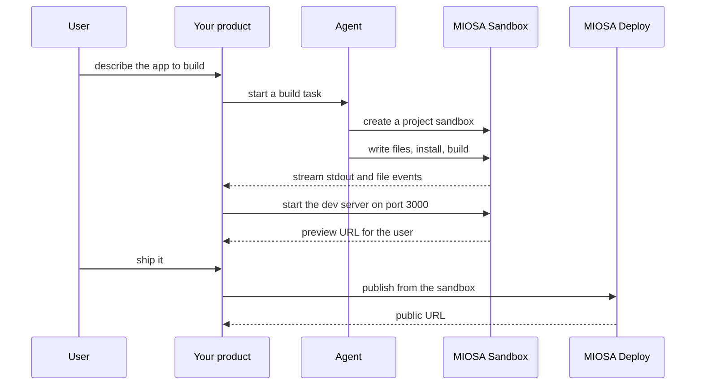

`~25 min` `TypeScript` `Python`

> **您正在构建的内容**：提示全栈应用程序，实时预览，发布。
>
> **您将使用的原语**：沙箱、智能体和利用、部署（Docker 主机）

## 你正在构建什么

一个 AI 应用程序构建器，用户可以在聊天中描述应用程序，并获得正在运行的全栈 Web 应用程序，并具有实时预览和一键发布功能。

聊天提示会发送到编写 Web 应用程序（具有数据库和身份验证等后端集成的 React 前端）的智能体，运行它，显示实时预览，让用户在聊天中继续迭代，并将其发布到托管 URL。

您将使用的基元：沙箱·智能体和利用·部署（App Engine）

- 在聊天中描述一个应用程序并获得一个可用的全栈应用程序
- 实时预览随着智能体编辑而更新
- 通过聊天进行迭代；自动修复构建错误
- 发布到托管 URL，可以选择在自定义域上发布

来源：[loveable.dev](https://lovable.dev/)。 Lovable 是其所有者的商标；本指南不隶属于他们，也不受他们认可。

## MIOSA 需要什么

每一行都是在开始之前创建的一件事。该数字与使用它的步骤相匹配。

1. 组织和 API 密钥 - 确定每次调用的范围；工作人员只需要一把工作区钥匙即可。 - `miosa api-key create app-key --preset agent` [文档](/docs/platform/api-keys)
2. 沙箱 - 智能体在其中编写代码和运行命令的隔离 Linux 工作区。 - `miosa create app-box --template nextjs --wait` [Docs](/docs/develop/sandboxes)
3. 每个客户一个工作区 - 隔离每个客户的机器、部署和数据。 - `miosa workspace create customer-1` [文档](/docs/platform/white-label)
4. 品牌和白标 - 您的姓名和预览、部署和桌面上的 slug；顾客永远不会看到 MIOSA。 - `miosa org` [文档](/docs/platform/white-label)
5. 使用计量和计费 - 每个客户的使用情况，以及哪个帐户为新机器付费。 - `miosa org bill` [文档](/docs/platform/usage-and-billing)
6. 智能体和工具 - 将提示转化为工作：选择运行使用的工具和模型。 - `miosa agent harnesses` [文档](/docs/api-reference/agent-runs)
7. 部署 (App Engine) - 将应用程序发布到不可变的版本化 URL，并进行回滚。 - `miosa deploy create --from-sandbox app-box --name app --wait` [文档](/docs/docker-host/overview)

## 架构



## 它如何映射到 MIOSA

每个项目都是一个独立的工作区 -> 每个项目一个 MIOSA 沙箱

智能体编写并编辑代码 -> 智能体针对项目沙箱运行（`miosa prompt`, client.runs）流事件，在其中写入文件

构建时进行实时预览 -> 沙箱预览 URL (`miosa preview create`)

一键发布 -> MIOSA 部署 (`miosa deploy create`)，不可变且版本化

## 数据和存储

您的控制平面存储项目（ID、所有者、沙箱 ID、预览 URL、部署 ID、状态）、每个项目的聊天消息以及版本列表（快照 ID、部署版本）。生成的应用程序的文件仅存在于项目沙箱的 /workspace 中。

生成的应用程序是无状态的，除非用户请求数据；此时添加每个项目的 Postgres。

## 授权和租赁

您的组织就是平台；客户永远不会获得 MIOSA 帐户，他们会登录您的产品。每个客户在入职时创建一个工作区，隔离他们的机器、运行和数据。

```bash
miosa workspace create lovable-customer-1
```

标记每台机器并使用 `metadata` 中的客户 ID 运行，并且切勿跨客户查询。使用 GET /api/v1/usage 计量每个客户的使用情况，并使用 PUT /api/v1/bill-to (/docs/platform/usage-and-billing) 设置付款人。

## 智能体循环

运行框架：OSA 是 MIOSA 自己的运行框架，可与您连接的任何模型提供商配合使用，包括您自己的模型。

模型：人类（克劳德）。呼叫使用我自己的提供商密钥（`miosa connections add models`）； MIOSA 平台密钥从未被使用过。

会话：每个项目或对话一次聊天，因此智能体可以保留其上下文。沙箱上的第一个 `miosa prompt` 使用 `--new-chat` （打印聊天 ID）；之后的每个回合都会经过 `--chat <chat-id>`。 `--reuse chat` 每个聊天保留一台新计算机，以便文件保留。

流式传输：使用 `miosa run follow <run-id>` 或 client.runs.streamEvents(run.id) 跟踪运行，并使用 `miosa run steer` 和 `miosa run interrupt` 引导或停止运行。

该工具在项目沙箱内工作：它写入文件、运行构建并启动开发服务器。不要在本地构建并上传结果。当构建失败时，将编译器输出作为下一次打开同一聊天的反馈（“修复构建”），直到退出 0。

## 步骤

1. 在客户工作区中为每个项目创建一个沙箱，根据项目 ID 命名。
   ```bash
   miosa create lovable-box --template nextjs --wait
   ```
   检查：沙箱正在运行并且 `miosa exec` 返回输出。
2. 将用户的提示交给座席。它将文件写入 /workspace、安装和构建。
   ```bash
   miosa prompt --sandbox lovable-box --harness osa --model <anthropic-model-id> --chat <chat-id> "Build what the user asked for under /workspace; run npm install and npm run build; fix errors until it builds"
   ```
   检查：/workspace 保留应用程序并且 `miosa exec lovable-box -- npm run build` 退出 0。
3. 将应用程序作为后台进程启动，并打开 UI 可嵌入的预览。
   ```text
   sandbox.process.start("npm run dev", { name: "web", cwd: "/workspace" })
   ```
   ```bash
   miosa preview create lovable-box 3000 --name web
   ```
   检查：预览URL回答200并显示应用程序；当智能体编辑文件时它会更新。
4. 迭代：每条后续消息都是同一聊天的另一轮。每次更改之前的快照，以便用户可以返回并分叉以比较两种方法。
   ```text
   sandbox.snapshots.create("before <change>")
   ```
   ```text
   sandbox.fork()
   ```
   检查：可以恢复以前的版本，并且分叉不会影响原始版本。
5. 发布。服务器渲染的应用程序成为动态部署；静态导出从 /workspace/out 发布。
   ```bash
   miosa deploy create --from-sandbox lovable-box --name lovable --dir /workspace --port 3000 --run-command "npm start" --wait
   ```
   检查：部署返回一个可以应答的 public_url，并且它是一个新的不可变版本。

## 限制和成本

设置显式的`timeout_sec`（1h适合交互式构建）和`idle_timeout_sec`，以便废弃的项目暂停并停止计费；持久沙箱保留 /workspace 和已安装的依赖项。

使用已发布的模板 (nextjs)，而不是为每个项目重新安装依赖项。

每个活动项目一个沙箱是成本驱动因素：暂停闲置项目，销毁废弃项目。

原型：将其保留在默认大小的一台计算机上，跳过不需要的副本和自定义主机名，并在完成后删除所有内容。

## 验收检查

应用程序构建并预览显示它。

每个项目都隔离在自己的沙箱中。

已发布的 URL 答案和早期版本都可以恢复。

每个客户都被隔离在自己的工作空间中，并且根据他们的使用情况进行计量。

它创建的所有内容都可以被删除，而不会留下任何运行的内容。

## 后续步骤

- [智能体提示构建器选择产品形状并将简介交给您的智能体。](/docs/build)
- [运行编码智能体 在云中运行 Claude Code、Codex 或 Cursor，或在其上构建产品。](/docs/build/run-agents)
- [比较 MIOSA MIOSA 与其他沙箱和智能体平台的比较。](/docs/compare)
- [您可以构建什么 MIOSA 支持的每个产品模式。](/docs/use-cases)
