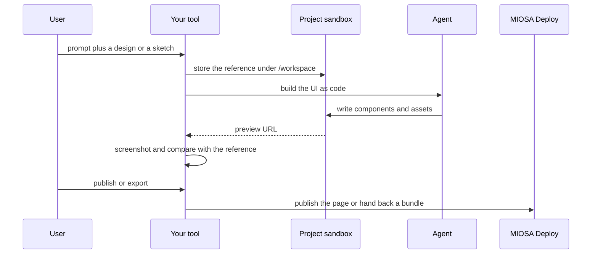

`~25 min` `TypeScript` `Python`

> **您正在构建的内容**：根据提示生成 UI 组件。
>
> **您将使用的原语**：沙箱、智能体和利用、部署（Docker 主机）

## 你正在构建什么

一个根据 Magic Patterns 的提示生成 UI 组件的工具。

提示（或图像）生成可实时渲染并导出为代码的 UI 组件。

您将使用的基元：沙箱·智能体和利用·部署（App Engine）

- 提示UI组件
- 实时渲染
- 导出为代码
- 重用设计系统

来源：[www.magicpatterns.com](https://www.magicpatterns.com/)。 Magic Patterns 是其所有者的商标；本指南不隶属于他们，也不受他们认可。

## MIOSA 需要什么

每一行都是在开始之前创建的一件事。该数字与使用它的步骤相匹配。

1. 组织和 API 密钥 - 确定每次调用的范围；工作人员只需要一把工作区钥匙即可。 - `miosa api-key create app-key --preset agent` [文档](/docs/platform/api-keys)
2. 沙箱 - 智能体在其中编写代码和运行命令的隔离 Linux 工作区。 - `miosa create app-box --template nextjs --wait` [Docs](/docs/develop/sandboxes)
3. 每个客户一个工作区 - 隔离每个客户的机器、部署和数据。 - `miosa workspace create customer-1` [文档](/docs/platform/white-label)
4. 品牌和白标 - 您的姓名和预览、部署和桌面上的 slug；顾客永远不会看到 MIOSA。 - `miosa org` [文档](/docs/platform/white-label)
5. 使用计量和计费 - 每个客户的使用情况，以及哪个帐户为新机器付费。 - `miosa org bill` [文档](/docs/platform/usage-and-billing)
6. 智能体和工具 - 将提示转化为工作：选择运行使用的工具和模型。 - `miosa agent harnesses` [文档](/docs/api-reference/agent-runs)
7. 部署 (App Engine) - 将应用程序发布到不可变的版本化 URL，并进行回滚。 - `miosa deploy create --from-sandbox app-box --name app --wait` [文档](/docs/docker-host/overview)

## 架构



## 它如何映射到 MIOSA

提示（和参考设计）工作 UI -> 智能体运行 (`miosa prompt`, client.runs) 流事件，将 UI 作为代码写入项目沙箱内

实时预览 -> 沙盒预览 URL (`miosa preview create`)

项目和资产 -> 用于项目元数据的托管 Postgres (`DATABASE_URL`)；设计文件并导出到沙箱的 /workspace 下

共享或导出结果 -> MIOSA 部署 (`miosa deploy create`)，对于已发布的页面或从沙箱下载的捆绑包来说是不可变的和版本化的

## 数据和存储

项目元数据较小；设计本身是项目沙箱 /workspace 中的代码和资产。

资产通过哈希进行内容寻址，因此永远不会重新生成相同的输入。

## 授权和租赁

您的组织就是平台；客户永远不会获得 MIOSA 帐户，他们会登录您的产品。每个客户在入职时创建一个工作区，隔离他们的机器、运行和数据。

```bash
miosa workspace create magic-patterns-customer-1
```

标记每台机器并使用 `metadata` 中的客户 ID 运行，并且切勿跨客户查询。使用 GET /api/v1/usage 计量每个客户的使用情况，并使用 PUT /api/v1/bill-to (/docs/platform/usage-and-billing) 设置付款人。

## 智能体循环

运行框架：OSA 是 MIOSA 自己的运行框架，可与您连接的任何模型提供商配合使用，包括您自己的模型。

模型：人类（克劳德）。呼叫使用我自己的提供商密钥 (`miosa connections add models`)； MIOSA 平台密钥从未被使用过。

会话：每个项目或对话一次聊天，因此智能体可以保留其上下文。沙箱上的第一个 `miosa prompt` 使用 `--new-chat` （打印聊天 ID）；之后的每个回合都会经过 `--chat <chat-id>`。 `--reuse chat` 每个聊天保留一台新计算机，以便文件保留。

流式传输：使用 `miosa run follow <run-id>` 或 client.runs.streamEvents(run.id) 跟踪运行，并使用 `miosa run steer` 和 `miosa run interrupt` 引导或停止运行。

该工具将 UI 作为代码写入项目沙箱内，以便它可以构建和截屏自己的工作，并根据引用进行迭代。

## 步骤1. 创建项目沙箱，将生成的设计保存为代码并提供预览服务。
   ```bash
   miosa create magic-patterns-box --template nextjs --wait
   ```
   检查：沙箱正在运行。
2. 将设计上下文（Figma 导出、屏幕截图、品牌文件）放在 /workspace/design 下，以便智能体可以读取。
   检查：文件存在并且智能体可以描述它们。
3. 生成：调度工具根据提示和上下文构建 UI。
   ```bash
   miosa prompt --sandbox magic-patterns-box --harness osa --model <anthropic-model-id> --chat <chat-id> "Build the design from /workspace/design and the prompt; use the existing design tokens"
   ```
   检查：项目在视觉容差范围内构建并匹配参考。
4. 预览和比较：渲染预览，无头截图并与参考进行比较。
   ```bash
   miosa preview create magic-patterns-box 3000 --name web
   ```
   检查：参考图像旁边存在预览屏幕截图。
5.导出：将结果打包为代码（/workspace的zip）或渲染资源；无需部署即可交回文件。
   ```text
   sandbox.files.download("/workspace/out")
   ```
   检查：导出的包在干净的机器上打开。

## 限制和成本

预览很便宜；每个活动项目保留一个沙箱并暂停闲置项目。

提供商的使用（发电、语音）由这些提供商计费；存储您自己的工作级别成本。

原型：将其保留在默认大小的一台计算机上，跳过不需要的副本和自定义主机名，并在完成后删除所有内容。

## 验收检查

生成的设计进行构建和预览。

结果可以导出。

使用相同的输入重新运行会得到相同的结果结构。

每个客户都被隔离在自己的工作空间中，并且根据他们的使用情况进行计量。

它创建的所有内容都可以被删除，而不会留下任何运行的内容。

## 后续步骤

- [智能体提示构建器选择产品形状并将简介交给您的智能体。](/docs/build)
- [运行编码智能体 在云中运行 Claude Code、Codex 或 Cursor，或在其上构建产品。](/docs/build/run-agents)
- [比较 MIOSA MIOSA 与其他沙箱和智能体平台的比较。](/docs/compare)
- [您可以构建什么 MIOSA 支持的每个产品模式。](/docs/use-cases)
