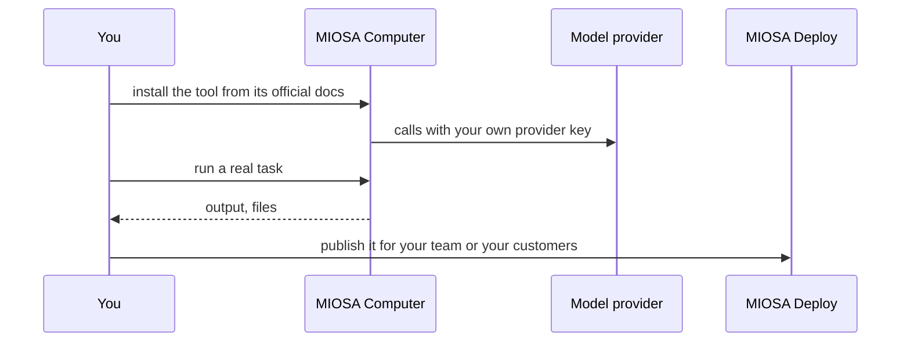

`~15 min` `TypeScript` `Python`

> **您正在构建的内容**：在永不休眠的持久计算机上安装开源助手。
>
> **您将使用的原语**：计算机

## 你正在构建什么

一个开源个人人工智能助手，在您控制的机器上运行，并通过 OpenClaw 基金会在 OpenClaw 上建模的聊天应用程序进行访问。

OpenClaw 在持久设备上运行，接受来自聊天应用程序（WhatsApp、Telegram 等）的请求，并在您离开时处理电子邮件、日历和网络。

您将使用的原语：计算机

- 通过您已经使用的聊天应用程序进行联系
- 在永不休眠的持久设备上运行
- 适用于收件箱、日历和网络任务
- 开源

您在 MIOSA 上安装并**运行真正的 OpenClaw**。首先阅读官方文档：[docs.openclaw.ai/start/getting-started](https://docs.openclaw.ai/start/getting-started)。下面的每个安装命令都来自他们；如果文档和本指南不一致，则文档获胜。 OpenClaw 是开源的，由 OpenClaw 基金会管理。

## MIOSA 需要什么

每一行都是在开始之前创建的一件事。该数字与使用它的步骤相匹配。

1. 组织和 API 密钥 - 确定每次调用的范围；工作人员只需要一把工作区钥匙即可。 - `miosa api-key create app-key --preset agent` [文档](/docs/platform/api-keys)
2. 计算机 - 用于浏览器、鼠标和屏幕截图工作的持久 Linux 桌面。 - `miosa computer create app-desktop` [文档](/docs/computers/overview)
3. 每个客户一个工作区 - 隔离每个客户的机器、部署和数据。 - `miosa workspace create customer-1` [文档](/docs/platform/white-label)
4. 品牌和白标 - 您的姓名和预览、部署和桌面上的 slug；顾客永远不会看到 MIOSA。 - `miosa org` [文档](/docs/platform/white-label)
5. 使用计量和计费 - 每个客户的使用情况，以及哪个帐户为新机器付费。 - `miosa org bill` [文档](/docs/platform/usage-and-billing)

## 架构



## 它如何在 MIOSA 上运行

它运行的地方 -> MIOSA 计算机（带有浏览器的持久桌面）

状态和文件 -> 状态、内存和凭证位于计算机上。使用 MIOSA 计算机，以便网关在对话之间保持运行状态，并延长其 TTL (`miosa extend`)。

模型 -> 您自己的提供商密钥，而不是 MIOSA 平台密钥

您的客户 -> 各一个工作空间，彼此隔离

## 授权和租赁

您的组织就是平台；客户永远不会获得 MIOSA 帐户，他们会登录您的产品。每个客户在入职时创建一个工作区，隔离他们的机器、运行和数据。

```bash
miosa workspace create openclaw-customer-1
```

标记每台机器并使用 `metadata` 中的客户 ID 运行，并且切勿跨客户查询。使用 GET /api/v1/usage 计量每个客户的使用情况，并使用 PUT /api/v1/bill-to (/docs/platform/usage-and-billing) 设置付款人。

## 安装 OpenClaw

按顺序在计算机（其终端）内运行它们。命令来自官方文档。

```text
curl -fsSL https://openclaw.ai/install.sh | bash
```

检查：安装完成，没有错误；接下来的部分将配置并启动它。

## 配置

需要节点 24.16+ 或 26.1+；安装程序在需要时提供它。包裹路线是`npm install -g openclaw@latest --allow-scripts=openclaw`。

入职验证模型访问、创建工作区并配置网关；它要求您自己的模型提供者密钥。

渠道（WhatsApp、Telegram、Slack 等）由您使用每个平台自己的凭据连接。

模型：人类（克劳德）。呼叫使用我自己的提供商密钥（在工具自己的设置中输入）； MIOSA 平台密钥从未被使用过。

## 运行它

启动它并证明它有效。

```text
openclaw onboard --install-daemon
```

```text
openclaw gateway status
```

检查：工具启动无错误并响应。

## 持久化和访问

状态、内存和凭证都存在于机器上。使用 MIOSA 计算机，以便网关在对话之间保持运行状态，并延长其 TTL (`miosa extend`)。

检查：机器暂停并恢复后，工具再次启动，状态完好。

## 使其成为产品

每个客户在其工作区中自己的计算机上运行一个网关，因此状态、内存和凭据永远不会混合。

## 限制和成本

固定您测试的版本并刻意更新；这些工具变化很快。

仅向该工具提供其所需的凭据（作为秘密），而不是写入文件中。原型：将其保留在默认大小的一台计算机上，跳过不需要的副本和自定义主机名，并在完成后删除所有内容。

## 验收检查

OpenClaw 在 MIOSA 计算机上运行并回答实际任务。

状态在暂停和恢复后仍然存在。

每个客户都有自己的工作区和自己的实例；他们之间没有任何东西是共享的。

它创建的所有内容都可以被删除，而不会留下任何运行的内容。

## 后续步骤

- [智能体提示构建器选择产品形状并将简介交给您的智能体。](/docs/build)
- [运行编码智能体 在云中运行 Claude Code、Codex 或 Cursor，或在其上构建产品。](/docs/build/run-agents)
- [比较 MIOSA MIOSA 与其他沙箱和智能体平台的比较。](/docs/compare)
- [您可以构建什么 MIOSA 支持的每个产品模式。](/docs/use-cases)
