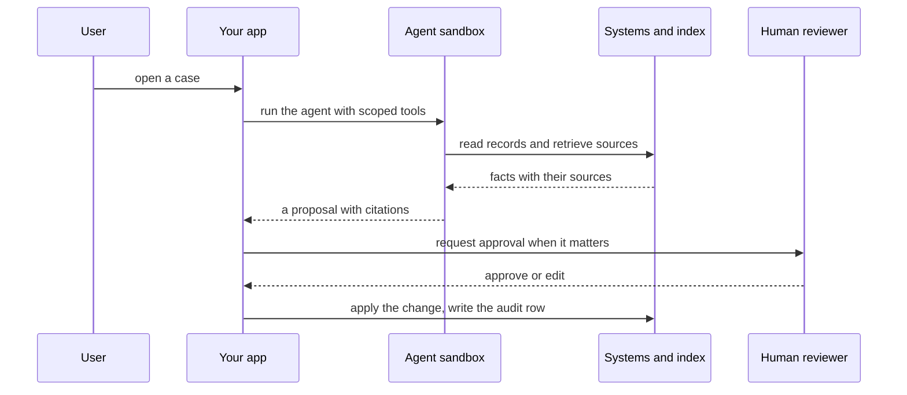

`~25 min` `TypeScript` `Python`

> **您正在构建的内容**：在可信语料库中引用答案。
>
> **您将使用的原语**：沙箱、智能体和工具、Postgres、Qdrant 向量、部署（Docker 主机）

## 你正在构建什么

医学证据引擎：从受信任的语料库回答临床医生的问题，并引用 OpenEvidence 的《在 OpenEvidence 上建模》的源文章。

首先通过检索来回答问题：应用程序搜索许可或公共语料库，阅读段落，然后模型编写引用源文章的答案；图表来自检索到的段落。

您将使用的基元：沙箱·智能体和工具·Postgres·Qdrant向量·部署（App Engine）

- 答案基于可信语料库
- 检索并引用来源
- 面向临床医生的问答界面
- 当来源发生变化时保持索引最新

来源：[www.openevidence.com](https://www.openevidence.com/)。 OpenEvidence 是其所有者的商标；本指南不隶属于他们，也不受他们认可。

## MIOSA 需要什么

每一行都是在开始之前创建的一件事。该数字与使用它的步骤相匹配。

1. 组织和 API 密钥 - 确定每次调用的范围；工作人员只需要一把工作区钥匙即可。 - `miosa api-key create app-key --preset agent` [文档](/docs/platform/api-keys)
2. 沙箱 - 智能体在其中编写代码和运行命令的隔离 Linux 工作区。 - `miosa create app-box --template nextjs --wait` [Docs](/docs/develop/sandboxes)
3. Postgres - 托管关系数据，在机器和生产中作为 DATABASE_URL 注入。 - `miosa api POST /databases -d '{"name":"app-db","engine":"postgresql"}'` [文档](/docs/data/postgres)
4. Qdrant 矢量 - 用于搜索和嵌入的托管矢量存储，作为 QDRANT_URL 注入。 - `miosa api POST /databases -d '{"name":"app-index","engine":"qdrant"}'` [文档](/docs/data/qdrant)
5. 每个客户一个工作区 - 隔离每个客户的机器、部署和数据。 - `miosa workspace create customer-1` [文档](/docs/platform/white-label)
6. 品牌和白标签 - 您的名字和预览、部署和桌面上的 slug；顾客永远不会看到 MIOSA。 - `miosa org` [文档](/docs/platform/white-label)
7. 使用计量和计费 - 每个客户的使用情况，以及哪个帐户为新机器付费。 - `miosa org bill` [文档](/docs/platform/usage-and-billing)
8. 智能体和工具 - 将提示转化为工作：选择运行使用的工具和模型。 - `miosa agent harnesses` [文档](/docs/api-reference/agent-runs)
9. 部署 (App Engine) - 将应用程序发布到不可变的版本化 URL，并进行回滚。 - `miosa deploy create --from-sandbox app-box --name app --wait` [文档](/docs/docker-host/overview)

## 架构



## 它如何映射到 MIOSA

执行域工作的智能体 -> 智能体在沙箱中运行 (`miosa prompt`, client.runs) 流事件，并使用您定义的可能调用的工具

域记录和历史 -> 托管 Postgres (`DATABASE_URL`) 用于记录、引用和审计跟踪

每个客户都是隔离的 -> 每个客户一个工作区 (`miosa workspace create`)

人工审核和升级 -> 智能体批准 (`miosa agent approvals`) 以及产品中的审核队列

证据应用程序和智能体层 -> 通过预览 URL 或部署提供服务的 MIOSA 应用程序

授权语料库块和嵌入 -> 向量的托管 Qdrant (`QDRANT_URL`)；用于文档元数据、引文和用户的托管 Postgres (`DATABASE_URL`)

源文档->对象存储（S3兼容的桶）

摄取和重新嵌入 -> 智能体按计划在沙箱中运行 (`miosa schedule`)

答案合成->你带来的模型API；没有我们自己的专有模型或搜索索引

## 数据和存储

Postgres 是一个带有仅附加审核表的记录系统；智能体决定的任何内容都不会仅存在于提示中。

向量索引支持检索；保留源 ID，以便解析每个引用的段落。

## 授权和租赁

您的组织就是平台；客户永远不会获得 MIOSA 帐户，他们会登录您的产品。每个客户在入职时创建一个工作区，隔离他们的机器、运行和数据。

```bash
miosa workspace create openevidence-customer-1
```

标记每台机器并使用 `metadata` 中的客户 ID 运行，并且切勿跨客户查询。使用 GET /api/v1/usage 计量每个客户的使用情况，并使用 PUT /api/v1/bill-to (/docs/platform/usage-and-billing) 设置付款人。

## 智能体循环

运行框架：OSA 是 MIOSA 自己的运行框架，可与您连接的任何模型提供商配合使用，包括您自己的模型。模型：人类（克劳德）。呼叫使用我自己的提供商密钥（`miosa connections add models`）； MIOSA 平台密钥从未被使用过。

会话：每个项目或对话一次聊天，因此智能体可以保留其上下文。沙箱上的第一个 `miosa prompt` 使用 `--new-chat` （打印聊天 ID）；之后的每个回合都会经过 `--chat <chat-id>`。 `--reuse chat` 每个聊天保留一台新计算机，以便文件保留。

流式传输：使用 `miosa run follow <run-id>` 或 client.runs.streamEvents(run.id) 跟踪运行，并使用 `miosa run steer` 和 `miosa run interrupt` 引导或停止运行。

智能体仅使用您定义的工具在沙箱内运行。它建议；您的代码强制执行限制（退款上限、允许的收件人），因此模型无法绕过这些限制。

## 步骤

1. 创建域数据库。
   ```bash
   miosa api POST /databases -d '{"name":"openevidence-db","engine":"postgresql"}'
   ```
   ```bash
   miosa db connection openevidence-db
   ```
   检查：域表是否存在：语料库文档、块、引文、用户。
2. 创建智能体沙箱。
   ```bash
   miosa create openevidence-box --template agent-python --wait
   ```
   检查：沙箱正在运行并设置了 DATABASE_URL。
3. 将语料库提取到向量索引中：将每个源拆分为段落，并将文章 ID、章节和页面保留在有效负载中，以便答案可以引用其使用的确切段落。
   ```bash
   miosa api POST /databases -d '{"name":"openevidence-corpus","engine":"qdrant"}'
   ```
   检查：政策、文档或文章问题检索到正确的段落。
4. 定义对语料库的只读检索。智能体仅根据检索到的段落进行回答，并且必须引用其使用的段落；如果语料库没有回答问题，它就会这样说。
   ```bash
   miosa prompt --sandbox openevidence-box --harness osa --model <anthropic-model-id> --chat <chat-id> "Handle the case using only the defined tools; cite sources; escalate if unsure"
   ```
   检查：答案的每个句子都解析为语料库中的一个段落；无法回答的问题被拒绝。
5. 将人员置于重要的环节：智能体人提出建议，人员批准任何不可逆转或高风险的事情，以及低可信度案例随上下文升级。
   ```bash
   miosa agent approvals
   ```
   检查：超过限额的退款、发送或提交等待批准。
6. 为每个智能体操作编写审核记录：谁、什么、输入、输出和运行 ID。
   ```bash
   miosa audit
   ```
   检查：任何决策都可以从审计跟踪中重建。
7. 发布智能体API和审核UI。
   ```bash
   miosa deploy create --from-sandbox openevidence-box --name openevidence --dir /workspace --port 3000 --run-command "npm start" --wait
   ```
   检查：public_url 服务于审核队列。

## 限制和成本

仅使用您获得许可或允许重复使用的来源，保持引用链完整，并从文档中明确工具答案，而不是提供医疗建议。真实的患者数据需要签署BAA（企业）和您自己的审核；参见/信任。

将租户数据分开：每个客户一个工作区，以及按租户过滤的每个查询。

在每个案例的运行和上限工具调用上设置 `--max-time`。

原型：将其保留在默认大小的一台计算机上，跳过不需要的副本和自定义主机名，并在完成后删除所有内容。

## 验收检查

智能体仅使用定义的工具端到端地解决代表性案例。

一项高风险的行动正在等待人类的批准。

审计追踪重构了决策。

每个客户都被隔离在自己的工作空间中，并且根据他们的使用情况进行计量。

它创建的所有内容都可以被删除，而不会留下任何运行的内容。

## 后续步骤

- [智能体提示构建器选择产品形状并将简介交给您的智能体。](/docs/build)
- [运行编码智能体 在云中运行 Claude Code、Codex 或 Cursor，或在其上构建产品。](/docs/build/run-agents)
- [比较 MIOSA MIOSA 与其他沙箱和智能体平台的比较。](/docs/compare)
- [您可以构建什么 MIOSA 支持的每个产品模式。](/docs/use-cases)
