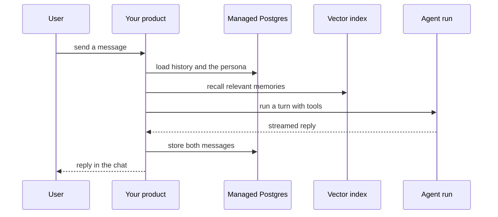

`~25 min` `TypeScript` `Python`

> **您正在构建的**：一个热情、健谈的私人助理。
>
> **您将使用的原语**：沙箱、Postgres、Qdrant 向量、智能体和工具、部署（Docker 主机）

## 你正在构建什么

一个热情的、会话式的个人助理，由 Inflection AI 设计，以 Pi 为模型。

聊天助手可提供支持性、简短的对话式回复，记住用户之前说过的话。

您将使用的基元：沙箱·Postgres·Qdrant向量·智能体和利用·部署（App Engine）

- 会话式私人助理
- 简短而温暖的回复
- 记得之前的对话
- 语音选项

来源：[pi.ai](https://pi.ai/)。 Pi 是 Inflection AI 的商标；本指南不隶属于他们，也不受他们认可。

## MIOSA 需要什么

每一行都是在开始之前创建的一件事。该数字与使用它的步骤相匹配。

1. 组织和 API 密钥 - 确定每次调用的范围；工作人员只需要一把工作区钥匙即可。 - `miosa api-key create app-key --preset agent` [文档](/docs/platform/api-keys)
2. 沙箱 - 智能体在其中编写代码和运行命令的隔离 Linux 工作区。 - `miosa create app-box --template nextjs --wait` [Docs](/docs/develop/sandboxes)
3. Postgres - 托管关系数据，在机器和生产中作为 DATABASE_URL 注入。 - `miosa api POST /databases -d '{"name":"app-db","engine":"postgresql"}'` [文档](/docs/data/postgres)
4. Qdrant 矢量 - 用于搜索和嵌入的托管矢量存储，作为 QDRANT_URL 注入。 - `miosa api POST /databases -d '{"name":"app-index","engine":"qdrant"}'` [文档](/docs/data/qdrant)
5. 每个客户一个工作区 - 隔离每个客户的机器、部署和数据。 - `miosa workspace create customer-1` [文档](/docs/platform/white-label)
6. 品牌和白标签 - 您的名字和预览、部署和桌面上的 slug；顾客永远不会看到 MIOSA。 - `miosa org` [文档](/docs/platform/white-label)
7. 使用计量和计费 - 每个客户的使用情况，以及哪个帐户为新机器付费。 - `miosa org bill` [文档](/docs/platform/usage-and-billing)
8. 智能体和工具 - 将提示转化为工作：选择运行使用的工具和模型。 - `miosa agent harnesses` [文档](/docs/api-reference/agent-runs)
9. 部署 (App Engine) - 将应用程序发布到不可变的版本化 URL，并进行回滚。 - `miosa deploy create --from-sandbox app-box --name app --wait` [文档](/docs/docker-host/overview)

## 架构



## 它如何映射到 MIOSA

记住用户 -> 管理的 Postgres (`DATABASE_URL`) 的消息、配置文件和内存

每个回复背后的模型和工具 -> 智能体在沙箱中运行 (`miosa prompt`, client.runs) 流事件，每个用户轮流运行一次

对话内存 -> 托管 Postgres (`DATABASE_URL`) 用于历史记录，托管 Qdrant (`QDRANT_URL`) 用于调用

为应用程序提供服务 -> MIOSA 部署 (`miosa deploy create`)，不可变且版本化

## 数据和存储

Postgres 是一个记录系统：用户、角色、对话、消息（带有角色和时间戳）和记忆（摘要文本、源消息 ID、重要性）。

Qdrant 拥有记忆的嵌入，如果您想回忆旧消息，还可以嵌入消息块。将 Postgres id 存储在点负载中。

## 授权和租赁

您的组织就是平台；客户永远不会获得 MIOSA 帐户，他们会登录您的产品。每个客户在入职时创建一个工作区，隔离他们的机器、运行和数据。

```bash
miosa workspace create pi-customer-1
```

标记每台机器并使用 `metadata` 中的客户 ID 运行，并且切勿跨客户查询。使用 GET /api/v1/usage 计量每个客户的使用情况，并使用 PUT /api/v1/bill-to (/docs/platform/usage-and-billing) 设置付款人。

## 智能体循环

运行框架：OSA 是 MIOSA 自己的运行框架，可与您连接的任何模型提供商配合使用，包括您自己的模型。

模型：人类（克劳德）。呼叫使用我自己的提供商密钥（`miosa connections add models`）； MIOSA 平台密钥从未被使用过。

会话：每个项目或对话一次聊天，因此智能体可以保留其上下文。沙箱上的第一个 `miosa prompt` 使用 `--new-chat` （打印聊天 ID）；之后的每个回合都会经过 `--chat <chat-id>`。 `--reuse chat` 每个聊天保留一台新计算机，以便文件保留。

流式传输：使用 `miosa run follow <run-id>` 或 client.runs.streamEvents(run.id) 跟踪运行，并使用 `miosa run steer` 和 `miosa run interrupt` 引导或停止运行。

大多数回合都是来自后端的简单模型调用，并在提示中包含角色和记忆。工具轮流（搜索、代码、文件）进入后端沙箱内的工具，因此工具独立运行。

## 步骤1. 创建数据库和模式：用户、角色（或机器人）、对话、消息、记忆。
   ```bash
   miosa api POST /databases -d '{"name":"pi-memory","engine":"postgresql"}'
   ```
   ```bash
   miosa db connection pi-memory
   ```
   检查：您可以通过DATABASE_URL插入和读取消息。
2. 创建用于记忆调用的向量索引。
   ```bash
   miosa api POST /databases -d '{"name":"pi-recall","engine":"qdrant"}'
   ```
   检查：QDRANT_URL 和 QDRANT_API_KEY 可用于后端。
3. 创建提供聊天服务并运行您的工具的后端沙箱；给它 DATABASE_URL。
   ```bash
   miosa create pi-box --template agent-node --wait
   ```
   检查：后端在Postgres中读取和写入消息。
4. 将每个角色（系统提示、样式、边界）存储为版本化行，并将其加载到每个回合中。
   检查：编辑角色会更改下一个回复，而不是过去的回复。
5. 处理回合：加载角色、最近的消息和回忆，调用模型，流式传输回复，存储两条消息。使用运行框架进行需要工具的转弯；普通聊天轮流可以直接致电提供商。
   ```bash
   miosa prompt --sandbox pi-box --harness osa --model <anthropic-model-id> --chat <chat-id> "Reply to the user as the persona. Use tools only when the message needs them"
   ```
   检查：第一个令牌快速到达 UI，并存储整个交换。
6. 记忆：每次训练结束后，将其总结为记忆行，将其嵌入到 Qdrant 中，并在每次回合中回忆出前几行。
   检查：本周是否正确回忆了上周所说的事情。
7. 语音（可选）：语音转文本和文本转语音是您提供密钥的服务； MIOSA 运行您的后端，而不是语音模型。
   检查：语音消息变成文本，经过相同的轮次处理程序，然后语音回复。
8. 发布聊天UI和API。
   ```bash
   miosa deploy create --from-sandbox pi-box --name pi --dir /workspace --port 3000 --run-command "npm start" --wait
   ```
   检查：public_url 提供聊天服务，并且新对话可以端到端运行。

## 限制和成本

聊天是高容量和低计算量的：保持后端较小并在机器大小之前扩展副本；除非使用工具，否则不要为每个对话提供自己的机器。

Cap内存增长：总结并过期；嵌入摘要，而不是每条消息。

原型：将其保留在默认大小的一台计算机上，跳过不需要的副本和自定义主机名，并在完成后删除所有内容。

## 验收检查

几天后，对话以正确的角色和记住的事实重新开始。

用户可以删除他们的历史记录，它就会从 Postgres 和索引中消失。

该产品告诉用户他们正在与人工智能交谈。

每个客户都被隔离在自己的工作空间中，并且根据他们的使用情况进行计量。

它创建的所有内容都可以被删除，而不会留下任何运行的内容。

## 后续步骤

- [智能体提示生成器选择产品形状并将简介交给您的智能体。](/docs/build)
- [运行编码智能体 在云中运行 Claude Code、Codex 或 Cursor，或在其上构建产品。](/docs/build/run-agents)
- [比较 MIOSA MIOSA 与其他沙箱和智能体平台的比较。](/docs/compare)
- [您可以构建什么 MIOSA 支持的每个产品模式。](/docs/use-cases)
