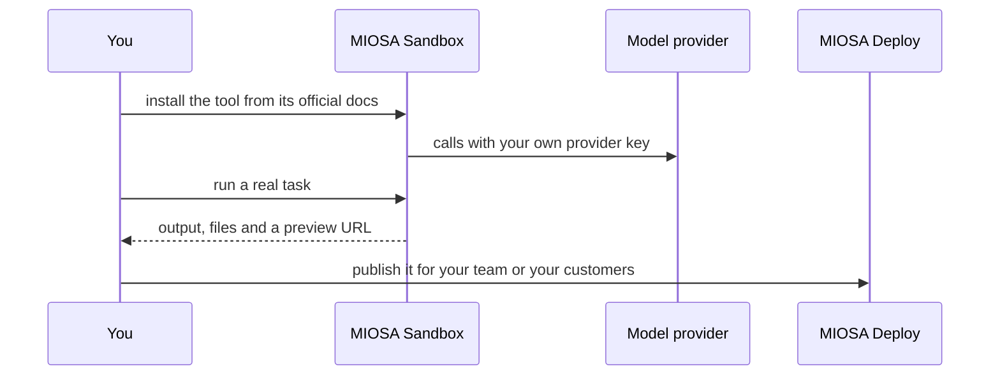

`~15 min` `TypeScript` `Python`

> **您正在构建的内容**：安装从语音到文本到文本到语音的开源语音管道。
>
> **您将使用的原语**：沙盒、Redis

## 你正在构建什么

Daily 的实时语音和多模式智能体的开源框架，以 Pipecat 为模型（开源）。

Pipecat 构建了一个帧处理器管道：通过 WebRTC 或 websocket 传输的音频输入、语音到文本、LLM、文本到语音和音频输出。

您将使用的基元：沙箱·Redis

- STT、LLM 和 TTS 的管道
- 实时传输（WebRTC、websocket）
- 工具调用和函数处理程序
- 开源且与提供商无关

您在 MIOSA 上安装并**运行真正的 Pipecat**。首先阅读官方文档：[docs.pipecat.ai/getting-started/quickstart](https://docs.pipecat.ai/getting-started/quickstart)。下面的每个安装命令都来自他们；如果文档和本指南不一致，则文档获胜。 Pipecat 是开源 Python 框架。

## MIOSA 需要什么

每一行都是在开始之前创建的一件事。该数字与使用它的步骤相匹配。

1. 组织和 API 密钥 - 确定每次调用的范围；工作人员只需要一把工作区钥匙即可。 - `miosa api-key create app-key --preset agent` [文档](/docs/platform/api-keys)
2. 沙箱 - 智能体在其中编写代码和运行命令的隔离 Linux 工作区。 - `miosa create app-box --template nextjs --wait` [Docs](/docs/develop/sandboxes)
3. Redis - 托管缓存和会话存储，作为 REDIS_URL 注入。 - `miosa api POST /databases -d '{"name":"app-cache","engine":"redis"}'` [文档](/docs/data/redis)
4. 每个客户一个工作区 - 隔离每个客户的机器、部署和数据。 - `miosa workspace create customer-1` [文档](/docs/platform/white-label)
5. 品牌和白标签 - 您的名字和预览、部署和桌面上的 slug；顾客永远不会看到 MIOSA。 - `miosa org` [文档](/docs/platform/white-label)
6. 使用计量和计费 - 每个客户的使用情况，以及哪个帐户为新机器付费。 - `miosa org bill` [文档](/docs/platform/usage-and-billing)

## 架构



## 它如何在 MIOSA 上运行

它运行的地方 -> MIOSA 沙箱（一个独立的 Linux 工作区）

状态和文件 -> 会话状态属于托管 Redis，而不是沙箱磁盘。

模型 -> 您自己的提供商密钥，而不是 MIOSA 平台密钥

其 Web 端口 7860 -> MIOSA 预览 URL (`miosa preview create`)

您的客户 -> 各一个工作空间，彼此隔离

## 授权和租赁

您的组织就是平台；客户永远不会获得 MIOSA 帐户，他们会登录您的产品。每个客户在入职时创建一个工作区，隔离他们的机器、运行和数据。

```bash
miosa workspace create pipecat-customer-1
```

标记每台机器并使用 `metadata` 中的客户 ID 运行，并且切勿跨客户查询。使用 GET /api/v1/usage 计量每个客户的使用情况，并使用 PUT /api/v1/bill-to (/docs/platform/usage-and-billing) 设置付款人。

## 安装 Pipecat

按顺序在沙箱内运行它们（例如 `miosa exec pipecat-box -- bash -lc '<command>'`）。命令来自官方文档。

```text
curl -LsSf https://astral.sh/uv/install.sh | sh
```

```text
uv tool install "pipecat-ai[cli]"
```

```text
pipecat init
```

```text
# or, by hand: uv init my-pipecat-app && cd my-pipecat-app && uv add pipecat-ai
```

检查：安装完成，没有错误；接下来的部分将配置并启动它。

## 配置

添加您使用的提供商附加功能 (`uv add "pipecat-ai[option,...]"`) 并将您自己的语音转文本、LLM 和文本转语音键放入 `.env` 中。电话和 WebRTC 传输是您带来的外部提供商。

模型：人类（克劳德）。调用使用我自己的提供商密钥（ANTHROPIC_API_KEY）； MIOSA 平台密钥从未被使用过。

```bash
export ANTHROPIC_API_KEY="..."   # set it in the process environment, or the Secrets API; never write it into files you commit
```

## 运行它

启动它并证明它有效。

```text
uv run bot.py
```

检查：工具启动无错误并响应。

## 持久化和访问

会话状态属于托管 Redis，而不是沙箱磁盘。

它侦听端口 7860。将其作为后台进程运行，以便它比您的 shell 寿命更长，然后打开预览：

```bash
miosa preview create pipecat-box 7860 --name web
```

检查：预览 URL 应答，并且在机器暂停和恢复后仍然应答（预览根据请求唤醒它）。

## 使其成为产品

每个客户工作空间（或带有会话路由器的池）一个机器人进程； Redis 中的会话状态由呼叫 ID 键入。

## 限制和成本

固定您测试的版本并刻意更新；这些工具变化很快。

仅向该工具提供其所需的凭据（作为秘密），而不是写入文件中。

原型：将其保留在默认大小的一台计算机上，跳过不需要的副本和自定义主机名，并在完成后删除所有内容。

## 验收检查

Pipecat 在 MIOSA 沙箱上运行并回答实际任务。

状态在暂停和恢复后仍然存在。

每个客户都有自己的工作区和自己的实例；他们之间没有任何东西是共享的。

它创建的所有内容都可以被删除，而不会留下任何运行的内容。

## 后续步骤

- [智能体提示构建器选择产品形状并将简介交给您的智能体。](/docs/build)
- [运行编码智能体 在云中运行 Claude Code、Codex 或 Cursor，或在其上构建产品。](/docs/build/run-agents)
- [比较 MIOSA MIOSA 与其他沙箱和智能体平台的比较。](/docs/compare)
- [您可以构建什么 MIOSA 支持的每个产品模式。](/docs/use-cases)
